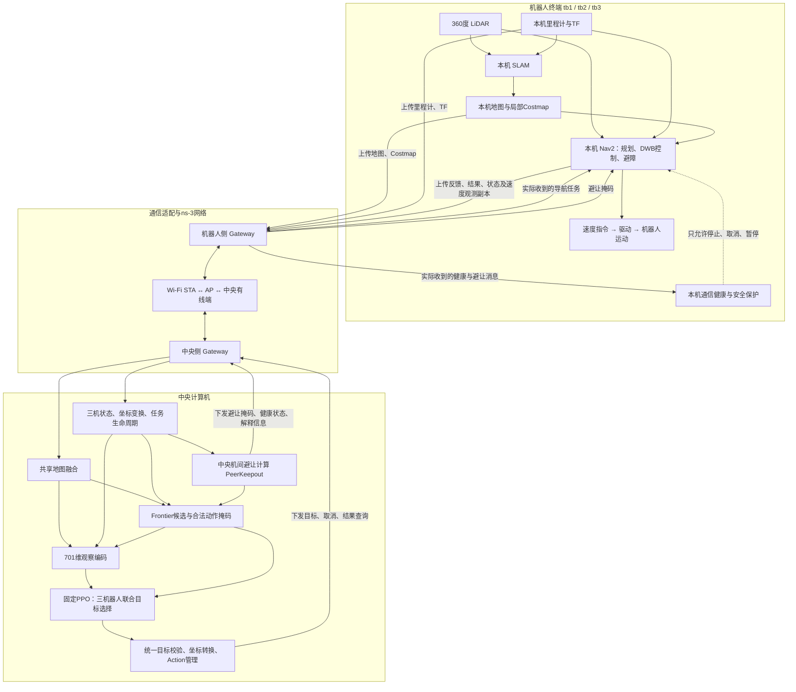
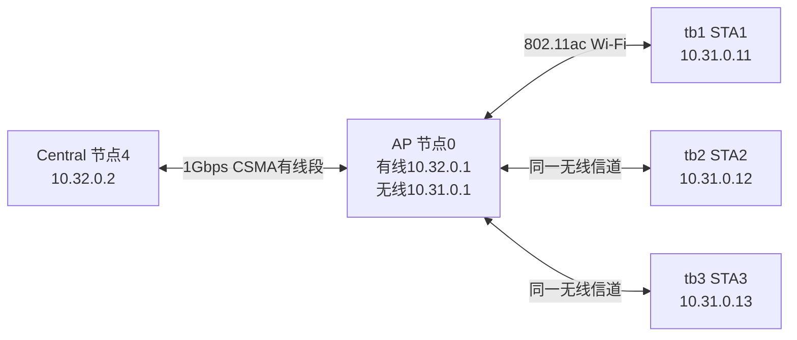

# 当前三机器人系统的信息交互与无线传输说明

日期：2026-11-10。面向需要判断机器人本地计算、中央RL输入输出、无线业务和仿真数据隔离边界的项目参与者。

本说明对应NET-01D交付代码：分支`net-01d/fault-causal-audit`，运行源码提交`81710e6739311a59ed4bef945a0fbd871d274a64`，既有审计封存提交`5f6635a9d69998c7ef503c03bd6d30a966d75a7e`。固定探索参考版本仍为`MR3-RL-POLICY-v1.1.0`。本次仅整理已有代码与数据，没有新增实验、训练或机器人控制。

## 1. 先理解当前分工

可以按“大脑—通信层—机器人终端”理解，但中央神经网络与中央业务程序不是同一个东西。

**机器人上传地图和状态，中央处理后生成RL输入；RL选择探索目标，中央将目标转换为完整Nav2任务，再经ns-3传回机器人。机器人本地负责看雷达、SLAM定位建图、规划路径、避障和产生速度。**

| 层次 | 职责 | 不应混淆的概念 |
|---|---|---|
| 中央PPO神经网络 | 根据编码观察和合法动作掩码选择三机联合探索目标 | 不接收所有原始ROS消息，不输出速度 |
| 中央业务程序 | 地图融合、Frontier、观察编码、坐标转换、任务所有权、目标检查、机间避让计算 | 不只是神经网络forward |
| Gateway | 将ROS消息变为网络载荷，并将实际收件还原成ROS消息或Action交互 | 是消息适配器，不是无线信道本身 |
| ns-3 | 模拟IP/UDP、有线段、Wi-Fi MAC/PHY、队列、信道和完整消息重组路径 | 不理解探索任务，不选择目标 |
| 机器人本地 | LiDAR、SLAM、Nav2、驱动与本地安全停止 | 不依赖中央逐周期下发速度 |
| 独立仿真与评价 | 仿真时钟、网络节点真实位置、覆盖率、安全与运行控制 | 不得给RL补充未通过业务网络交付的地图或位姿 |

当前研究平台还存在定位消息取用等待等阻断问题。本文描述实际链路与已取得的消息证据，**不代表最新完整Gazebo联网探索已经通过**。

## 2. 业务交互总图

以下为B/C联网模式的业务路径。三台机器人各有相同的本地处理链。



701维观察是在中央生成的，候选索引也在中央转换为导航目标。**目前无线传输的不是701维向量，也不是三个候选索引。**

## 3. 实际进程、ROS域与网络拓扑

### 3.1 当前不是四台独立计算机的TAP网络

| 对象 | 当前布局 |
|---|---|
| 中央RL、地图融合、PeerKeepout | ROS_DOMAIN_ID=91，简称C域 |
| 三机器人、SLAM、Nav2、机器人侧监督 | 三机共用ROS_DOMAIN_ID=92，简称R域 |
| Gateway | 一个Python进程，内部含C/R两个Context、两个SingleThreadedExecutor，轮换处理 |
| 跨域业务 | 显式话题/Action代理，通过选定传输后端交付 |
| DDS发现与内部协议 | 留在各自ROS域，不整体进入ns-3 |
| Linux TAP、每机器人独立网络命名空间 | 当前这条实际业务路径没有采用 |

三机器人话题有命名空间，但共享R域意味着DDS层没有把机器人彼此完全隔离。当前不能把“两ROS域”描述成“三个独立无线机器人端点已完成底层隔离”。

### 3.2 一条实际消息怎样过网

```text
ROS生产者
  → Gateway订阅
  → 原始ROS CDR序列化
  → Unix-domain socket
  → packet_hub
  → native进程输入：SENDAT + 实际载荷
  → ns-3 UDP socket
  → CSMA有线段 / AP / Wi-Fi / STA（方向相反时倒序）
  → UDP真实接收、分片完整重组
  → native输出：RX + 重组载荷
  → Hub / Unix socket
  → 目的Gateway
  → 目的ROS publisher或Action代理
```

接收载荷来自网络接收和重组，不是用“目的收到一个通知”去源端查回原消息。这里模拟的是消息载荷的网络传输，**不是将原DDS报文逐包穿过Wi-Fi**。

### 3.3 网络节点与配置



业务流中的sender/receiver编号0代表中央，映射到ns-3节点4；中央不是AP节点本身。

| 配置 | 当前固定值或机制 |
|---|---|
| Wi-Fi | 802.11ac，5GHz，80MHz，单空间流 |
| B高质量条件 | VhtMcs9，16dBm，路径损耗指数2 |
| C受限条件 | VhtMcs3，2dBm，路径损耗指数3 |
| UDP端口 | 19001 |
| MTU | 1500字节 |
| 每UDP应用数据上限 | 1200字节；36字节分片头，最多1164字节分片载荷 |
| 无线MAC与有线发送队列 | 各1024包 |
| MAC过期、消息重组期限 | 各0.5秒网络仿真时间 |
| 业务优先级 | 全部ToS0、AC_BE；没有健康/地图/Action差异化优先级 |
| 消息交付 | 只交付完整重组消息；不把残片当有效ROS消息 |
| 当前同步执行量子 | NET-01D执行profile为10ms；不能拿历史配置中0.1s静态描述替代 |

## 4. 所有机器人上行数据

下表N=1、2、3。普通上行flow编号为20N+offset。

| 信息 / flow | 话题与类型 | 主要字段 | 中央用途 | 是否直接成为神经网络特征 |
|---|---|---|---|---|
| 本机SLAM地图 21/41/61 | `/tbN/map` OccupancyGrid | 栅格、未知/自由/占据、分辨率、尺寸、原点、frame、stamp | 融合地图；本机自由空间与目标检查 | 间接：融合后形成512维地图特征 |
| 里程计 22/42/62 | `/tbN/odom` Odometry | header、child frame、位姿/协方差、twist/协方差 | 中央位置、朝向、速度、机间避让计算 | 是，经TF变换后 |
| 动态TF 23/43/63 | `/tbN/tf` TFMessage | map→odom、odom→底盘、轮子等变换及各自时间戳 | 坐标转换、地图投影、目标转换、定位时效 | 间接 |
| 静态TF 24/44/64 | `/tbN/tf_static` TFMessage | 固定变换、frame、时间戳 | 坐标链完整性 | 间接 |
| 局部导航代价图 25/45/65 | `/tbN/local_costmap/costmap` OccupancyGrid | 局部栅格、frame、原点、分辨率、时间戳 | 路由起点连接、目标及可信自体区域检查 | 间接：影响候选与掩码 |
| 速度指令副本 26/46/66 | `/tbN/cmd_vel` Twist | 线速度、角速度；本体没有header时间戳 | 执行观测；当前中央RL相关回调为空 | 否 |
| 导航接受、反馈、结果、状态 | Action消息，见第7节 | UUID、accepted、距离、终态等 | 所有权、忙闲、历史、重分配与记录 | 部分间接影响任务特征 |

**编码中的速度来自Odometry.twist，不是cmd_vel。** 动态TF含多个生产者，并不只是单一频率的“机器人位置包”。TFMessage本身没有统一header，源时间需要检查其中每条变换。

### 4.1 话题QoS和数据时基

以下是代理端ROS段配置，不等于无线段的可靠传输保证。普通TopicWire使用QoSProfile默认可靠性；无线段仍为UDP。History depth不是发送频率。

| 数据 | 代理history depth / 持久性 | 来源时基与参考数据量 |
|---|---|---|
| 本机地图 | 10 / transient local | SLAM名义5墙钟秒更新；历史实际CDR约35～53KB，随地图增长变化 |
| 里程计 | 10 / volatile | 30Hz仿真时间名义上限；历史完整CDR 724B |
| 动态TF | 100 / volatile | odom TF与odom同源；双轮TF约10Hz仿真时间；map→odom约50Hz墙钟，持有最新scan时间加原容差 |
| 静态TF | 100 / transient local | 启动/固定关系发布，无固定持续Hz承诺 |
| 局部Costmap | 1 / transient local | 200×200；历史CDR 40104B；5Hz墙钟检查是否越过0.5秒ROS发布时间间隔 |
| cmd_vel副本 | 4 / volatile | 执行时名义20Hz墙钟；历史CDR 52B |

时间基准必须分清：在约0.5实时率时，10Hz仿真时间约为5Hz墙钟；50Hz墙钟的TF不会相应减半。以上是冻结来源合同和历史捕获参考，不是所有场景的固定吞吐保证。

## 5. 中央怎样生成701维RL输入

真实链条是：收到ROS数据→构造共享地图/机器人状态/候选→701维编码及条件动作掩码→PPO→统一目标执行。当前固定公共ROI为`[-5.8,-5.6,7.25,5.3]`，投影分辨率0.05m。

| 输入部分 | 维数及零起始下标 | 内容与来源 |
|---|---|---|
| 已知地图 | 256，0～255 | 中央融合地图16×16分块内已知面积比例，cells>=0 |
| 占据地图 | 256，256～511 | 同一地图16×16分块内cells==100的面积比例 |
| tb1状态 | 13，512～524 | 见下表 |
| tb2状态 | 13，525～537 | 同上 |
| tb3状态 | 13，538～550 | 同上 |
| 候选0～14 | 150，551～700 | 每候选10项；不足15个补零 |
| 合计 | 701个float32 | 不包含未知区域真值 |

每机13项的准确顺序：

| 顺序 | 字段 | 编码 |
|---|---|---|
| 1～2 | 公共坐标位置x、y | x/20、y/20 |
| 3～4 | 朝向 | sin(yaw)、cos(yaw) |
| 5～6 | 公共坐标线速度vx、vy | 各除以0.26 |
| 7 | 角速度 | 原值 |
| 8～10 | idle、pending、active | 三个状态标志 |
| 11～12 | 当前目标相对位置 | Δx/20、Δy/20；无目标为0 |
| 13 | 当前目标持续时间 | min(duration,500)/500 |

每候选10项的准确顺序：存在标志、x/20、y/20、路径代价估计/20、信息增益代理/10、valid、reachable、所属机器人tb1/tb2/tb3三个标志。候选按机器人归属，最多每机5个、总计15个，并非每机器人可以任意选择全部候选。

信息增益代理来自已观察Frontier栅格面积，不是读取未知区域真值计算未来收益。TF、局部地图、Costmap和Peer状态会通过候选与合法性间接影响网络选择；它们并非全部直接出现在701个数里。

### 5.1 观察合同还包括神经网络以外的数据

中央观察对象还保留地图版本、决策身份、源时间、任务token、Action UUID、最近结果、取消状态、候选冲突、有效候选数和历史等。动作掩码与生命周期会使用这些数据。

所以，不能因为UUID或健康状态不直接在701维中，就认为通信不影响它们；也不能把所有观察对象字段都称为神经网络输入。固定策略包含编码、候选、掩码和任务规则，远不止权重文件。

## 6. RL输出与实际下发目标

```text
PPO输出三组17个动作分数
  → 按tb1、tb2、tb3顺序使用联合条件掩码
  → 固定推理采用合法动作argmax
  → 候选索引 / KEEP / WAIT
  → 统一分配器检查地图版本、所有权、联合冲突
  → 精确候选索引转换为公共坐标目标
  → 转换到对应机器人map坐标并复核
  → 构造完整NavigateToPose.SendGoal
  → 实际经过ns-3
  → 机器人本地Nav2执行
```

| 层次 | 数据 | 是否发送无线消息 |
|---|---|---|
| 网络原始输出 | 三组17个logits；Critic value | 否，中央内部；Critic不直接控制机器人 |
| 联合动作 | slot0～14候选；slot15 KEEP；slot16 WAIT | 索引本身不发往机器人 |
| 新目标 | UUID、PoseStamped、BT字段 | 是，完整Action请求 |
| KEEP | 保持原合法目标 | 不重复提交同一Goal |
| WAIT | 本轮无新Goal | 不产生新的导航目标包 |
| 底层控制 | 本机Nav2生成线速度、角速度 | 本地生成，不由RL下发 |

正常中央决策是原5秒仿真时间节奏，不是每个物理步发送新目标。持续执行目标有UUID和所有权保护。超时请求取消，不等于已物理停稳。

## 7. 完整Action交互与确认

每机Action根路径为`/tbN/navigate_to_pose`；flow基数为200+20N。

| 消息 | flow：tb1 / tb2 / tb3 | 方向 | 载荷与含义 |
|---|---|---|---|
| SendGoal请求 | 220 / 240 / 260 | C→R | 原Goal UUID、PoseStamped(frame/stamp/位置/姿态)、behavior_tree |
| SendGoal响应 | 221 / 241 / 261 | R→C | 真正accepted/拒绝及接受时间 |
| GetResult请求 | 222 / 242 / 262 | C→R | 原UUID结果查询；允许长时间pending |
| GetResult响应 | 223 / 243 / 263 | R→C | 真正终态及原生Nav2 Result |
| CancelGoal请求 | 224 / 244 / 264 | C→R | 原取消请求身份与条件 |
| CancelGoal响应 | 225 / 245 / 265 | R→C | return_code、goals_canceling |
| Feedback | 226 / 246 / 266 | R→C | UUID、当前位姿、导航时间、预计剩余时间、恢复次数、剩余距离 |
| Status | 227 / 247 / 267 | R→C | GoalStatusArray及UUID状态列表 |
| Readiness | 228 / 248 / 268 | R→C | 服务/反馈/status端点发现、安全准入；0.1秒仿真周期，中央0.5墙钟秒过期 |
| 应用层传输ACK | 229 / 249 / 269 | 双向 | 两字节版本/原offset，加传输中的同RPC身份；不是Nav2接受或成功 |

请求/响应保留同RPC、同原始CDR，按0.2墙钟秒间隔有限重送，1墙钟秒确认界、最多5次。接收端识别重复请求，不重复调用原服务。反馈、状态、readiness不使用这套同RPC请求重送机制。

RPC身份用于消息交付关联，不替代Goal UUID。未知接受/结果继续保持UNKNOWN，不能合成成功。ROS反馈代理depth10，状态采用标准Action status QoS，服务端点采用默认服务QoS；这些配置不是无线业务优先级。

## 8. 除目标之外的全部中央下行信息

2026-11-11续修说明：下表的业务来源、消费者和隔离边界保持不变。当前候选承载为明确版本的`tcp-mtu-v2`，原UDP版本仍可恢复；候选已完成真实ROS无运动负载和断链验证，新的Gazebo闭环尚待实际运行。下文UDP分片描述是原承载版本，不能当作当前TCP候选的协议说明。

| 信息 / flow | 源与目的 | 内容、用途 | 是否神经网络产生 |
|---|---|---|---|
| 避让掩码 30/50/70 | C→对应STA | 每机400×400栅格，标记其他机器人禁入盘，供本机Nav2使用 | 否，PeerKeepout计算 |
| 健康状态 31/51/71 | 同一个C状态分别下发三个STA | 三机poses、odom/correction源戳、年龄、ready/failures、坐标变换、sequence | 否 |
| 过滤器解释信息 32/52/72 | C→对应STA | CostmapFilterInfo，说明如何解释/订阅掩码 | 否 |
| 融合地图89 | C→STA1 | `/merge_map`，供R域Observer与评价读取中央实际融合结果 | 否 |
| 控制器记录95 | C→STA1 | `/net01/controller_records`，目标请求/接受/结果/停止原因；运行管理会使用 | 否 |
| Action消息 | C↔对应STA | RL选择后由统一执行层产生的任务管理协议 | 高层选择来自RL，协议由执行层产生 |

健康消息不是Ping。中央PeerKeepout消费已上传的odom/TF，在C域计算三机位置和避让信息。C域RL直接使用C域Peer状态进行候选/路由/目标检查，是中央本地计算；同一状态再各自下发给机器人进行本地保护。

flow31收到后发布R域公共`/peer_keepout_state`，51/71分别发布`/tb2/peer_keepout_state`、`/tb3/peer_keepout_state`。每机Guardian使用自己的实际链路收件，不能用其他STA副本替它刷新时效。

掩码在C内部由`/net01/tbN/peer_mask_bound`携带原CDR和生成批次/源戳绑定；这不是额外无线流。绑定与掩码一起进入30/50/70，R端验证且Guardian接受后才发布原OccupancyGrid。不能用收件时间冒充原源时间。

### 8.1 下行并不只是几个目标坐标

每机掩码400×400，单纯栅格约160KB；三机按10Hz仿真时间生成，**仅栅格名义产生量约4.8MB/仿真秒，即38.4Mbit/仿真秒**。还未计来源绑定、分片、UDP/IP、Wi-Fi开销和其他业务。这是尺寸乘周期计算的业务产生量，不是实测吞吐。

掩码/过滤器depth1且transient local，健康depth1且volatile。融合地图depth10且transient local；记录depth100且volatile。大消息在网络段分成多个UDP片，只要未完整重组就不能交付为有效消息。

下行融合地图不是中央RL的输入绕行：中央使用自己已融合的地图，不需要先下传再上传。STA1是网络目的身份；R域共享，Observer可以订阅交付后的副本。机器人本地Nav2使用各自`/tbN/map`和`/tbN/scan`，不靠这份融合地图副本导航。

控制器记录也不能全部视为可删除调试日志：R侧运行期从实际接收的flow95读取停止原因，不能直接从C源文件取代未交付消息。退出后的所有权审计另有只读原件使用，不能混称运行期旁路。

### 8.2 中央地图与评价端收到的地图要分开

现有覆盖率曲线和T95按R域bag收到`/merge_map`的仿真时间计算；A1/B/C的这份地图经过下行89，A0直接模式没有该额外下行。因此，下行迟到或缺失可能改变评价端看到的结果，不能直接写成中央当时的融合覆盖下降。地图header沿用最老贡献局部图的时间，也不能冒充本次融合图生成时间。

新增可选`--capture-central-map`仅在C Gateway现有89回调旁保留已序列化原CDR及现有元信息，停后写盘，用于补充源侧视图和迟丢分析。它不新增网络流、不把评价结果反馈给策略、不替换原R侧指标；记录点明确为C Gateway捕获，不能当作融合发布者或HQ实际读取时刻。A0无此C wire，不伪造中央捕获样本。实现与隔离验证见[被动采集说明](../net01d/followup02/CENTRAL_MAP_CAPTURE.md)。

## 9. 本地数据、评价数据与独立控制通道

| 数据或功能 | 当前用途 | 是否经过ns-3业务链路 | 隔离边界 |
|---|---|---|---|
| `/tbN/scan` | 本机SLAM、Nav2障碍检测 | 不上传中央RL | 中央不能用扫描旁路补未交付地图 |
| 轮子、关节、驱动内部数据 | 本地里程计与执行 | 不作为独立无线业务上传 | 保持本地控制 |
| 本机SLAM内部通信 | 定位建图 | 内部不过网；产出的map/TF上传 | 不用真值替代SLAM结果 |
| Nav2内部规划/控制/恢复 | 本地导航 | 不整体过网 | 中央只给高层任务 |
| plan、local_plan | 本地导航及记录 | 当前非独立上行流 | 不是PPO直接输入 |
| `/clock` | ROS/Gazebo/ns-3同步 | R→C独立直接白名单 | 只传时间，不夹带状态 |
| `/gazebo/model_states` | 评价、独立安全、无线节点Mobility更新 | 不作为无线业务输入Policy | Gateway只送POSITION给ns-3，不能发布C odom/TF |
| 真值地图 | 离线覆盖率/地图质量 | 不进入Policy业务 | 不用于Frontier或目标选择 |
| contacts、drive_diagnostics、真实轨迹 | 独立安全与评价 | 不作为RL业务输入 | 可以触发停止，不能给策略补状态 |
| 物理步进、native ACK、信用控制 | 推进物理与网络时钟 | 独立控制通道 | 同步ACK不是业务收件ACK |
| Gateway状态、guard_fault、arm服务 | 本地管理和准入 | R域管理通道 | 不替代未交付业务观察 |
| 本地Cancel/GetResult/PAUSE/零速度 | 网络异常后的安全停止 | R域直接执行 | 只停止、清理，不生成正常探索Goal |
| HELLO/ACK | 三链路启动确认 | 是，flow65535/65534 | 不包含Policy状态，不是Action ACK |

原300ms健康时效、定位源龄和本地安全要求保留。正常导航取消可以从中央经无线发出；失联时本地Guardian也可以直接取消、查终态、零速度和暂停Nav2。后者是停止白名单，不能用来证明无线Cancel已交付。

Gazebo真值更新无线Mobility是仿真模型输入，允许不经过被模拟的无线链路；但真实位置只能改变信道几何，不能作为“最新定位”注入RL。真实系统中地图融合使用公共坐标标定，当前固定初始标定并不等于已经解决任意实机的公共定位问题。

## 10. 是否有机器人之间的通信

当前没有独立的STA→STA地图交换或目标协商协议，主要采用中央星型协作。


| 情形 | 性质 |
|---|---|
| tb1上传地图，中央融合后影响tb2目标 | 经中央计算的间接协作信息 |
| tb1位置经中央生成tb2避让掩码 | 经中央转发/计算的机间信息 |
| tb2雷达扫描到tb1 | 物理感知，不是通信 |
| 三STA竞争同一无线信道 | 网络资源相互影响，不等于有机间应用协议 |
| 三机器人共享R域 | 具有同域DDS发现能力，不等于已实现直连协商，也不等于彼此底层隔离 |

## 11. 数据隔离应怎样判断

正确要求是：**中央用于决策的机器人来源数据，只能来自对应的实际无线交付出口。** 不是要求中央内部所有计算都重复过网。

例如“无线交付的三张地图→中央融合→中央Frontier→中央RL”是合理路径；C域Peer基于已交付odom/TF计算后本地供RL检查也合理。需要追溯原料来源，而不是只看最后一个ROS话题是否在中央本地发布。

| 边界 | 当前实现与证据 | 判断 |
|---|---|---|
| R业务→C | 分域，显式代理，真实网络收件后发布 | 有实际过网正向证据 |
| C目标→R | Action代理、网络传输、实际服务调用 | 有Goal及接受响应正证 |
| 真值→Policy | Policy订阅与701白名单没有真值 | 源码未发现回填路径 |
| C内部地图/Peer/编码通信 | 中央本地 | 正常中央计算 |
| B/C失败后自动改本地队列 | 代码没有业务回退 | 未发现这种回退实现 |
| 断网后全部关键业务不再交付 | 最新完整负载在计划radio-off之前故障 | 完整负例未完成 |
| 每机器人底层隔离 | 三机共用R域92 | 尚不是独立机器人网络隔离结构 |

**目前不能保证整个系统所有旁路已彻底排除。** 有明确正向过网证据，未发现B/C本地回退；完整负载下的全业务断链负例还没有完成。这是证据缺口，不是已发现旁路，也不是已证明绝无旁路。

仿真独立安全监督可以看真值并停止实验，不能把真值改写成“新odom/TF”让策略继续探索。日志、评价程序和中央策略即使位于同一宿主机，也必须保留这样的消费者边界。

## 12. 最新一次实际Wi-Fi收发数据

以下来自NET-01D的`actual-phase-wifi-01`原始统计。**该回合是无运动完整业务测试：真实ROS接口、真实ns-3 Wi-Fi、受控状态源与Action服务；0 Gazebo运动、0真实Nav2、0 RL forward。** 所以它证明实际载荷过网，不证明PPO在这一回合消费数据并完成探索。

“入网/收全”表示进入网络后端的消息数/目的端完整重组数，不是原始ROS总发布数，也不是Policy消费次数。每个完整应用消息可能对应很多UDP和MAC包。

| 消息 | tb1入网/收全 | tb2入网/收全 | tb3入网/收全 |
|---|---:|---:|---:|
| 本机地图 | 2/2 | 2/2 | 2/2 |
| 里程计 | 120/120 | 120/120 | 120/120 |
| 动态TF | 588/557 | 588/557 | 589/558 |
| 静态TF | 1/1 | 1/1 | 1/1 |
| 局部Costmap | 8/8 | 8/8 | 8/8 |
| cmd_vel观测副本 | 198/183 | 199/183 | 200/184 |
| 避让掩码 | 41/41 | 41/41 | 41/41 |
| 健康状态 | 40/40 | 40/40 | 40/40 |
| 过滤器解释信息 | 1/1 | 1/1 | 1/1 |
| SendGoal请求 | 1/1 | 1/1 | 1/1 |
| SendGoal真正接受响应 | 1/1 | 1/1 | 1/1 |
| GetResult请求 | 1/1 | 1/1 | 1/1 |
| GetResult响应 | 2/0 | 2/0 | 2/0 |
| Feedback | 535/525 | 536/525 | 535/525 |
| Status | 2/1 | 2/1 | 2/1 |
| Readiness | 40/40 | 40/40 | 40/40 |
| Action应用层ACK | 3/3 | 3/3 | 3/3 |

| 其他信息 | 入网/收全 |
|---|---:|
| 中央融合地图89 | 4/4 |
| 中央任务记录95 | 6/6 |
| 三链路启动HELLO/ACK合计 | 6/6 |

此回合没有普通无线Cancel请求/响应，本地真实安全取消不能代替它。全业务4767条入网、4587条完整交付；180条截至结束未完整，其中177条在首故障后的最终网络horizon进入且未再推进，不能全算永久无线丢包。

首故障前4422条入网最终完整，但不代表墙钟及时，也不保证源DDS零丢失。已完成消息模型内时延p95约6.109ms，包含有线/AP/Wi-Fi/重组路径，是网络仿真时间，不是纯空口传播或Linux墙钟延迟。

最新故障的主要观测是：本地ROS报告收件到实际取件之间出现约0.6～0.9墙钟秒等待，定位源龄随后失效。不能把这种取件等待直接算Wi-Fi损失。详见[NET-01D最终报告](../net01d/NET01D_FINAL_REPORT.md)。

## 13. 怎样决定留本地、上传和下发

下表是基于当前职责的评估，本次没有修改边界、消息频率或传输机制。

| 数据/功能 | 分工判断 | 依据与保留条件 |
|---|---|---|
| 原始LiDAR、驱动、局部控制、紧急停止 | 留机器人本地 | 保持本地感知、避障与失联停止能力 |
| 本机SLAM、Nav2 | 留机器人本地 | 中央分配任务，不远程替代底层导航 |
| 本机地图 | 中央探索需要上传 | 共享地图与Frontier主要来源；将来增量传输应保持语义 |
| 位姿、速度、定位有效性、源时间 | 中央需要上传 | 判断三机位置、忙闲、状态是否可信 |
| 任务接受、结果、取消和必要反馈 | 双向传输 | 保留真实所有权和生命周期 |
| TF | 当前实现需要上传 | 可独立研究紧凑状态交付，但必须保持坐标和时效语义 |
| 局部Costmap | 当前合法性逻辑需要上传 | 不直接进入701不代表可删除 |
| cmd_vel副本 | 非当前RL编码必需 | 当前回调不用于策略特征，是可单独评估的监测负载 |
| 中央避让掩码、健康状态 | 当前导航与安全依赖下行 | 是较重业务，不能直接关闭 |
| 融合地图下行副本 | 非本机Nav2或中央RL必需输入 | 当前服务R域观察/评价，应与探索必需业务分开统计 |
| 控制器记录下行 | 兼有记录与终止用途 | 不能全部按无关日志删除 |
| 真值地图、真实模型位姿、覆盖率 | 独立评价/仿真控制侧 | 不得补策略缺失观察 |
| 701编码、候选索引、网络logits | 中央本地 | 当前机器人只需合法目标，不需要收到网络内部量 |

当前无线负载不只是地图和目标：还包括完整TF、局部Costmap、速度副本、避让掩码、健康状态及运行记录。应分别计量探索必需、安全必需、监测和实现开销，再讨论通信优化；不能以通信优化名义改变固定RL输入、候选或目标规则。

## 14. 原始出处与复核入口

| 内容 | 当前源码/证据 |
|---|---|
| 固定行为合同 | [BEHAVIOR_CONTRACT.md](BEHAVIOR_CONTRACT.md) |
| 普通话题、编号、ROS QoS | [topic_wire.py](../net01/topic_wire.py) |
| 两域Gateway、收件发布、clock/Mobility白名单 | [gateway.py](../net01/gateway.py) |
| 场景节点域放置 | [net_scene_launch.py](../net01/net_scene_launch.py) |
| ROS到Hub实际载荷 | [hub_client.py](../net01/hub_client.py)、[packet_hub.py](../net01/tools/packet_hub.py) |
| 网络模型和原始UDP收发 | [payload_transport.cc](../net01/native/payload_transport.cc)、[NETWORK_LOCK_V3.json](../net01/config/NETWORK_LOCK_V3.json) |
| 701编码与联合输出 | [ppo.py](../workspace/src/multi_robot_exploration/multi_robot_exploration/ppo.py) |
| 中央实际订阅与目标执行 | [ros_policy.py](../workspace/rl01/ros_policy.py)、[headquarters.py](../workspace/gz01/headquarters.py) |
| 中央地图融合 | [merge_map.py](../workspace/src/merge_map/merge_map/merge_map.py) |
| 机间避让状态与栅格 | [peer_keepout.py](../workspace/gz01/peer_keepout.py)、[bound_peer.py](../net01/bound_peer.py)、[bound_mask_wire.py](../net01/bound_mask_wire.py) |
| Action协议与确认去重 | [action_wire.py](../net01/action_wire.py) |
| 本地停止白名单 | [delivery_guard.py](../net01/delivery_guard.py) |
| 运行Observer、接收记录、独立监督 | [run_network_case.py](../net01/run_network_case.py)、[run_case.py](../workspace/gz01/run_case.py) |
| Nav2本机地图、雷达与Keepout配置 | [Corr6201 tb1 Nav2配置](../config/validated/corridor/rl/peer_nav2_tb1.yaml) |
| 来源频率、时基与历史大小 | [FROZEN_TRAFFIC_CLOCK_CONTRACT.md](../net01/followup04/FROZEN_TRAFFIC_CLOCK_CONTRACT.md)；其中“提案”段为历史状态，不覆盖本文当前实现 |
| 最新逐流收发统计 | [ACTUAL_PHASE_WIFI_01_NETWORK_DELIVERY.json](../net01d/review/ACTUAL_PHASE_WIFI_01_NETWORK_DELIVERY.json) |
| 最新完整结果与独立评审 | [NET01D_FINAL_REPORT.md](../net01d/NET01D_FINAL_REPORT.md)、[INDEPENDENT_REVIEW.md](../net01d/review/INDEPENDENT_REVIEW.md) |

旧历史实验和既有审计封存内容没有因本文而改写。新增文档及README入口不改变模型、机器人、地图、Nav2、SLAM、安全阈值或传输行为。
