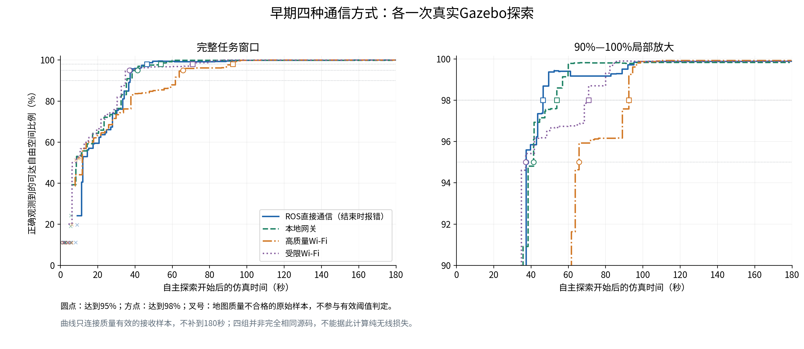
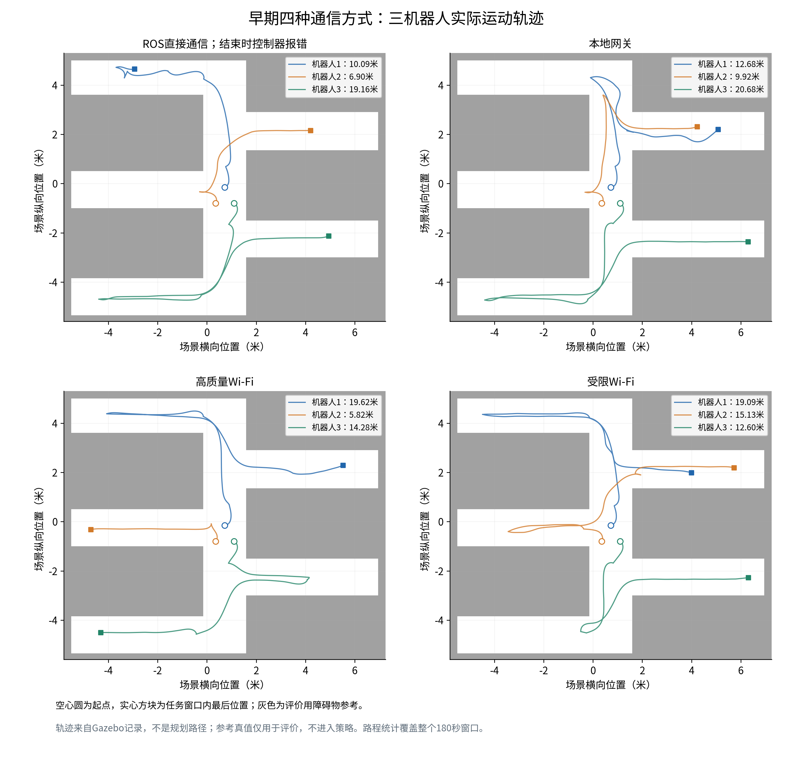
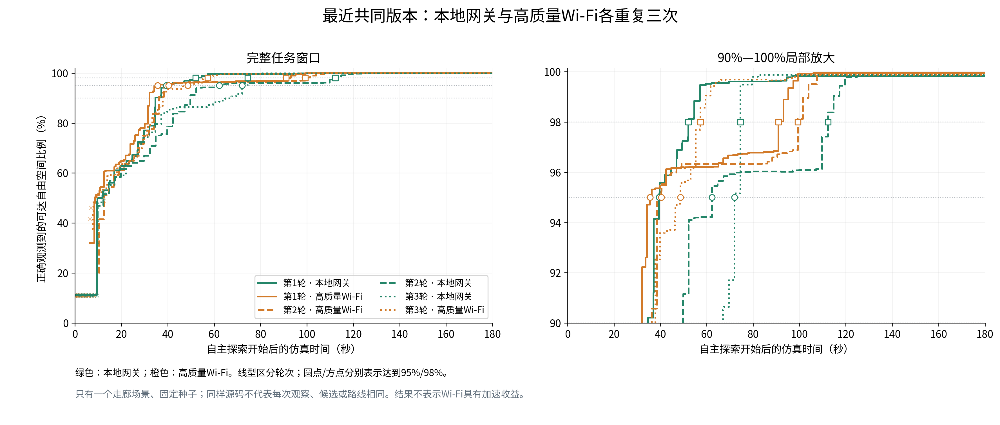
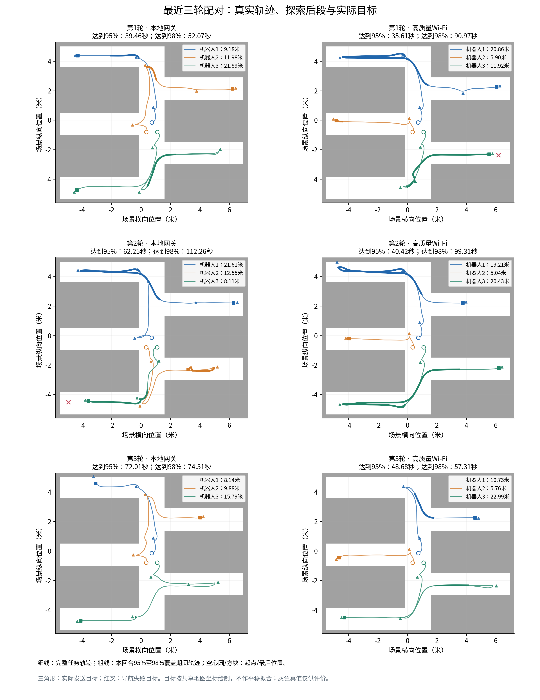
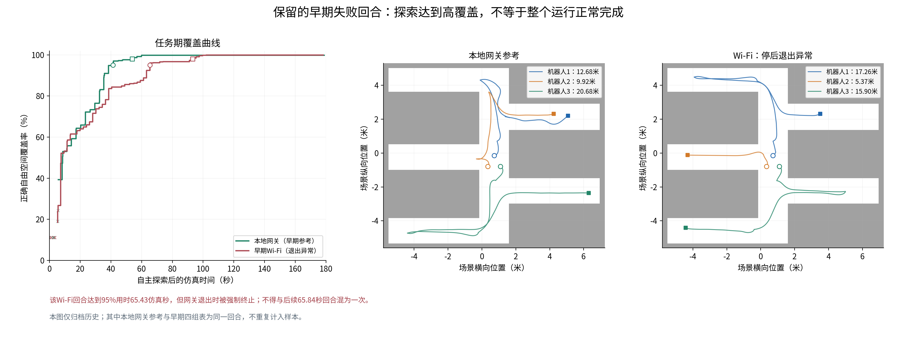

# ROS直接通信、本地网关与Wi-Fi：覆盖率、轨迹及结果汇总

本文把之前主要的Gazebo通信对比图表重新整理为中文。所有曲线、轨迹和数值都来自已有封存记录，本次没有新跑机器人、训练模型或改动评价标准。

**目前能直接看到：三种业务传输方式都已有机器人真实探索记录；接入ns-3以后仍能完成高覆盖探索。但探索时间有明显波动，不能仅凭某次Wi-Fi更快或更慢，就认定无线通信带来了相应比例的性能变化。**

这里分为两批：早期四种条件各一次，以及最近共同版本下网关/Wi-Fi各三次。另在附录保留一个早期退出异常回合。**这不是把全部历史实验混为一个同版本样本集**；早期数据不能充当最近版本缺少的ROS直取或受限Wi-Fi重复实验。

## 1. 四种通信方式分别是什么

|本文名称|旧记录代号|实际数据路径|如何理解|
|---|---|---|---|
|ROS直接通信|A0|机器人与中央控制器的业务通过原ROS/DDS直接交互|工程参考，不等于零延时或绝对成功|
|本地网关|A1|保留业务代理、编码解码及Action管理；使用有序可靠的本地后端|包含网关成本，不经过模拟Wi-Fi|
|高质量Wi-Fi|B（旧成功回合也写B02）|关键业务经过网关及真实ns-3 Wi-Fi MAC/PHY|链路条件较好，仍有队列、协议与传输成本|
|受限Wi-Fi|C|同类业务路径，采用事前固定的受限无线配置|无线配置不同，不保证每次探索一定更慢|

本汇总的场景均为Corr6201走廊地图，3台TurtleBot3 Waffle，每个完整任务窗口180仿真秒。四种方式使用固定v1.1.0 PPO高层目标分配网络，路径规划、局部避障和速度控制由Nav2执行。Wi-Fi组不是给机器人换了另一种探索算法。联网条件下的关键探索业务不能通过直接DDS旁路；图中的真值背景和轨迹用于评价展示，不是PPO的直接输入。

## 2. 看图前需要统一的口径

- **覆盖率**：参考可达自由空间中，被地图正确观测为自由的比例；本场景评价分母为15,558格、38.895平方米。不是“地图里有颜色的格子比例”。
- **横轴**：从各回合原先记录的自主探索起点算起的Gazebo仿真秒数，不是电脑实际经过的秒数。起点已有约11%的初始扫描覆盖，并非从完全空白计时。
- **达到95%/98%的时间**：直接引用原分析中首次质量有效的阈值记录，不是本次看图重新取点。未达到应写“未达到”，不能写0。
- **最后覆盖率**：最后一个质量有效的收到地图样本。采样不一定恰好落在第180秒，曲线不强行补满或延伸。
- **叉号**：原记录中地图质量不合格的样本。它们原样保留，但不计入质量有效的阈值判定；阶梯曲线只连接有效样本。
- **路程**：机器人真实运动的采样累计距离，覆盖整个180秒任务窗口，不是只算到95%时刻，也不是规划路径长度。
- **结束原因**：下表完整任务窗口均由180秒预算结束；达到95%甚至99.9%，也不自动代表控制器已证明探索自然完成。
- **时间与安全配置**：这些结果属于已授权的共同模拟时间健康计龄实验；300毫秒按共同仿真时间计龄，另有真实时间进度保护。不能把它当成实机300毫秒安全性能已经验证。

## 3. 早期四种通信方式：各一次

这一批最接近原来的“四组对比图”。四个回合的停止、日志与异常记录代码存在版本差异，不是所有源码逐项完全相同的严格配对。这里保留原样，只作工程现象展示。

### 3.1 覆盖率随时间增长

|通信方式|达到90%（仿真秒）|达到95%（仿真秒）|达到98%（仿真秒）|最后有效覆盖率（%）|成功目标/已发目标|结束情况|
|---|---|---|---|---|---|---|
|ROS直接通信|37.47|37.47|46.51|99.8843|13/14|180秒预算结束；控制器退出时报错|
|本地网关|35.85|41.48|53.93|99.8265|10/10|180秒预算结束；停稳并正常收尾|
|高质量Wi-Fi|61.73|65.84|92.47|99.9164|11/11|180秒预算结束；停稳并正常收尾|
|受限Wi-Fi|34.90|37.15|70.96|99.8907|11/11|180秒预算结束；停稳并正常收尾|

ROS直接通信那次任务窗口内成功13个目标，另一个在收尾取消；控制器退出时报错，不能因覆盖率高而说整个回合正常结束。本地网关、高质量Wi-Fi及受限Wi-Fi在这里使用的是对应原报告中后续已正常收尾的回合。

这一次受限Wi-Fi比高质量Wi-Fi更早达到95%，是真实保留的结果，**不是已经证明弱网络更好**。收到地图和反馈的时刻会改变候选、目标选择和路线；一次任务时间还混合了运动执行、建图、计算及同步影响。

### 3.2 机器人真实轨迹与路程

|通信方式|机器人1路程（米）|机器人2路程（米）|机器人3路程（米）|合计路程（米）|任务期实际耗时（秒）|
|---|---|---|---|---|---|
|ROS直接通信|10.09|6.90|19.16|36.15|284.2|
|本地网关|12.68|9.92|20.68|43.28|291.4|
|高质量Wi-Fi|19.62|5.82|14.28|39.72|425.2|
|受限Wi-Fi|19.09|15.13|12.60|46.81|380.8|

同一颜色始终代表同一机器人。空心圆是起点，方块是任务窗口最后位置；灰色为评价用场景障碍。路程不同说明实际分工与路线已经发生变化，不能把它们理解为同一条机器人路线只叠加了网络延迟。

## 4. 最近共同版本：网关与高质量Wi-Fi各重复三次

这批六个回合使用同一共同运行源码、同一固定PPO、场景、出生配置与已登记的种子。六次均完成180秒自主窗口、真实运动、停稳与正常进程收束。不过，固定种子不能消除ROS调度和实时联合仿真带来的执行差异；每次实际收到的初始地图、候选及后续路线并不完全一样。

### 4.1 六条覆盖率曲线

|配对轮次|通信方式|达到90%（仿真秒）|达到95%（仿真秒）|达到98%（仿真秒）|最后有效覆盖率（%）|成功目标/已发目标|导航失败数|
|---|---|---|---|---|---|---|---|
|第1轮|本地网关|34.66|39.46|52.07|99.8393|11/11|0|
|第1轮|高质量Wi-Fi|32.16|35.61|90.97|99.9550|10/11|1|
|第2轮|高质量Wi-Fi|36.29|40.42|99.31|99.9357|10/10|0|
|第2轮|本地网关|49.76|62.25|112.26|99.8265|11/12|1|
|第3轮|本地网关|67.01|72.01|74.51|99.8779|11/11|0|
|第3轮|高质量Wi-Fi|37.87|48.68|57.31|99.8843|9/9|0|

总计64个实际导航目标：62成功、2个导航中止；这里没有任务超时或取消。两次导航失败分别发生在第1轮Wi-Fi和第2轮网关，全部保留，没有只挑最快的回合。

### 4.2 三轮配对的机器人轨迹

|配对轮次|通信方式|机器人1路程（米）|机器人2路程（米）|机器人3路程（米）|合计路程（米）|任务期实际耗时（秒）|
|---|---|---|---|---|---|---|
|第1轮|本地网关|9.18|11.98|21.89|43.05|360.0|
|第1轮|高质量Wi-Fi|20.86|5.90|11.92|38.68|420.5|
|第2轮|高质量Wi-Fi|19.21|5.04|20.43|44.68|408.1|
|第2轮|本地网关|21.61|12.55|8.11|42.27|360.0|
|第3轮|本地网关|8.14|9.88|15.79|33.82|360.0|
|第3轮|高质量Wi-Fi|10.73|5.76|22.99|39.48|409.5|

图中粗线特别标出从95%到98%覆盖之间的运动，便于看最后几个区域的探索代价。三角形是实际发送的目标，红叉是原Nav2中止的目标。目标来自估计共享地图，背景来自评价真值；它们可能有坐标偏差，图中没有通过拟合、平移把差异藏起来。

### 4.3 平均值、分布与配对差值

下表时间均为仿真秒；只汇总本批六次，**不掺入第3节四个旧回合**。

|通信方式|回合数|达到95%均值（秒）|达到95%中位数（秒）|达到95%范围（秒）|达到98%均值（秒）|全窗平均路程（米）|
|---|---|---|---|---|---|---|
|本地网关|3|57.91|62.25|39.46—72.01|79.61|39.71|
|高质量Wi-Fi|3|41.57|40.42|35.61—48.68|82.53|40.95|

|配对|实际先后顺序|Wi-Fi减网关：达到95%时间差（秒）|Wi-Fi减网关：达到98%时间差（秒）|
|---|---|---|---|
|第1轮|网关→Wi-Fi|-3.85|+38.90|
|第2轮|Wi-Fi→网关|-21.83|-12.95|
|第3轮|网关→Wi-Fi|-23.33|-17.20|

差值为负表示Wi-Fi本次较快，正表示Wi-Fi本次较慢。三轮Wi-Fi达到95%都较快；但第一轮达到98%反而慢38.90秒，平均达到98%的时间也略长。这说明“先达到95%”与“后续剩余区域探索更快”不是同一个结论。

此外，本地网关完成180仿真秒实际约需360秒，Wi-Fi约需408—420秒。Wi-Fi组仿真推进更慢，却不一定有更大的仿真T95。**电脑运行开销、模拟通信时间和机器人任务时间是三个不同概念，不能相互替代。**

只有单个走廊场景、每组3次，且不是三个独立无线种子。这里不作统计显著性、跨地图推广或通信优化收益声明。三机器人都有真实运动，但这些图也不能证明新增地图信息严格均匀地由三机贡献。

## 5. 之前量到的消息交付时间

以下数据来自**第3节早期四组**的原耗时导出，不是最近六次的网络测量。95分位数表示该组统计样本中约95%的阶段耗时不超过这个值，不是最大值。

|通信方式|机器人3健康消息发布完成→完整收件，95分位（真实毫秒）|同伴避让消息开始处理→被接受，95分位（真实毫秒）|
|---|---:|---:|
|ROS直接通信|3.314|9.121|
|本地网关|19.548|26.844|
|高质量Wi-Fi|102.312|133.443|
|受限Wi-Fi|125.250|165.935|

健康消息用于判断状态是否新鲜；同伴避让消息用于机器人间的安全空间约束。这里测的是指定业务链路的墙钟时间，包含相应的发布、排队、代理、联合仿真处理和接收开销，**不是纯无线电传播时间**，也不是地图或导航目标所有消息的统一时延。

另一个时间口径是ns-3内部已成功消费的健康/避让消息，从预定入网到完整重组的服务时间：

|早期条件|已匹配的成功消费消息数|95分位（模拟毫秒）|99分位（模拟毫秒）|最大值（模拟毫秒）|
|---|---:|---:|---:|---:|
|高质量Wi-Fi|10,799|17.317561|19.315920|23.582208|
|受限Wi-Fi|10,801|53.256243|60.688117|82.456931|

这个阶段包含TCP、队列、Wi-Fi竞争/重传和接收重组，不是单纯空口耗时；只统计已消费的匹配消息，**不能从这些计数算出全输入丢包率**。模拟毫秒不能与上表真实毫秒直接相加；不同阶段的95分位也不能相加。

这两张表支持一个有限事实：早期受限Wi-Fi的消息服务通常较慢；但它那个探索回合仍比高质量Wi-Fi更早达到95%。因此，任务时间与单项消息时延并不是简单的一一对应关系。

## 6. 保留的早期Wi-Fi退出异常回合

此前另一张网关/Wi-Fi图使用的是更早一次Wi-Fi回合。它达到95%用时65.43仿真秒、最后覆盖99.9164%，10个目标成功；但停后网关未能正常退出，最终被强制终止。第3节高质量Wi-Fi的65.84秒是另一次后续回合，不能将两者合并成一次成功记录。

这张附图中的本地网关就是第3节相同的本地网关回合，不另计一个样本。保留该图是为了说明历史过程问题没有被后续高覆盖或正常退出覆盖掉；它不加入最近三次重复的均值。

## 7. 这些结果现在能说明什么

1. **ns-3已接入实际探索业务路径。** 现有Wi-Fi回合并非只让网络仿真器独立产生吞吐量，机器人确有策略决策、Nav2执行、运动和地图增长记录；业务路径的证据仍以原报告为准。
2. **传输方式会与信息到达、目标分配和机器人路线共同发生变化。** 任务曲线已有差别，但目前不能把全部差别拆成“无线传播损失多少、网关处理多少、调度随机性多少”。
3. **同一模式的探索效率仍有明显波动。** 本地网关三次达到95%的时间从39.46到72.01秒；Wi-Fi从35.61到48.68秒。不能拿最好一次当平均水平。
4. **目前不能声称Wi-Fi提高了探索效率，也不能给出可信的固定无线性能损失百分比。** 研究价值在于已经有真实过网、任务和地图结果，而接下来的因果分解仍需要独立证据。

## 8. 原始来源、附件与复现

|本汇总内容|原始入口|
|---|---|
|早期四组图及配置差异|[原绘图索引](../../net01d/followup04/analysis/comparison-four-arm/manifest.json)|
|ROS直接通信|[原结果](../../net01d/followup04/analysis/gz-simhealth-a0-01/RESULT.md) · [原指标](../../net01d/followup04/analysis/gz-simhealth-a0-01/metrics/result.json)|
|本地网关|[原结果](../../net01d/followup04/analysis/gz-simhealth-a1-03/RESULT.md) · [原指标](../../net01d/followup04/analysis/gz-simhealth-a1-03/metrics/result.json)|
|高质量Wi-Fi|[原结果](../../net01d/followup04/analysis/gz-simhealth-b1-02/RESULT.md) · [原指标](../../net01d/followup04/analysis/gz-simhealth-b1-02/metrics/result.json)|
|受限Wi-Fi|[原结果](../../net01d/followup04/analysis/gz-simhealth-c1-01/RESULT.md) · [原指标](../../net01d/followup04/analysis/gz-simhealth-c1-01/metrics/result.json)|
|最近六次共同版本结果|[原报告](../../net01e/followup04/REPORT.md) · [逐回合表](../../net01e/followup04/TRIALS.csv) · [配对表](../../net01e/followup04/PAIRS.csv)|
|早期网关阶段耗时|[原耗时摘要](../../net01d/followup04/analysis/costs-four-arm-01/SUMMARY.md)|
|早期ns-3模型服务耗时|[原模型耗时摘要](../../net01d/followup04/analysis/native-costs-01/SUMMARY.md)|
|保留的早期Wi-Fi退出异常回合|[原结果](../../net01d/followup04/analysis/gz-simhealth-b1-01/RESULT.md)|
|之前的两张网关/Wi-Fi对比图|[最早一对](../../net01d/followup04/analysis/comparison/coverage-and-gt-comparison.png) · [后续一对](../../net01d/followup04/analysis/comparison-b02/coverage-and-gt-comparison.png)|

中文图片在`figures/`，每张同时提供PNG和SVG；六份中文指标表在`data/`，可直接用表格软件打开。桌面副本使用相同相对目录，整文件夹复制后可阅读图文；本节指向仓库原件的链接和重绘脚本只在原仓库目录结构中有效。

绘图脚本为[make_summary.py](make_summary.py)，只读已有的覆盖率CSV、规范指标JSON、轨迹CSV和先前一次提取的事件缓存，不打开bag或大型网络原始账本，不运行ROS、Gazebo、ns-3、模型推理或训练。没有重算覆盖定义、首次有效阈值、导航终态或原安全判定。
