# 40轮通信方式对比图表汇总

## 40轮通信方式对比图表汇总
走廊 Corr6201 / 房间 Rooms6101 · 固定PPO v1.1.0 · 三机器人 · 每次120仿真秒

**已完成40个比较窗口，保留全部42次真实启动。** 两图各四条件、每条件五轮；34/40达到中央质量有效T95。40窗口测量合格，36窗口完整工程通过且正常退出。另有4个停后退出失败、2个零自主窗口启动失败，均未抹除。

**通信服务确实变慢，但任务没有呈现一致的单调恶化。** B到C的ns-3网络服务P95在两图约增加4.20倍/4.44倍；B/C的原始发布到中央接收平均实际时间延迟高于A0/A1。走廊四组均5/5达到T95；房间A0/A1/B/C分别4/3/4/3达标。

因此，本报告支持“真实通信路径与服务延时存在差异”，**尚不能把任务成绩差异唯一归因于无线RF，也不能宣称Wi-Fi提高探索效率**。各图保留五轮原始覆盖曲线、四十个轨迹面板及逐次成绩，不挑最快回合。

本文只汇总正式v3队列；旧er13单例、v1/v2 discovery、GDB诊断和更早RF组均不混入。统计数值引用已封存SUMMARY.json / rows.json，未启动仿真、模型推理或训练。

## 1. 条件、时间与统计口径

|条件|实际业务路径|含义|
|---|---|---|
|A0|ROS直连|原ROS/DDS直连；HQ在R92，不承载模拟Wi-Fi业务|
|A1|本地网关|本地网关FIFO；有代理成本，不经过ns-3业务链路|
|B|较好Wi-Fi|真实ns-3 Wi-Fi：MCS9、16dBm、路径损耗指数2|
|C|较差Wi-Fi|真实ns-3 Wi-Fi：MCS3、2dBm、指数3；是复合条件|

共同合同：G20至G140，120sim；G25至G135共23个决策边界；10仿真毫秒物理步、40实际毫秒绝对节拍、2wall-s保护。所有窗口使用相同77项runtime身份、固定PPO权重/701结构和repair-v1行为。

每图每组以5次run等权；“±”为逐次结果的样本SD（ddof=1）。P95汇总是5个“逐次P95”的均值，不是池化消息的P95。两图复用五个seed块，不能当成十个独立无线种子。

T95是原评价首次质量有效达到95%的仿真时长；未达保持未达/null，不补120。房间仅达标者均值是条件统计，不能据此排序全部五次表现。Gazebo真值仅用于评价图，不进入策略。

## 2. 任务主结果
全部5次T95均值仅在5/5达到时有定义；括号n表示仅达标样本数。

|地图 / 条件|达成|全部5次T95 仿真秒|仅达标者T95 仿真秒（n）|末中央覆盖 %|全窗三机总路程 采样折线米|
|---|---|---|---|---|---|
|Corr6201 / A0|5/5|76.75 ± 17.28|76.75 ± 17.28 (5)|99.874 ± 0.029|48.02 ± 8.42|
|Corr6201 / A1|5/5|70.11 ± 20.03|70.11 ± 20.03 (5)|99.850 ± 0.057|51.62 ± 9.11|
|Corr6201 / B|5/5|75.39 ± 17.05|75.39 ± 17.05 (5)|99.582 ± 0.572|38.55 ± 6.68|
|Corr6201 / C|5/5|68.94 ± 15.26|68.94 ± 15.26 (5)|99.725 ± 0.282|43.94 ± 7.30|
|Rooms6101 / A0|4/5|N/A|106.50 ± 8.92 (4)|97.494 ± 3.471|42.64 ± 11.15|
|Rooms6101 / A1|3/5|N/A|88.26 ± 22.86 (3)|95.925 ± 4.460|43.04 ± 9.47|
|Rooms6101 / B|4/5|N/A|99.66 ± 14.56 (4)|97.483 ± 3.018|48.02 ± 8.29|
|Rooms6101 / C|3/5|N/A|104.05 ± 7.82 (3)|92.737 ± 6.759|41.30 ± 5.26|

### 全窗采样路程：五次等权均值 ± 样本SD

|地图 / 条件|机器人1（米）|机器人2（米）|机器人3（米）|三机器人合计（米）|
|---|---|---|---|---|
|Corr6201 / A0|16.96 ± 4.41|18.82 ± 1.90|12.24 ± 6.43|48.02 ± 8.42|
|Corr6201 / A1|17.59 ± 4.23|20.07 ± 2.10|13.96 ± 4.27|51.62 ± 9.11|
|Corr6201 / B|12.54 ± 5.89|17.01 ± 3.67|9.00 ± 3.11|38.55 ± 6.68|
|Corr6201 / C|14.47 ± 5.28|17.35 ± 0.36|12.12 ± 4.49|43.94 ± 7.30|
|Rooms6101 / A0|18.12 ± 2.11|11.70 ± 6.38|12.81 ± 6.58|42.64 ± 11.15|
|Rooms6101 / A1|15.37 ± 2.19|13.33 ± 6.82|14.34 ± 4.76|43.04 ± 9.47|
|Rooms6101 / B|17.31 ± 2.22|15.06 ± 7.15|15.64 ± 1.20|48.02 ± 8.29|
|Rooms6101 / C|14.30 ± 5.68|10.76 ± 5.19|16.24 ± 3.86|41.30 ± 5.26|

## 3. 通信主测量与分母
原始发布到中央实际接收的实际毫秒，与ns-3网络服务仿真毫秒分开。

|地图 / 条件|平均实际毫秒|逐次P95均值 实际毫秒|已观测源消息集合 条件交付率 %|网关捕获→ 目的publish率 %|
|---|---|---|---|---|
|Corr6201 / A0|61.499 ± 6.336|541.97 ± 68.03|99.837 ± 0.075|N/A|
|Corr6201 / A1|60.197 ± 8.270|477.52 ± 101.91|99.785 ± 0.108|100.0000 ± 0.0000|
|Corr6201 / B|101.956 ± 6.885|522.80 ± 65.55|99.706 ± 0.229|99.9993 ± 0.0015|
|Corr6201 / C|108.210 ± 12.775|541.23 ± 142.52|99.706 ± 0.314|99.9957 ± 0.0049|
|Rooms6101 / A0|107.260 ± 2.106|988.14 ± 10.54|86.204 ± 2.038|N/A|
|Rooms6101 / A1|108.141 ± 4.066|967.33 ± 21.77|88.642 ± 2.444|100.0000 ± 0.0000|
|Rooms6101 / B|152.326 ± 4.267|1025.09 ± 30.25|85.866 ± 2.050|99.9973 ± 0.0037|
|Rooms6101 / C|155.158 ± 4.843|994.55 ± 14.76|87.667 ± 3.124|99.9963 ± 0.0034|

已观测源消息集合仅来自既有R Observer对map/odom/tf/tf_static四类订阅的同次take，非全部publisher发送。条件交付率不是RF包成功率；时延只计已匹配交付消息，逐次分母与样本数见data/rows.json。

## 4. 模拟服务阶段：精确数值与适用范围
P95为五个逐次P95的等权均值 ± 样本SD；各阶段P95不能相加。

|地图 / 条件|ns-3网络服务P95 仿真毫秒|A1 本地网关刻度差 P95 仿真毫秒|网络服务可测 运行数|本地刻度差可测 运行数|
|---|---|---|---|---|
|Corr6201 / A0|N/A|N/A|0|0|
|Corr6201 / A1|N/A|0.000 ± 0.000|0|5|
|Corr6201 / B|5.836 ± 0.074|N/A|5|0|
|Corr6201 / C|24.533 ± 0.977|N/A|5|0|
|Rooms6101 / A0|N/A|N/A|0|0|
|Rooms6101 / A1|N/A|0.000 ± 0.000|0|5|
|Rooms6101 / B|5.872 ± 0.165|N/A|5|0|
|Rooms6101 / C|26.084 ± 0.995|N/A|5|0|

## 5. 端到端实际时间延迟与已观测源消息集合交付率
点：每次运行；方块与误差线：五次等权均值 ± 样本SD。

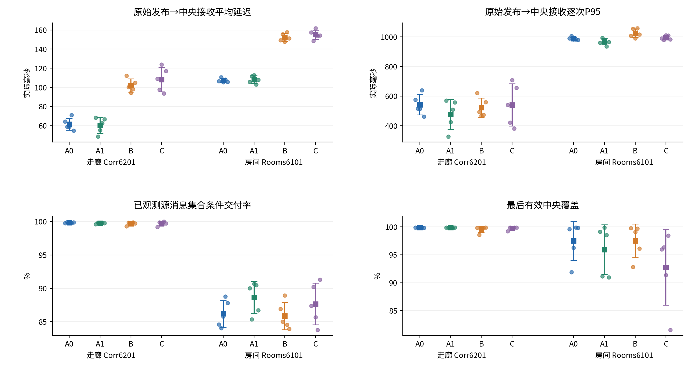

只计算匹配交付消息的时延，未观察消息不进入时延分布。交付率同时报告，不能把缺席慢消息解释为链路更快；实际毫秒不是生成AoI或纯RF传播时间。

## 6. 网关转发交付与模拟网络服务
native只统计可匹配TopicWire capture的admission→RX，不是全部Action/feedback/BoundMask总体。

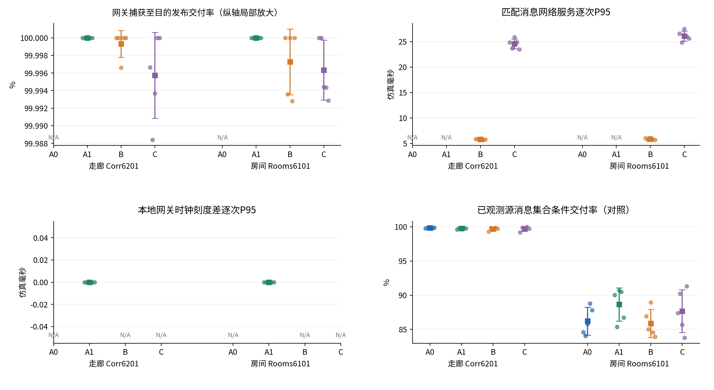

A0不适用wire/native；A1不适用native。A1 本地网关刻度差为同sim-clock刻度差（本批P95为0），不表示wall零延迟。两种时钟单位不能相加。

## 7. T95达成与逐次分布
T95未达不填120、不画成0；Rooms全5次真实T95均值均为N/A。

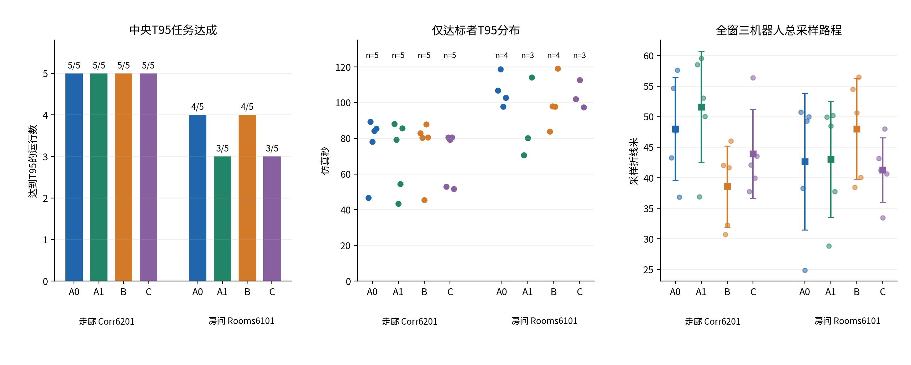

每点代表一轮；T95只显示达到者，n明示。总路程为完整120sim窗采样折线，不是规划路程或只到T95的路程；路线/执行变化不能全部归于通信。不同删失数量不支持按T95条件均值排序。

## 8.1 走廊 Corr6201覆盖均值与有效贡献数
中央接收视图；只在五条运行均有有效前样本的网格位置绘制均值与SD。

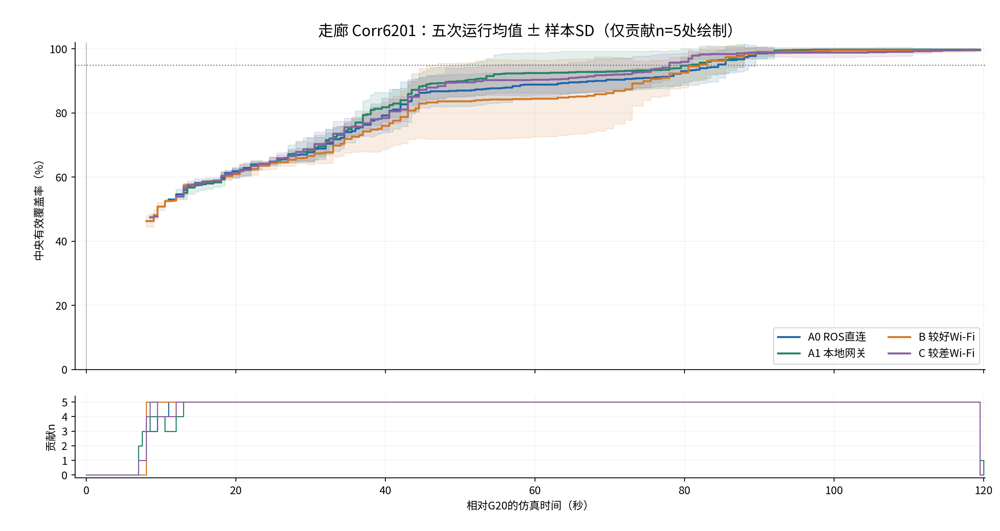

统一0.5sim网格取不晚于该点的最近原样本；不跨质量无效样本，不超出各run最后观测。此为展示重采样，不是新增实测。T95始终引用原结果。

## 8.2 走廊 Corr6201五轮原样覆盖曲线
五个面板各含A0/A1/B/C；未丢弃任何运行。

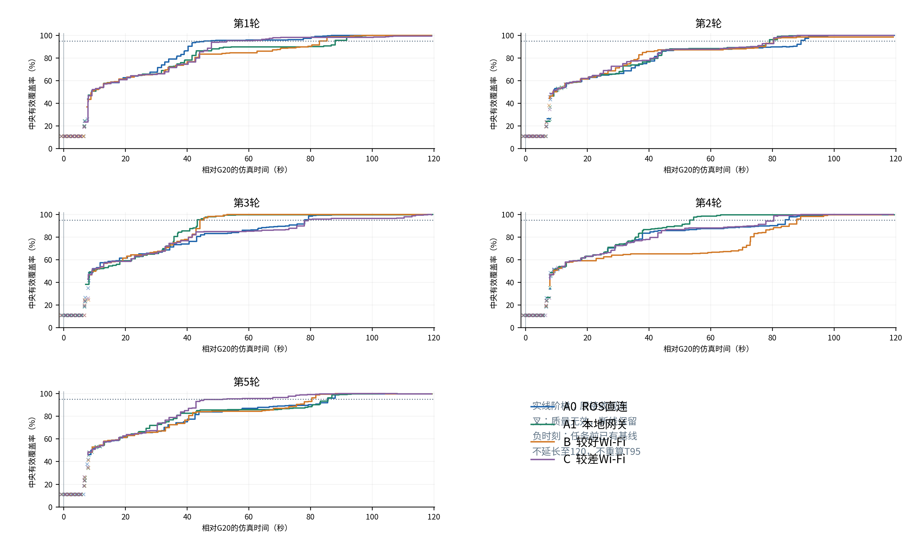

负时刻baseline表示G20之前已收到的地图，未伪装成t=0新到达；叉号为原质量无效样本，曲线在此断开，不连接跨过。末样本不延长到120sim。

## 8.3 房间 Rooms6101覆盖均值与有效贡献数
中央接收视图；只在五条运行均有有效前样本的网格位置绘制均值与SD。

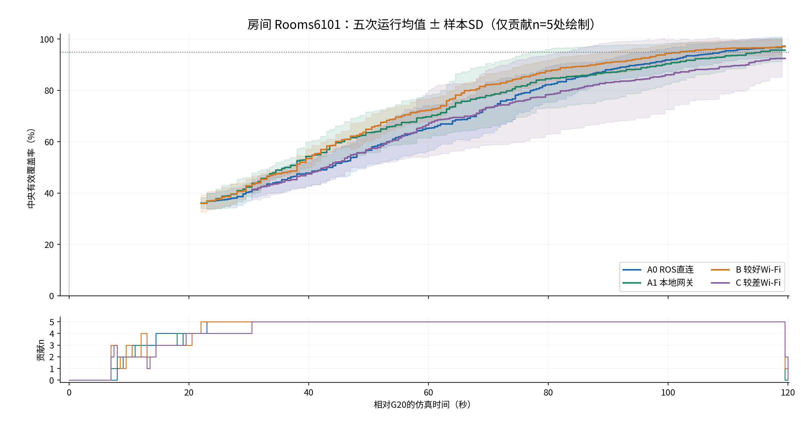

统一0.5sim网格取不晚于该点的最近原样本；不跨质量无效样本，不超出各run最后观测。此为展示重采样，不是新增实测。T95始终引用原结果。

## 8.4 房间 Rooms6101五轮原样覆盖曲线
五个面板各含A0/A1/B/C；未丢弃任何运行。

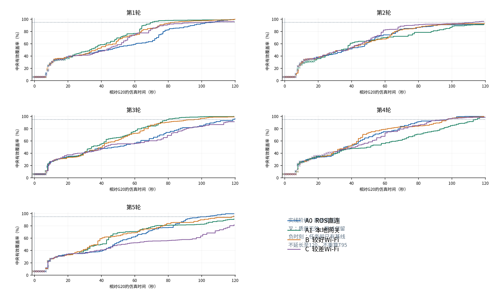

负时刻baseline表示G20之前已收到的地图，未伪装成t=0新到达；叉号为原质量无效样本，曲线在此断开，不连接跨过。末样本不延长到120sim。

## 9.1 走廊 Corr6201第1轮：四通信条件真实轨迹
三色对应机器人1/2/3；空心圆为G20首位置，方块为G140末位置。

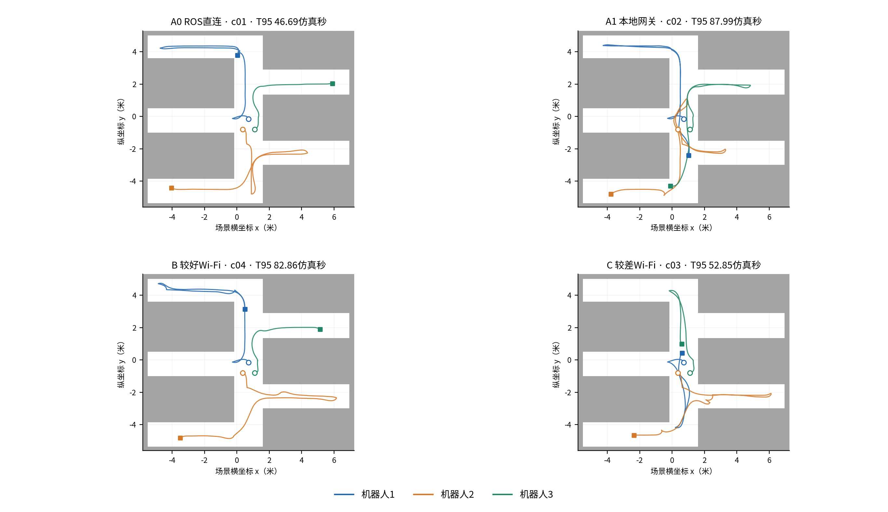

全部原样采样点的Gazebo world折线；灰色是评价障碍背景，不是策略输入。10Hz采样，时间由Observer clock量化；最大间隔0.16sim，折线路程不是连续运动的精确长度。

## 9.2 走廊 Corr6201第2轮：四通信条件真实轨迹
三色对应机器人1/2/3；空心圆为G20首位置，方块为G140末位置。

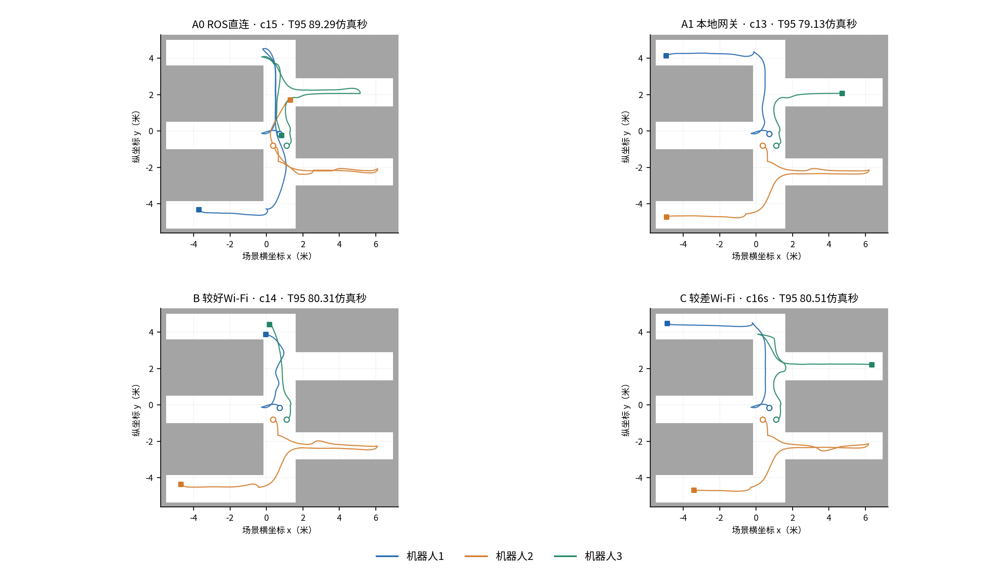

全部原样采样点的Gazebo world折线；灰色是评价障碍背景，不是策略输入。10Hz采样，时间由Observer clock量化；最大间隔0.16sim，折线路程不是连续运动的精确长度。

## 9.3 走廊 Corr6201第3轮：四通信条件真实轨迹
三色对应机器人1/2/3；空心圆为G20首位置，方块为G140末位置。

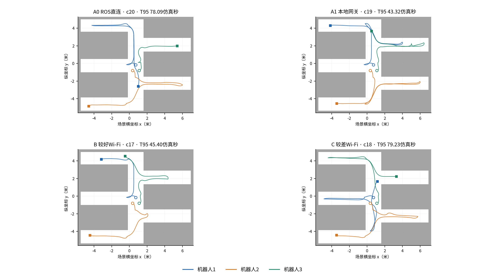

全部原样采样点的Gazebo world折线；灰色是评价障碍背景，不是策略输入。10Hz采样，时间由Observer clock量化；最大间隔0.16sim，折线路程不是连续运动的精确长度。

## 9.4 走廊 Corr6201第4轮：四通信条件真实轨迹
三色对应机器人1/2/3；空心圆为G20首位置，方块为G140末位置。

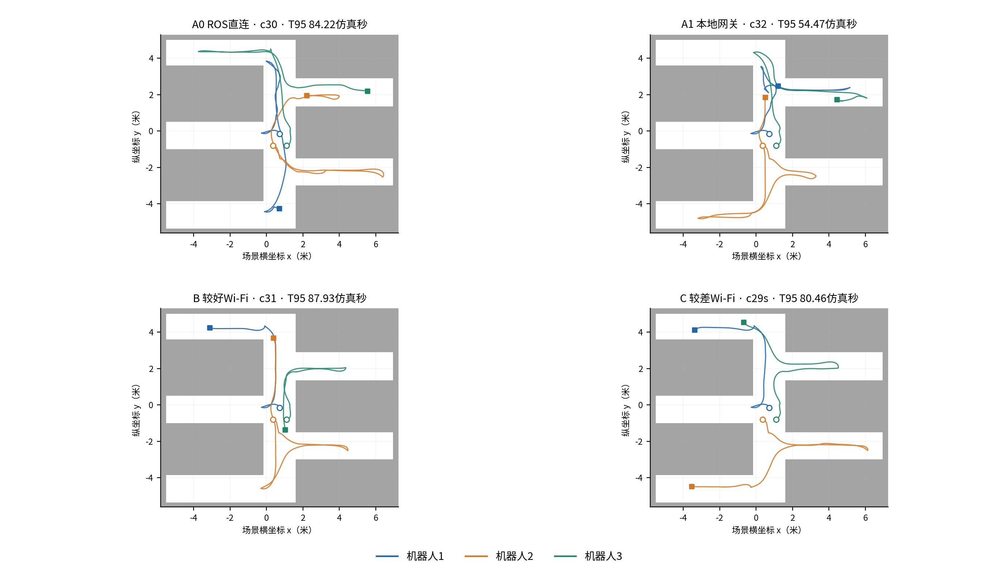

全部原样采样点的Gazebo world折线；灰色是评价障碍背景，不是策略输入。10Hz采样，时间由Observer clock量化；最大间隔0.16sim，折线路程不是连续运动的精确长度。

## 9.5 走廊 Corr6201第5轮：四通信条件真实轨迹
三色对应机器人1/2/3；空心圆为G20首位置，方块为G140末位置。

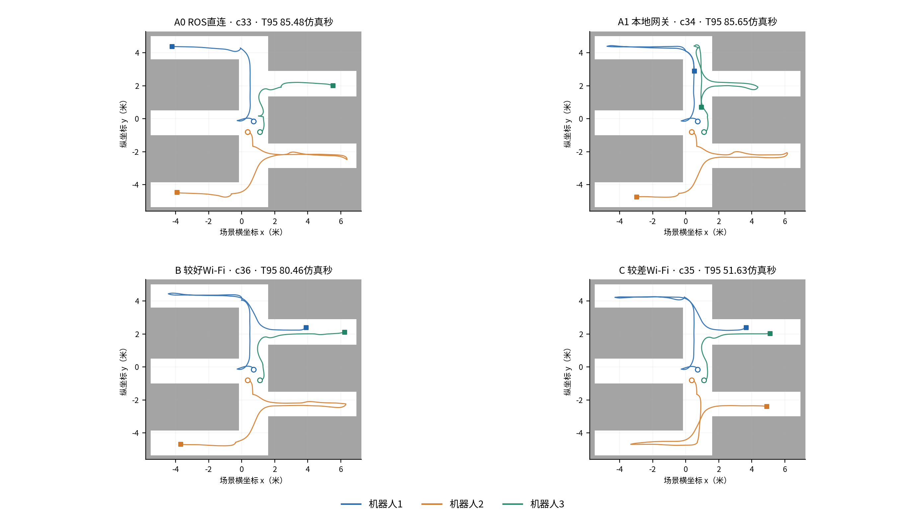

全部原样采样点的Gazebo world折线；灰色是评价障碍背景，不是策略输入。10Hz采样，时间由Observer clock量化；最大间隔0.16sim，折线路程不是连续运动的精确长度。

## 9.6 房间 Rooms6101第1轮：四通信条件真实轨迹
三色对应机器人1/2/3；空心圆为G20首位置，方块为G140末位置。

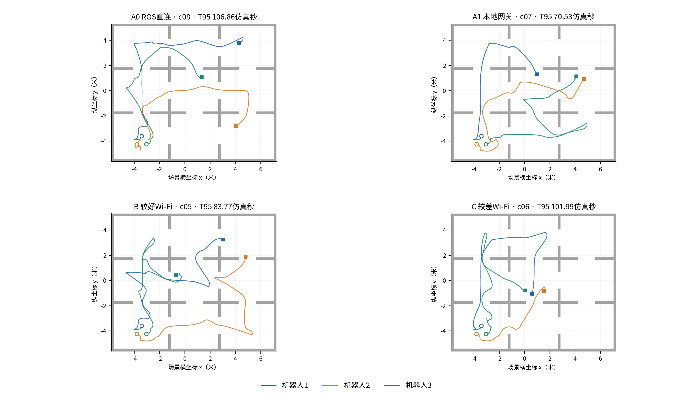

全部原样采样点的Gazebo world折线；灰色是评价障碍背景，不是策略输入。10Hz采样，时间由Observer clock量化；最大间隔0.16sim，折线路程不是连续运动的精确长度。

## 9.7 房间 Rooms6101第2轮：四通信条件真实轨迹
三色对应机器人1/2/3；空心圆为G20首位置，方块为G140末位置。

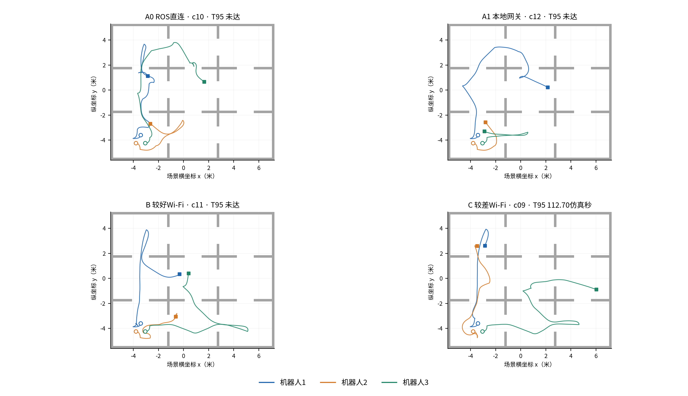

全部原样采样点的Gazebo world折线；灰色是评价障碍背景，不是策略输入。10Hz采样，时间由Observer clock量化；最大间隔0.16sim，折线路程不是连续运动的精确长度。

## 9.8 房间 Rooms6101第3轮：四通信条件真实轨迹
三色对应机器人1/2/3；空心圆为G20首位置，方块为G140末位置。

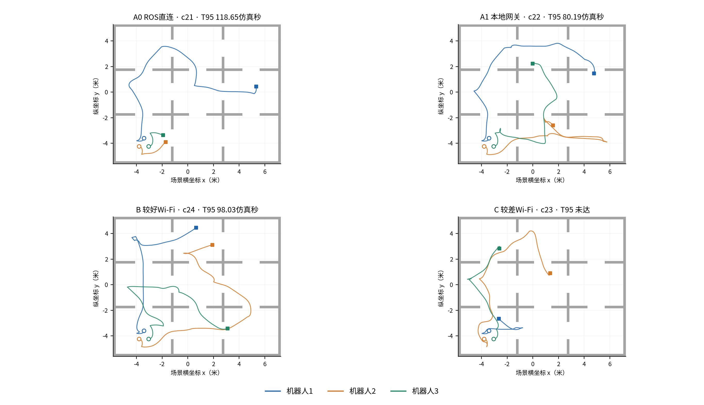

全部原样采样点的Gazebo world折线；灰色是评价障碍背景，不是策略输入。10Hz采样，时间由Observer clock量化；最大间隔0.16sim，折线路程不是连续运动的精确长度。

## 9.9 房间 Rooms6101第4轮：四通信条件真实轨迹
三色对应机器人1/2/3；空心圆为G20首位置，方块为G140末位置。

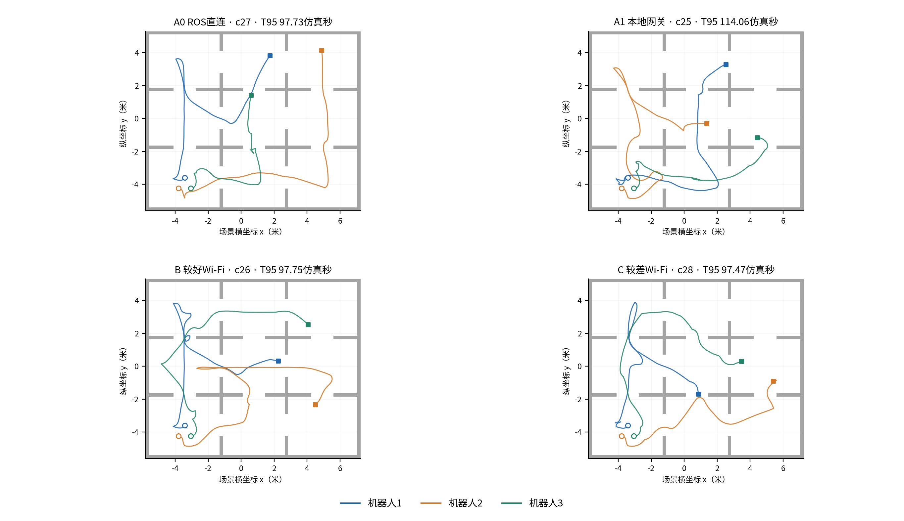

全部原样采样点的Gazebo world折线；灰色是评价障碍背景，不是策略输入。10Hz采样，时间由Observer clock量化；最大间隔0.16sim，折线路程不是连续运动的精确长度。

## 9.10 房间 Rooms6101第5轮：四通信条件真实轨迹
三色对应机器人1/2/3；空心圆为G20首位置，方块为G140末位置。

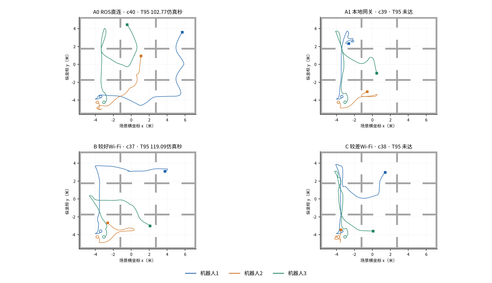

全部原样采样点的Gazebo world折线；灰色是评价障碍背景，不是策略输入。10Hz采样，时间由Observer clock量化；最大间隔0.16sim，折线路程不是连续运动的精确长度。

## 10.1 走廊 Corr6201逐次成绩与全窗采样路程
每行一个完整120sim窗口；路程含T95之后运动，未达保持“未达”。

|轮/条件|实际回合|T95 仿真秒|末覆盖 %|均延迟 实际毫秒|条件率 %|机器人1 米|机器人2 米|机器人3 米|合计 米|正常退出|
|---|---|---|---|---|---|---|---|---|---|---|
|1/A0|c01|46.69|99.85|64.18|99.78|16.30|19.45|7.52|43.26|是|
|1/A1|c02|87.99|99.88|68.20|99.60|21.56|20.10|16.88|58.54|是|
|1/B|c04|82.86|99.82|112.21|99.31|17.46|17.77|6.80|42.03|停后FAIL|
|1/C|c03|52.85|99.22|109.04|99.18|10.95|17.38|9.41|37.74|是|
|2/A0|c15|89.29|99.88|58.81|99.94|20.23|16.20|18.25|54.68|是|
|2/A1|c13|79.13|99.89|48.42|99.85|11.34|19.15|6.41|36.89|是|
|2/B|c14|80.31|98.56|100.22|99.85|6.24|18.77|5.70|30.71|停后FAIL|
|2/C|c16s|80.51|99.85|97.67|99.89|11.28|17.64|13.17|42.09|是|
|3/A0|c20|78.09|99.89|58.75|99.83|21.84|18.38|7.48|47.70|是|
|3/A1|c19|43.32|99.83|55.22|99.84|21.48|22.66|15.40|59.55|是|
|3/B|c17|45.40|99.85|94.37|99.74|9.53|10.59|12.16|32.28|是|
|3/C|c18|79.23|99.81|123.84|99.76|20.98|16.74|18.68|56.39|是|
|4/A0|c30|84.22|99.91|71.08|99.76|15.92|21.45|20.23|57.60|是|
|4/A1|c32|54.47|99.76|62.60|99.85|16.46|21.30|15.31|53.07|是|
|4/B|c31|87.93|99.83|98.07|99.89|9.44|19.81|12.44|41.68|是|
|4/C|c29s|80.46|99.86|93.43|99.99|9.72|17.61|12.60|39.94|是|
|5/A0|c33|85.48|99.84|54.67|99.88|10.49|18.63|7.73|36.86|是|
|5/A1|c34|85.65|99.88|66.55|99.78|17.10|17.15|15.79|50.03|是|
|5/B|c36|80.46|99.86|104.91|99.73|20.03|18.10|7.90|46.04|是|
|5/C|c35|51.63|99.88|117.07|99.71|19.40|17.41|6.74|43.56|是|

## 10.2 房间 Rooms6101逐次成绩与全窗采样路程
每行一个完整120sim窗口；路程含T95之后运动，未达保持“未达”。

|轮/条件|实际回合|T95 仿真秒|末覆盖 %|均延迟 实际毫秒|条件率 %|机器人1 米|机器人2 米|机器人3 米|合计 米|正常退出|
|---|---|---|---|---|---|---|---|---|---|---|
|1/A0|c08|106.86|99.61|106.54|84.58|18.93|17.33|14.47|50.72|是|
|1/A1|c07|70.53|99.12|105.61|90.01|13.67|16.05|20.20|49.92|是|
|1/B|c05|83.77|99.78|149.39|86.90|19.40|19.69|15.39|54.48|是|
|1/C|c06|101.99|95.98|157.38|87.37|17.90|8.48|16.78|43.16|停后FAIL|
|2/A0|c10|未达|91.91|110.52|84.05|14.40|8.65|15.21|38.27|是|
|2/A1|c12|未达|91.17|111.57|85.35|16.81|4.41|7.60|28.82|是|
|2/B|c11|未达|92.80|155.63|85.01|15.47|6.09|16.89|38.46|是|
|2/C|c09|112.70|96.33|148.64|90.22|10.42|10.38|20.46|41.26|停后FAIL|
|3/A0|c21|118.65|96.27|105.43|85.79|19.62|2.98|2.29|24.89|是|
|3/A1|c22|80.19|99.86|112.75|90.67|17.53|17.47|13.48|48.48|是|
|3/B|c24|98.03|99.08|147.63|88.95|14.55|20.09|15.98|50.62|是|
|3/C|c23|未达|91.39|161.76|85.65|6.21|17.19|10.04|33.44|是|
|4/A0|c27|97.73|99.86|108.12|88.77|18.92|18.42|11.97|49.31|是|
|4/A1|c25|114.06|98.51|102.98|90.47|16.38|20.68|13.17|50.22|是|
|4/B|c26|97.75|99.67|157.79|84.56|19.32|20.93|16.23|56.48|是|
|4/C|c28|97.47|98.43|153.71|83.78|18.00|14.05|15.94|48.00|是|
|5/A0|c40|102.77|99.83|105.69|87.82|18.75|11.10|20.13|49.98|是|
|5/A1|c39|未达|90.97|107.79|86.70|12.44|8.04|17.27|37.75|是|
|5/B|c37|119.09|96.09|151.19|83.91|17.81|8.52|13.72|40.05|是|
|5/C|c38|未达|81.55|154.30|91.31|18.98|3.69|18.00|40.66|是|

## 11. 全部42次启动：工程资格与窗口资格
40个任务窗口不是40个正常退出；原失败未改写成PASS。

|地图 / 条件|实际启动|窗口合格|完整工程|正常退出|无自主启动FAIL|
|---|---|---|---|---|---|
|Corr6201 / A0|5|5|5|5|0|
|Corr6201 / A1|5|5|5|5|0|
|Corr6201 / B|5|5|3|3|0|
|Corr6201 / C|7|5|5|5|2|
|Rooms6101 / A0|5|5|5|5|0|
|Rooms6101 / A1|5|5|5|5|0|
|Rooms6101 / B|5|5|5|5|0|
|Rooms6101 / C|5|5|3|3|0|

AM1：c04/c06/c09/c14完整120sim测量窗与所有必要footer/时序证据合格，但Gateway最终OS -15。原FAIL保留；main_return(code0)是返回意图，非实际正常OS退出。窗口被后验纳入，full/正常退出仍false。

AM3/AM4：原c16/c29均Corr/C，tb3 spawn响应超时，0自主窗口。经明确授权分别一次fresh c16s/c29s，同原map/arm/seed/run/order；原失败另列。因此Corr/C是7启动、5窗口，不能假定启动缺失随机。AM2仅修复离线负坐标参数解析。

## 12. 结论边界与数据索引

**可以确认：**四十个同runtime窗口完成；无线条件B/C确有实际业务传输，C的匹配TopicWire ns-3网络服务P95比B慢约4.20/4.44倍；wall端到端均值也更高。10个map/block四臂RTF对称跨度均通过1%门，最大仅0.002399%。

**还不能确认：**无线越弱任务必然越差、独立RF造成固定比例任务损失、PPO优于其他策略或实机安全。Rooms直连与本地网关也有已观测源消息集合未观察，不能把HQ未观察全部称无线丢包。C同时改MCS/功率/路径损耗；Gazebo墙不自动形成RF遮挡，尚无实测室内标定。

本PDF与MD使用SUMMARY/rows的权威统计。figures含PNG/SVG；data含40窗口、8组统计、42attempt、覆盖原观测/重采样、全轨迹与路程、话题分项分母。全组均值等权，不池化消息；原raw与全部修订原件在仓库保留。

源目录：local-runs/communication40-v3-20261113。关键入口：REPORT.md、SUMMARY.json、rows.json、FINAL_EXECUTION_CHECK.json、execution.jsonl及AM1-AM4。批后退出小修属于独立版本，未用于本批40，也未追溯改变4个FAIL；未进行新Gazebo复验。

### 导出文件

- [权威分组统计](data/SUMMARY.json)
- [40窗口完整统计](data/rows.json)
- [全部42次启动](data/attempts.csv)
- [覆盖原样本](data/coverage_samples.csv)
- [真实轨迹](data/trajectories.json)
- [路程](data/path_lengths.csv)
