# ROS固定延时消融图表汇总

## ROS固定延时消融图表汇总
本批V3：两地图 × 七条件 × 五个配对种子块；自主上限120仿真秒

70个预声明条件槽，实际启动78次；合格120秒测量窗70个、完整工程通过70个，另8次零自主启动原FAIL保留，不称78次全通过。任务状态 n=55 确认达标，m=15 实际观测窗内未达，k=0 未知。未知不是实测失败，null T95不补120。

A0是本批ROS直连校准；D0至D500均经过同一本地ROS/CDR代理，额外新增0至500实际毫秒的单向跨端等待，双向业务适用。纯延时对照仅D0..D500；A0→D0包含代理开销。未使用Wi-Fi业务，也不把wall毫秒换算成仿真毫秒。

七条件共用有限新鲜度门：health/mask/Observer receipt为0.60仿真秒，producer投影odom receipt为0.50仿真秒；原source age为0.70/0.85仿真秒。PPO/701、Nav2与共同绝对节拍保持；紧急停止与独立管理链不注入研究延时。

统计单位为一次运行，每组五次等权；误差是样本标准差。消息数不是独立重复。源消息条件交付率不是全部发布成功率；端到端延时只针对有实际匹配证据的已交付消息。

## 关键结果：延时增加，任务结果并非普遍单调变差
以下为本批实际14组统计；均值±样本SD，wall毫秒与sim秒不换算。

走廊：D0→D500的端到端平均延时由61.68 ± 6.50增至568.59 ± 12.88实际毫秒；两端都5/5达到T95，五次T95由79.74 ± 23.15变为62.78 ± 14.56仿真秒。D0/D100/D200/D300/D400/D500达标数依次为5、5、4、4、4、5。因此不能把更多延时解释为每次都更慢或更差。末覆盖为99.87 ± 0.02%→99.74 ± 0.22%。

房间：D0→D500的端到端平均延时由114.16 ± 5.67增至609.13 ± 3.52实际毫秒，达标由5/5（100%）降至2/5（40%）；六档达标数依次为5、3、4、2、3、2，仍非逐档单调。D0五次T95为95.84 ± 16.92仿真秒；D500只能报告成功者96.44 ± 11.00（n=2），不能当作五次均值。末覆盖由98.60 ± 1.38%变为96.12 ± 3.17%。

名义新增等待从0到500 wall毫秒，实测端到端延时在两图逐档上升；任务完成度没有同样的普遍单调关系。Rooms D300末覆盖88.34 ± 9.51%，而D400与D500分别为96.49 ± 3.42%和96.12 ± 3.17%，必须保留这种非单调结果。

A0只作直连校准：走廊A0/D0端到端均值分别56.55/61.68 wall毫秒；房间为110.78/114.16 wall毫秒。这一对照包含代理路径变化；本任务没有Wi-Fi业务，不能据此宣称唯一无线因果或实机安全。

## 1. 本批版本、原失败与统计分母
不混用旧V1/V2或旧40次通信比较成绩；所有原始失败保留。

|历史独立版本|实际启动数|原状态|处理|
|---|---|---|---|
|ros-delay-20261114|5|V1功能诊断批，整体退役|整体排除本批均值|
|ros-delay-v2-20261114|27|V2旧receipt合同批，整体退役|整体排除本批均值|

本批额外保留的零自主启动失败为8次。主70槽是经明确修订的自主进入条件比较，实际启动可靠性另计；不假定启动缺失与条件无关。具体继任映射、session、原错误见逐次来源与启动附表。

f016同一实际窗口由AM3离线关联修订：关闭后未准入capture复用最后identity，不能当成实际传输摘要改变。主表按PLAN指定的修订row读取，原BLOCK/UNKNOWN和原分析完整保留；不是重跑或改运行源。

## 2. 走廊 Corr6201 主结果
n确认达标 / m实际窗内未达 / k未知；五槽T95均值仅五次全部确认达标才给。

|条件|n/m/k|五次全达T95 仿真秒|仅达标均值 仿真秒(n)|实际末观测覆盖 %|端到端均值 实际毫秒|源条件交付率 %|
|---|---|---|---|---|---|---|
|A0|5/0/0|67.86 ± 16.05|67.86 ± 16.05 (n=5)|99.86 ± 0.03|56.55 ± 7.96|99.79 ± 0.30|
|D0|5/0/0|79.74 ± 23.15|79.74 ± 23.15 (n=5)|99.87 ± 0.02|61.68 ± 6.50|99.76 ± 0.04|
|D100|5/0/0|72.45 ± 17.10|72.45 ± 17.10 (n=5)|99.86 ± 0.02|163.71 ± 9.52|99.60 ± 0.36|
|D200|4/1/0|N/A|71.97 ± 14.66 (n=4)|95.18 ± 10.16|260.21 ± 12.33|99.63 ± 0.32|
|D300|4/1/0|N/A|61.49 ± 20.29 (n=4)|95.44 ± 9.93|369.14 ± 7.13|99.63 ± 0.21|
|D400|4/1/0|N/A|59.59 ± 21.60 (n=4)|97.73 ± 4.77|467.42 ± 5.61|99.63 ± 0.16|
|D500|5/0/0|62.78 ± 14.56|62.78 ± 14.56 (n=5)|99.74 ± 0.22|568.59 ± 12.88|99.27 ± 0.80|

未知存在时，任务成功率仅给n/5至(n+k)/5边界，k不填失败；五次均值缺任一必要观测即N/A。末覆盖取各自实际末时刻，部分窗时长不同，不等于统一120秒终点；结合逐次窗长解读。

## 2. 房间 Rooms6101 主结果
n确认达标 / m实际窗内未达 / k未知；五槽T95均值仅五次全部确认达标才给。

|条件|n/m/k|五次全达T95 仿真秒|仅达标均值 仿真秒(n)|实际末观测覆盖 %|端到端均值 实际毫秒|源条件交付率 %|
|---|---|---|---|---|---|---|
|A0|4/1/0|N/A|91.64 ± 17.48 (n=4)|97.80 ± 2.35|110.78 ± 7.84|86.06 ± 3.82|
|D0|5/0/0|95.84 ± 16.92|95.84 ± 16.92 (n=5)|98.60 ± 1.38|114.16 ± 5.67|87.16 ± 2.64|
|D100|3/2/0|N/A|95.73 ± 17.82 (n=3)|93.70 ± 7.09|212.56 ± 4.96|86.69 ± 1.49|
|D200|4/1/0|N/A|97.86 ± 13.25 (n=4)|95.06 ± 7.98|312.58 ± 9.57|86.97 ± 2.97|
|D300|2/3/0|N/A|111.55 ± 3.69 (n=2)|88.34 ± 9.51|413.83 ± 5.28|85.83 ± 3.63|
|D400|3/2/0|N/A|94.29 ± 20.93 (n=3)|96.49 ± 3.42|512.69 ± 5.12|85.91 ± 3.97|
|D500|2/3/0|N/A|96.44 ± 11.00 (n=2)|96.12 ± 3.17|609.13 ± 3.52|86.66 ± 1.57|

未知存在时，任务成功率仅给n/5至(n+k)/5边界，k不填失败；五次均值缺任一必要观测即N/A。末覆盖取各自实际末时刻，部分窗时长不同，不等于统一120秒终点；结合逐次窗长解读。

## 3. 实测端到端延时与交付

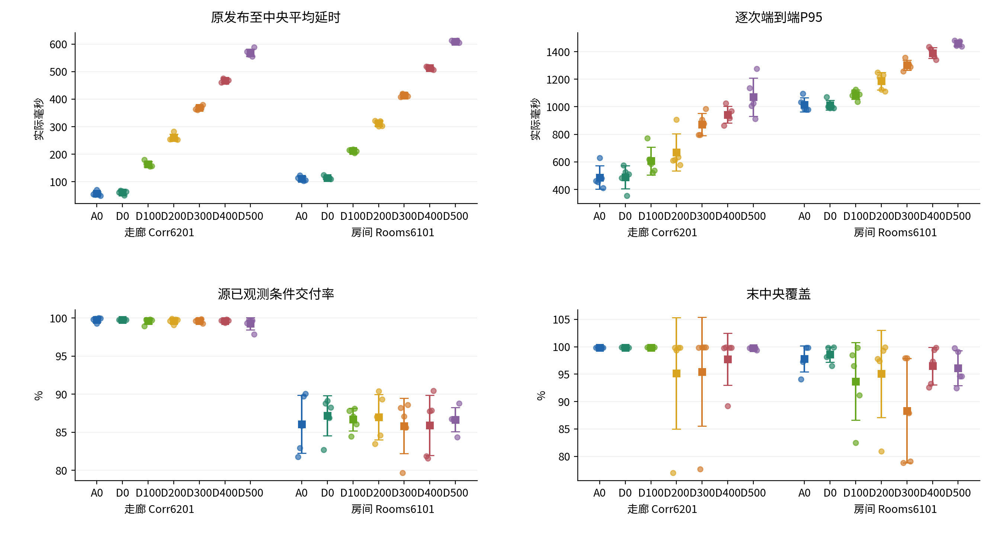

一次运行一个点，五次等权均值±样本SD。条件交付率以既有R Observer map/odom/tf/tf_static同次take集合为分母，不是全部publisher生成或RF包。

## 3.1 实测注入等待与名义D

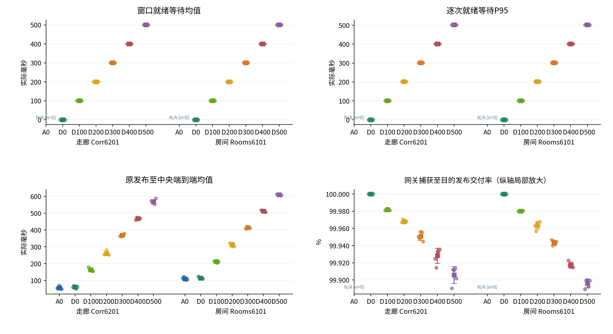

hold是capture至离开等待队列的就绪释放，不是目的发布/HQ接收。窗口capture与窗口release、关闭后drain分开；A0无队列，记不适用。

## 4. 任务状态、T95与采样路程

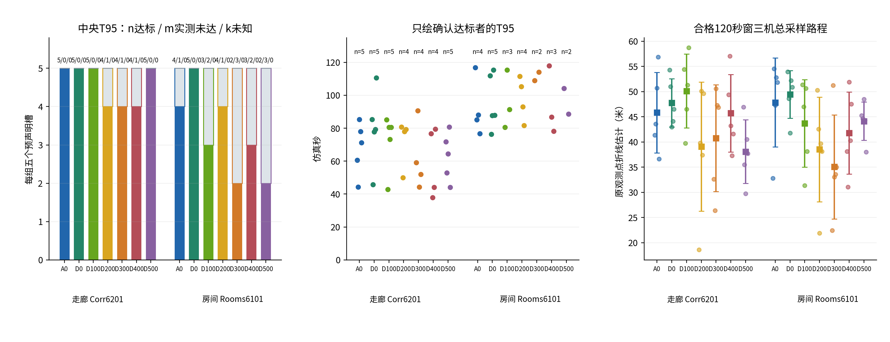

n/m/k分别显示。T95只绘确认达标者；路程只在合格120秒窗作五次等权均值，不把部分窗与全窗混算。

## 5. 走廊 Corr6201 / 中央实际接收融合图 均值
原实际观察时刻，展示网格0.5仿真秒；仅五条都有质量有效观测处绘均值与样本SD。

不跨质量无效点，不外推到120，不将地图header当接收时刻。局部、中央、机器人接收视图分别保留，中央是主任务指标。

## 5. 走廊 Corr6201 / 中央实际接收融合图 五块原曲线

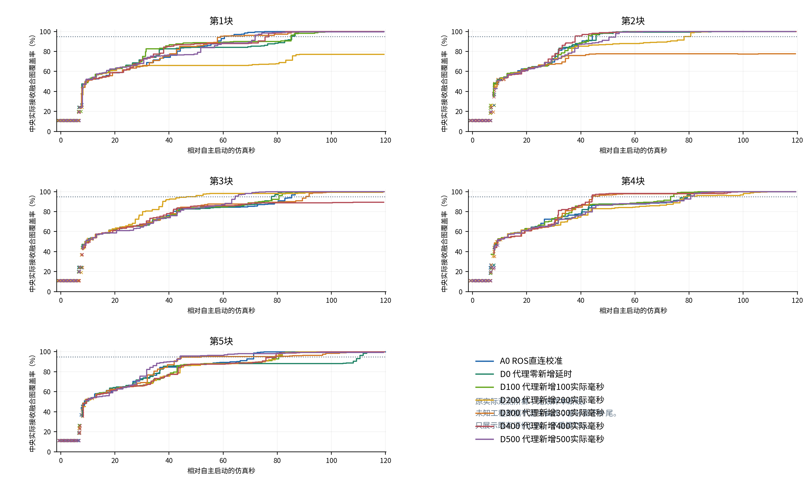

每块七条件原观测阶梯。未知工程数据不进入主曲线；合法部分窗只画其实际观察范围，不补尾、不重算T95。

## 5. 房间 Rooms6101 / 中央实际接收融合图 均值
原实际观察时刻，展示网格0.5仿真秒；仅五条都有质量有效观测处绘均值与样本SD。

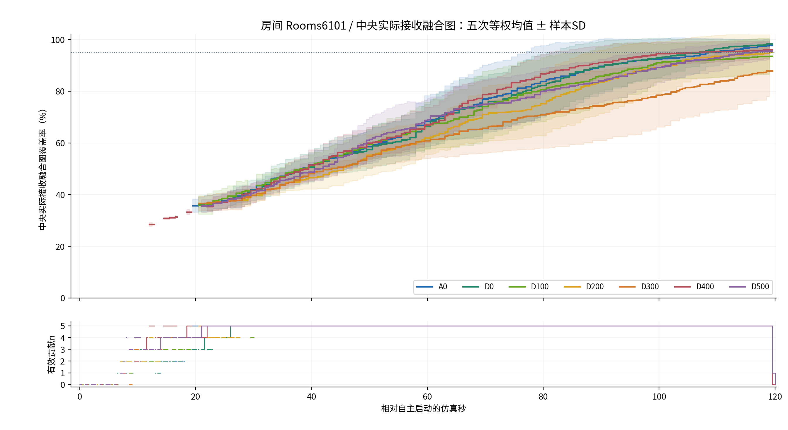

不跨质量无效点，不外推到120，不将地图header当接收时刻。局部、中央、机器人接收视图分别保留，中央是主任务指标。

## 5. 房间 Rooms6101 / 中央实际接收融合图 五块原曲线

每块七条件原观测阶梯。未知工程数据不进入主曲线；合法部分窗只画其实际观察范围，不补尾、不重算T95。

## 5. 走廊 Corr6201 / 三机器人本地图联合 均值
原实际观察时刻，展示网格0.5仿真秒；仅五条都有质量有效观测处绘均值与样本SD。

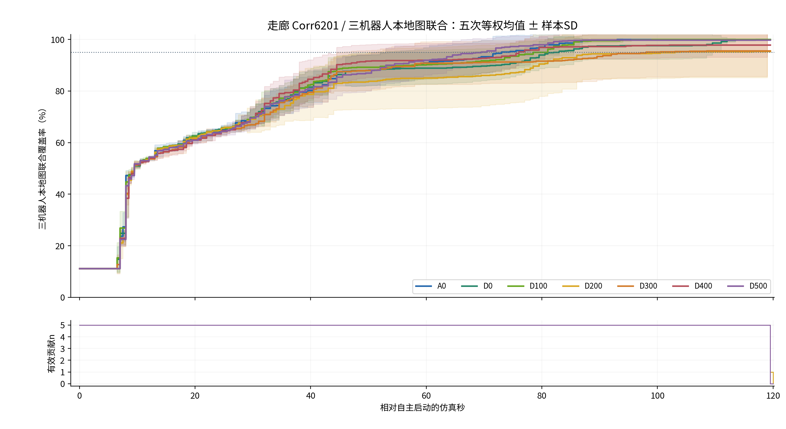

不跨质量无效点，不外推到120，不将地图header当接收时刻。局部、中央、机器人接收视图分别保留，中央是主任务指标。

## 5. 走廊 Corr6201 / 三机器人本地图联合 五块原曲线

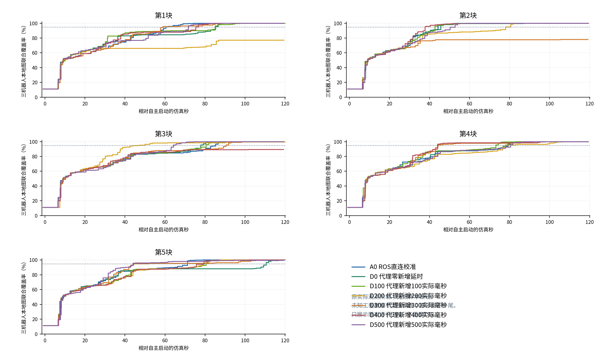

每块七条件原观测阶梯。未知工程数据不进入主曲线；合法部分窗只画其实际观察范围，不补尾、不重算T95。

## 5. 房间 Rooms6101 / 三机器人本地图联合 均值
原实际观察时刻，展示网格0.5仿真秒；仅五条都有质量有效观测处绘均值与样本SD。

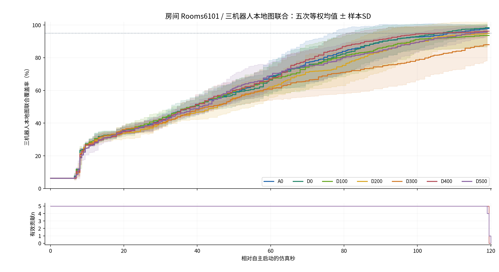

不跨质量无效点，不外推到120，不将地图header当接收时刻。局部、中央、机器人接收视图分别保留，中央是主任务指标。

## 5. 房间 Rooms6101 / 三机器人本地图联合 五块原曲线

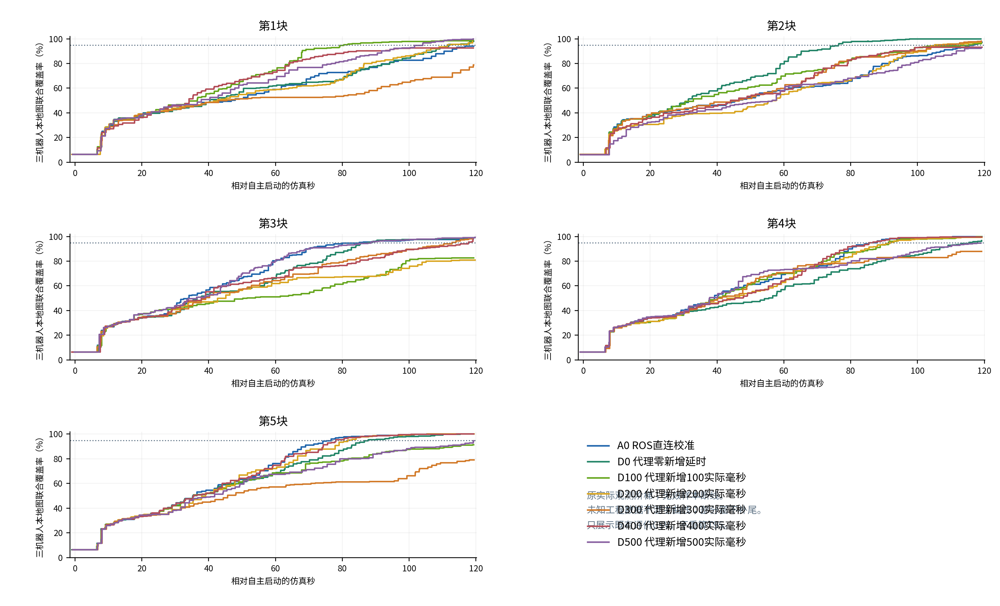

每块七条件原观测阶梯。未知工程数据不进入主曲线；合法部分窗只画其实际观察范围，不补尾、不重算T95。

## 5. 走廊 Corr6201 / 机器人实际收到的中央图 均值
原实际观察时刻，展示网格0.5仿真秒；仅五条都有质量有效观测处绘均值与样本SD。

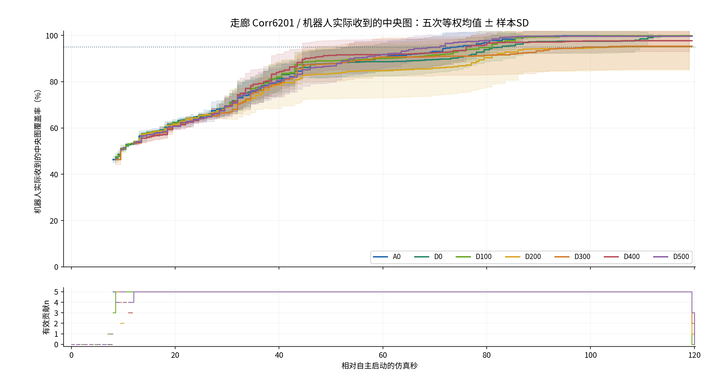

不跨质量无效点，不外推到120，不将地图header当接收时刻。局部、中央、机器人接收视图分别保留，中央是主任务指标。

## 5. 走廊 Corr6201 / 机器人实际收到的中央图 五块原曲线

每块七条件原观测阶梯。未知工程数据不进入主曲线；合法部分窗只画其实际观察范围，不补尾、不重算T95。

## 5. 房间 Rooms6101 / 机器人实际收到的中央图 均值
原实际观察时刻，展示网格0.5仿真秒；仅五条都有质量有效观测处绘均值与样本SD。

不跨质量无效点，不外推到120，不将地图header当接收时刻。局部、中央、机器人接收视图分别保留，中央是主任务指标。

## 5. 房间 Rooms6101 / 机器人实际收到的中央图 五块原曲线

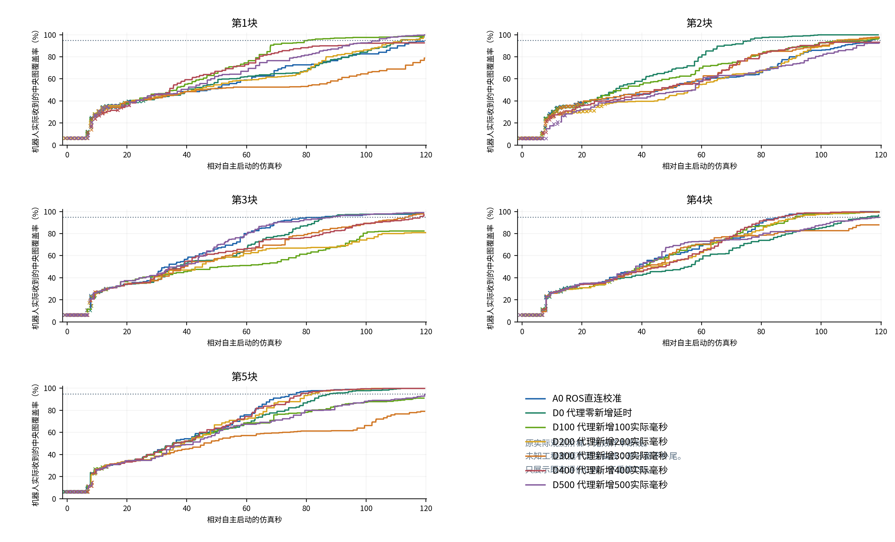

每块七条件原观测阶梯。未知工程数据不进入主曲线；合法部分窗只画其实际观察范围，不补尾、不重算T95。

## 三视图诊断：中央未达的实际回合
中央未达15次；其中local已达0次，三个视图T95均未达15次。原工具status/T95，不重算阈值。

|逻辑→实际回合|地图/条件|local原status / T95|central原status / T95|robot-received原status / T95|
|---|---|---|---|---|
|f006→f006|Corr6201/D200|未达（not_reached_within_budget）|未达（not_reached_within_budget）|未达（not_reached_within_budget）|
|f009→f009|Rooms6101/D400|未达（not_reached_within_budget）|未达（not_reached_within_budget）|未达（not_reached_within_budget）|
|f010→f010|Rooms6101/A0|未达（not_reached_within_budget）|未达（not_reached_within_budget）|未达（not_reached_within_budget）|
|f011→f011|Rooms6101/D300|未达（not_reached_within_budget）|未达（not_reached_within_budget）|未达（not_reached_within_budget）|
|f018→f018|Rooms6101/D400|未达（not_reached_within_budget）|未达（not_reached_within_budget）|未达（not_reached_within_budget）|
|f020→f020|Rooms6101/D500|未达（not_reached_within_budget）|未达（not_reached_within_budget）|未达（not_reached_within_budget）|
|f023→f023|Corr6201/D300|未达（not_reached_within_budget）|未达（not_reached_within_budget）|未达（not_reached_within_budget）|
|f034→f034|Corr6201/D400|未达（not_reached_within_budget）|未达（not_reached_within_budget）|未达（not_reached_within_budget）|

local已达但central未达的回合：无。三个视图都未达：f006、f009、f010、f011、f018、f020、f023、f034、f038、f040、f044、f045、f065、f066、f070。local达标不能证明中央已获得或使用同样信息；全视图未达也不能由此唯一归因于延时。

## 三视图诊断：中央未达的实际回合
中央未达15次；其中local已达0次，三个视图T95均未达15次。原工具status/T95，不重算阈值。

|逻辑→实际回合|地图/条件|local原status / T95|central原status / T95|robot-received原status / T95|
|---|---|---|---|---|
|f038→f038|Rooms6101/D100|未达（not_reached_within_budget）|未达（not_reached_within_budget）|未达（not_reached_within_budget）|
|f040→f040|Rooms6101/D200|未达（not_reached_within_budget）|未达（not_reached_within_budget）|未达（not_reached_within_budget）|
|f044→f044|Rooms6101/D500|未达（not_reached_within_budget）|未达（not_reached_within_budget）|未达（not_reached_within_budget）|
|f045→f045|Rooms6101/D300|未达（not_reached_within_budget）|未达（not_reached_within_budget）|未达（not_reached_within_budget）|
|f065→f065|Rooms6101/D100|未达（not_reached_within_budget）|未达（not_reached_within_budget）|未达（not_reached_within_budget）|
|f066→f066|Rooms6101/D300|未达（not_reached_within_budget）|未达（not_reached_within_budget）|未达（not_reached_within_budget）|
|f070→f070|Rooms6101/D500|未达（not_reached_within_budget）|未达（not_reached_within_budget）|未达（not_reached_within_budget）|

local已达但central未达的回合：无。三个视图都未达：f006、f009、f010、f011、f018、f020、f023、f034、f038、f040、f044、f045、f065、f066、f070。local达标不能证明中央已获得或使用同样信息；全视图未达也不能由此唯一归因于延时。

## 轨迹采样与节拍资格
原采样点，不补齐首端点、不按任务达标截断。

70次运行、210条机器人轨迹，每条1201个原点，共252210点；全部末样本为G140。204条首样本为G20；3条首样本为G20.01；3条首样本为G20.06。主图空心圆标实际首样本，不能统一叫G20精确位置。

名义10Hz；实际最大相邻时钟间隔为0.17sim秒，本批长间隔/倒退断边共0处。大于0.12sim的标志仅指Observer时钟取样不齐，不推断消息丢失或机器人停止。

路程复用原定义，对窗内全部相邻实际位置累计hypot，三机相加。它是采样折线估计，不是连续真实路程，也不是规划长度；没有坐标平移、插值、滤波或真值回灌策略。

原10个七条件RTF块全部通过，最大相对跨度为0.0867446%，小于预声明1%。原startup/barrier/停止/拷贝资格与任务是否达到T95分开。

## 6. 走廊 Corr6201 第1块路径 (1/2)
三台机器人Gazebo world原样采样轨迹；背景真值仅停后图示，不输入策略。

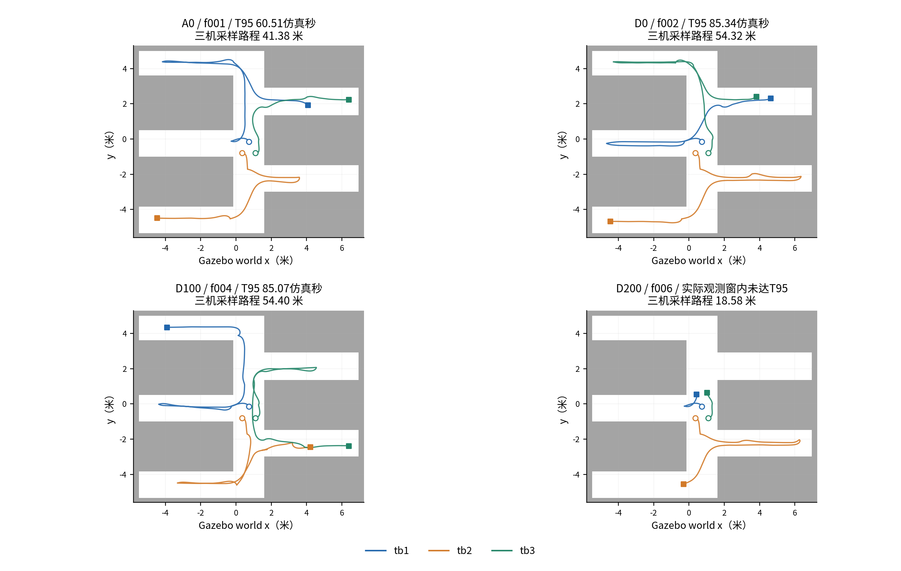

空心圆/方块为实际首/末采样位置，不插值端点、不平移拟合或平滑。10Hz名义采样与时钟量化；折线不是精确连续路程。时间倒退或≥0.20sim间隔断线，原间隔/长度保留数据中。

## 6. 走廊 Corr6201 第1块路径 (2/2)
三台机器人Gazebo world原样采样轨迹；背景真值仅停后图示，不输入策略。

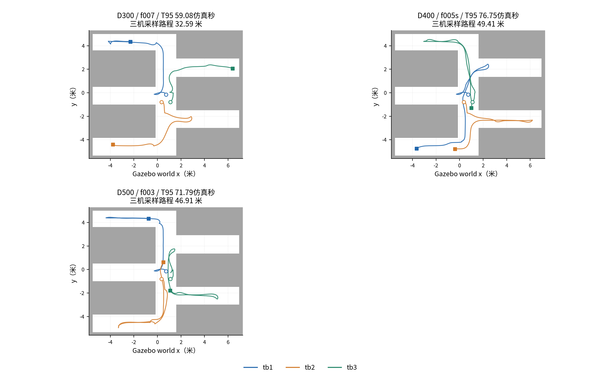

空心圆/方块为实际首/末采样位置，不插值端点、不平移拟合或平滑。10Hz名义采样与时钟量化；折线不是精确连续路程。时间倒退或≥0.20sim间隔断线，原间隔/长度保留数据中。

## 6. 走廊 Corr6201 第2块路径 (1/2)
三台机器人Gazebo world原样采样轨迹；背景真值仅停后图示，不输入策略。

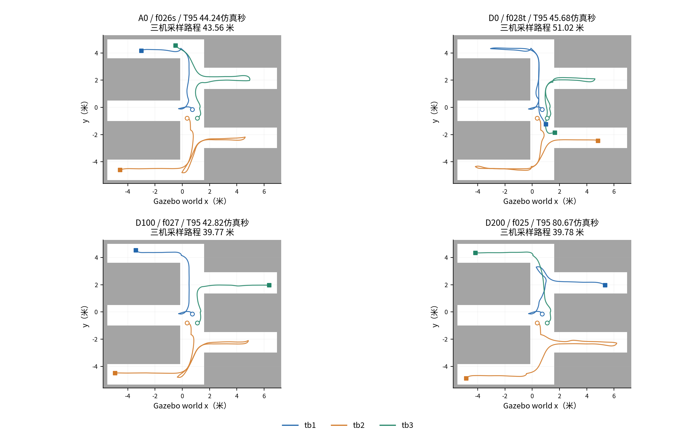

空心圆/方块为实际首/末采样位置，不插值端点、不平移拟合或平滑。10Hz名义采样与时钟量化；折线不是精确连续路程。时间倒退或≥0.20sim间隔断线，原间隔/长度保留数据中。

## 6. 走廊 Corr6201 第2块路径 (2/2)
三台机器人Gazebo world原样采样轨迹；背景真值仅停后图示，不输入策略。

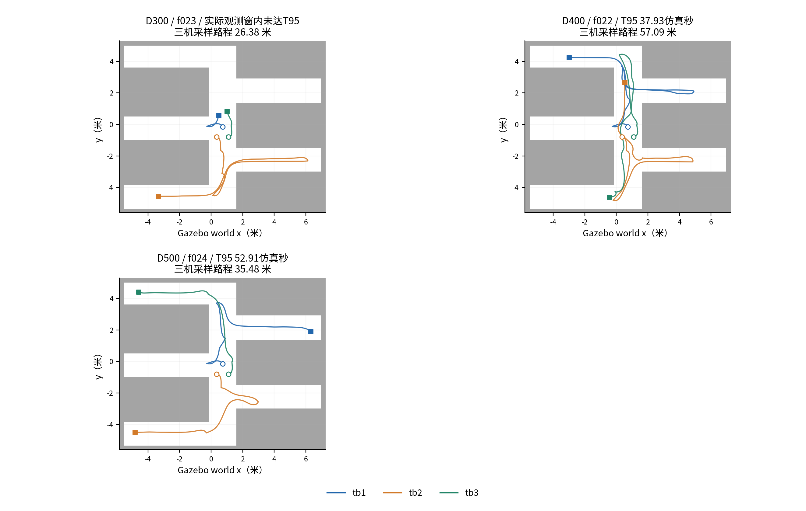

空心圆/方块为实际首/末采样位置，不插值端点、不平移拟合或平滑。10Hz名义采样与时钟量化；折线不是精确连续路程。时间倒退或≥0.20sim间隔断线，原间隔/长度保留数据中。

## 6. 走廊 Corr6201 第3块路径 (1/2)
三台机器人Gazebo world原样采样轨迹；背景真值仅停后图示，不输入策略。

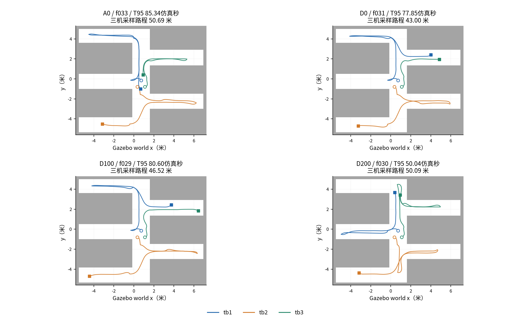

空心圆/方块为实际首/末采样位置，不插值端点、不平移拟合或平滑。10Hz名义采样与时钟量化；折线不是精确连续路程。时间倒退或≥0.20sim间隔断线，原间隔/长度保留数据中。

## 6. 走廊 Corr6201 第3块路径 (2/2)
三台机器人Gazebo world原样采样轨迹；背景真值仅停后图示，不输入策略。

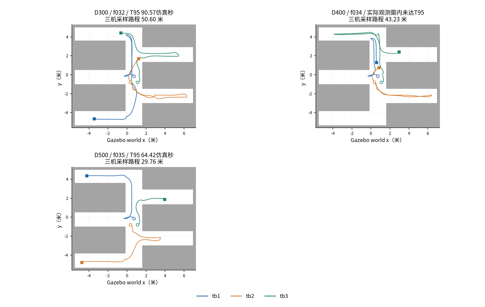

空心圆/方块为实际首/末采样位置，不插值端点、不平移拟合或平滑。10Hz名义采样与时钟量化；折线不是精确连续路程。时间倒退或≥0.20sim间隔断线，原间隔/长度保留数据中。

## 6. 走廊 Corr6201 第4块路径 (1/2)
三台机器人Gazebo world原样采样轨迹；背景真值仅停后图示，不输入策略。

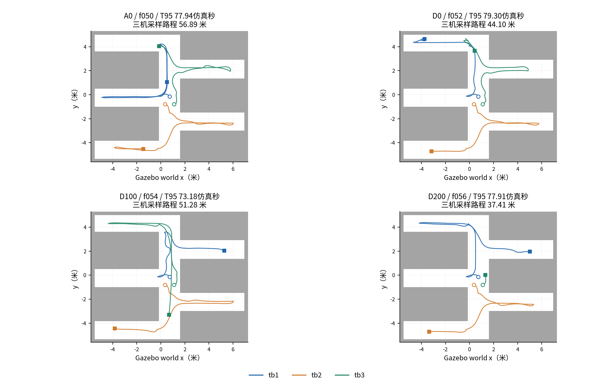

空心圆/方块为实际首/末采样位置，不插值端点、不平移拟合或平滑。10Hz名义采样与时钟量化；折线不是精确连续路程。时间倒退或≥0.20sim间隔断线，原间隔/长度保留数据中。

## 6. 走廊 Corr6201 第4块路径 (2/2)
三台机器人Gazebo world原样采样轨迹；背景真值仅停后图示，不输入策略。

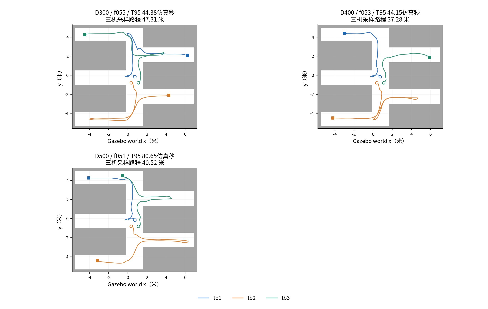

空心圆/方块为实际首/末采样位置，不插值端点、不平移拟合或平滑。10Hz名义采样与时钟量化；折线不是精确连续路程。时间倒退或≥0.20sim间隔断线，原间隔/长度保留数据中。

## 6. 走廊 Corr6201 第5块路径 (1/2)
三台机器人Gazebo world原样采样轨迹；背景真值仅停后图示，不输入策略。

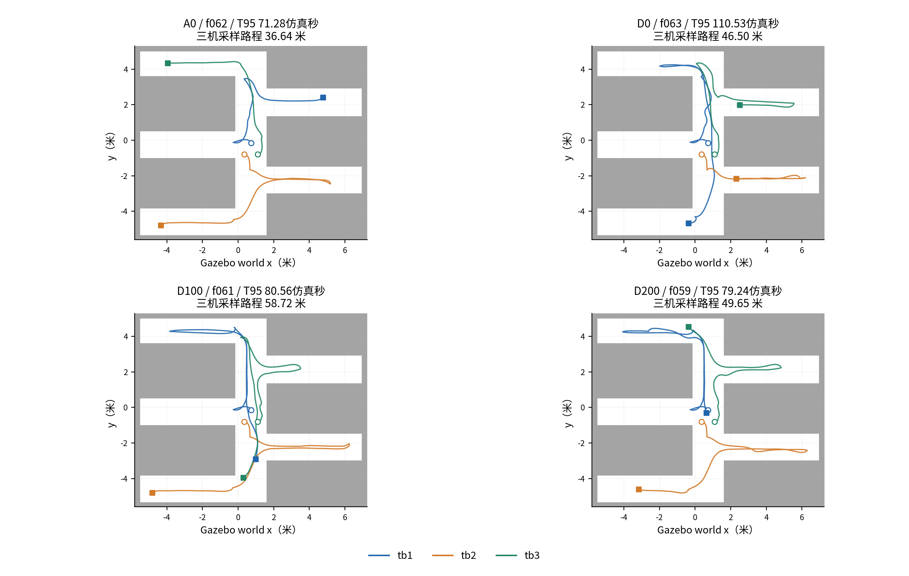

空心圆/方块为实际首/末采样位置，不插值端点、不平移拟合或平滑。10Hz名义采样与时钟量化；折线不是精确连续路程。时间倒退或≥0.20sim间隔断线，原间隔/长度保留数据中。

## 6. 走廊 Corr6201 第5块路径 (2/2)
三台机器人Gazebo world原样采样轨迹；背景真值仅停后图示，不输入策略。

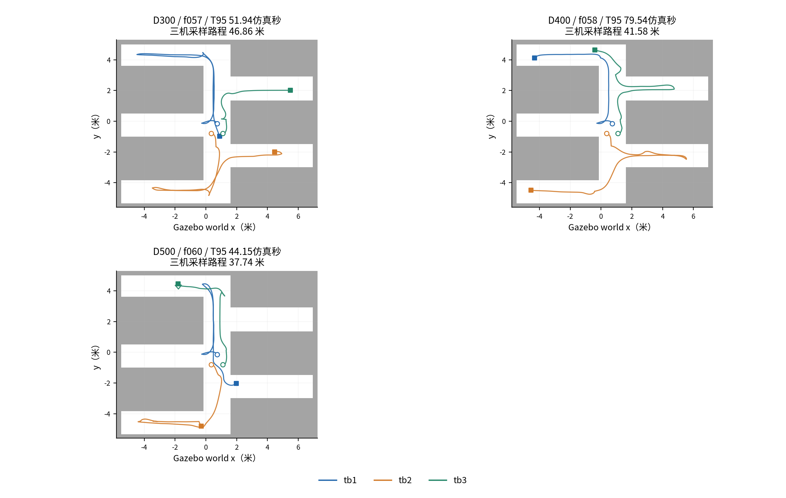

空心圆/方块为实际首/末采样位置，不插值端点、不平移拟合或平滑。10Hz名义采样与时钟量化；折线不是精确连续路程。时间倒退或≥0.20sim间隔断线，原间隔/长度保留数据中。

## 6. 房间 Rooms6101 第1块路径 (1/2)
三台机器人Gazebo world原样采样轨迹；背景真值仅停后图示，不输入策略。

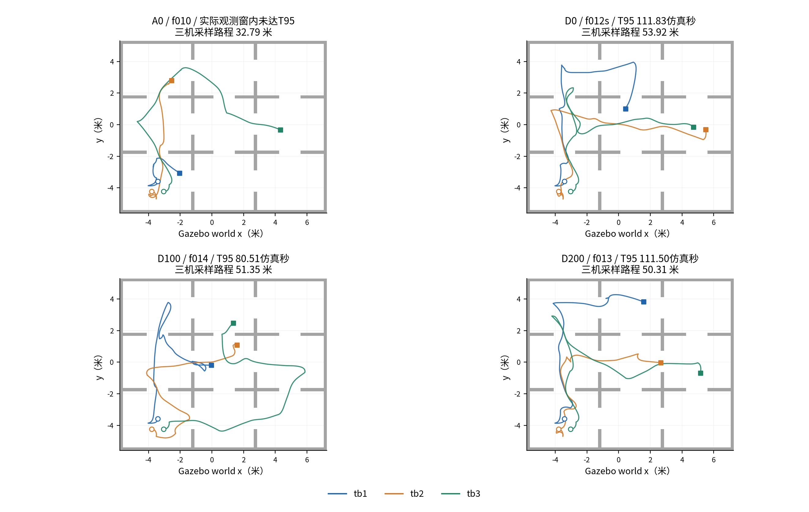

空心圆/方块为实际首/末采样位置，不插值端点、不平移拟合或平滑。10Hz名义采样与时钟量化；折线不是精确连续路程。时间倒退或≥0.20sim间隔断线，原间隔/长度保留数据中。

## 6. 房间 Rooms6101 第1块路径 (2/2)
三台机器人Gazebo world原样采样轨迹；背景真值仅停后图示，不输入策略。

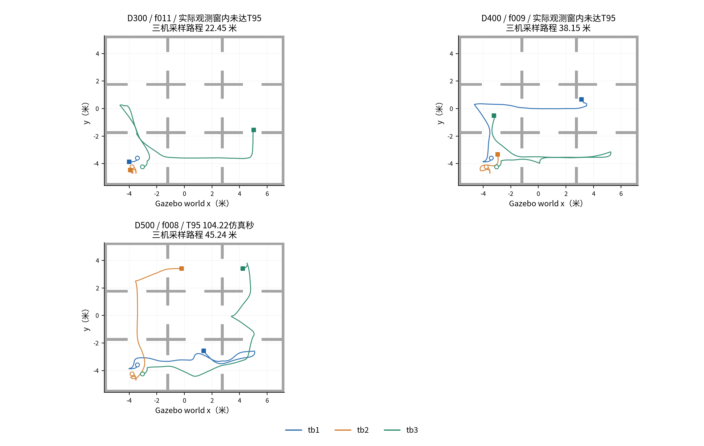

空心圆/方块为实际首/末采样位置，不插值端点、不平移拟合或平滑。10Hz名义采样与时钟量化；折线不是精确连续路程。时间倒退或≥0.20sim间隔断线，原间隔/长度保留数据中。

## 6. 房间 Rooms6101 第2块路径 (1/2)
三台机器人Gazebo world原样采样轨迹；背景真值仅停后图示，不输入策略。

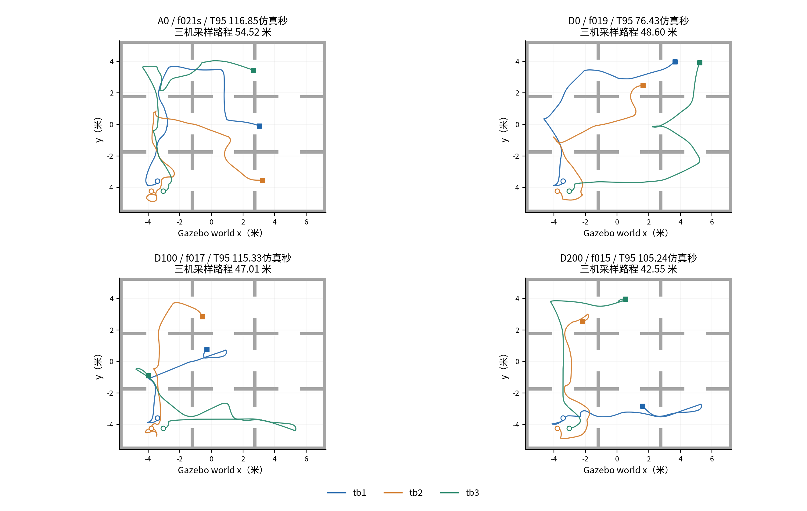

空心圆/方块为实际首/末采样位置，不插值端点、不平移拟合或平滑。10Hz名义采样与时钟量化；折线不是精确连续路程。时间倒退或≥0.20sim间隔断线，原间隔/长度保留数据中。

## 6. 房间 Rooms6101 第2块路径 (2/2)
三台机器人Gazebo world原样采样轨迹；背景真值仅停后图示，不输入策略。

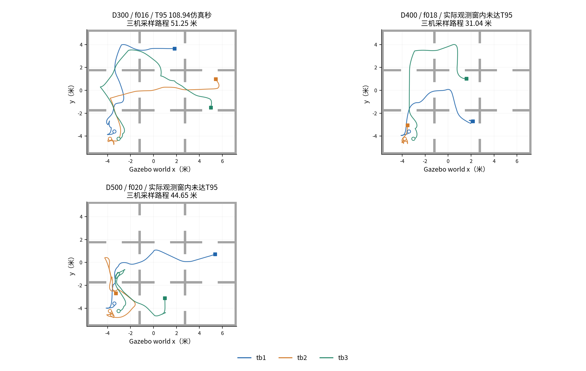

空心圆/方块为实际首/末采样位置，不插值端点、不平移拟合或平滑。10Hz名义采样与时钟量化；折线不是精确连续路程。时间倒退或≥0.20sim间隔断线，原间隔/长度保留数据中。

## 6. 房间 Rooms6101 第3块路径 (1/2)
三台机器人Gazebo world原样采样轨迹；背景真值仅停后图示，不输入策略。

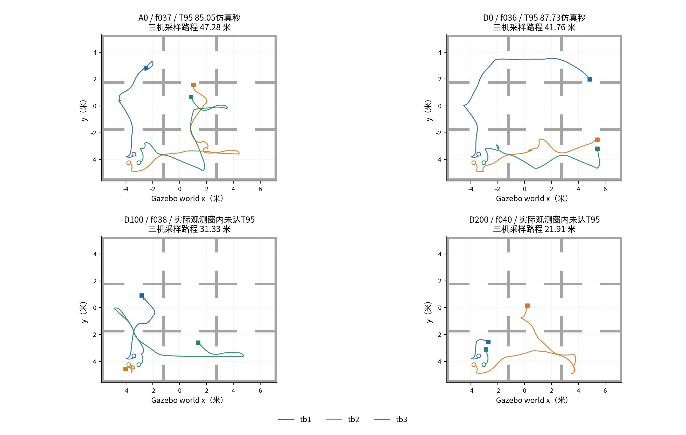

空心圆/方块为实际首/末采样位置，不插值端点、不平移拟合或平滑。10Hz名义采样与时钟量化；折线不是精确连续路程。时间倒退或≥0.20sim间隔断线，原间隔/长度保留数据中。

## 6. 房间 Rooms6101 第3块路径 (2/2)
三台机器人Gazebo world原样采样轨迹；背景真值仅停后图示，不输入策略。

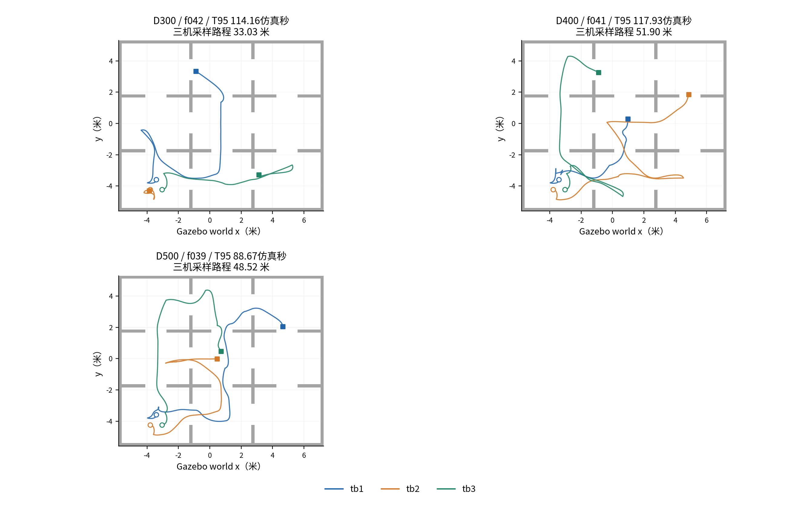

空心圆/方块为实际首/末采样位置，不插值端点、不平移拟合或平滑。10Hz名义采样与时钟量化；折线不是精确连续路程。时间倒退或≥0.20sim间隔断线，原间隔/长度保留数据中。

## 6. 房间 Rooms6101 第4块路径 (1/2)
三台机器人Gazebo world原样采样轨迹；背景真值仅停后图示，不输入策略。

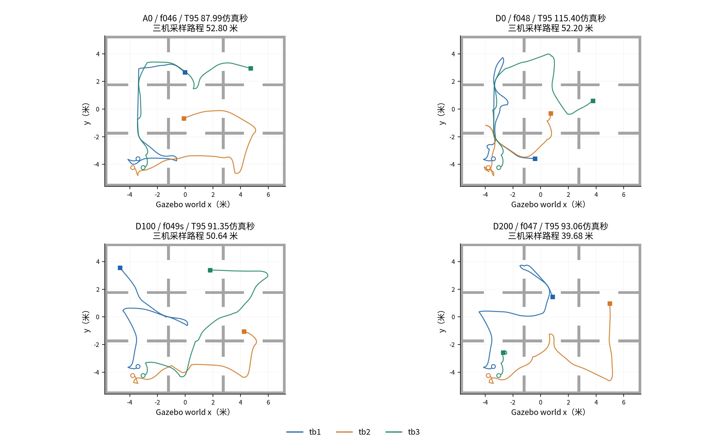

空心圆/方块为实际首/末采样位置，不插值端点、不平移拟合或平滑。10Hz名义采样与时钟量化；折线不是精确连续路程。时间倒退或≥0.20sim间隔断线，原间隔/长度保留数据中。

## 6. 房间 Rooms6101 第4块路径 (2/2)
三台机器人Gazebo world原样采样轨迹；背景真值仅停后图示，不输入策略。

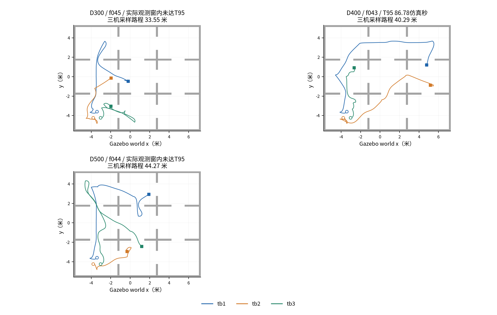

空心圆/方块为实际首/末采样位置，不插值端点、不平移拟合或平滑。10Hz名义采样与时钟量化；折线不是精确连续路程。时间倒退或≥0.20sim间隔断线，原间隔/长度保留数据中。

## 6. 房间 Rooms6101 第5块路径 (1/2)
三台机器人Gazebo world原样采样轨迹；背景真值仅停后图示，不输入策略。

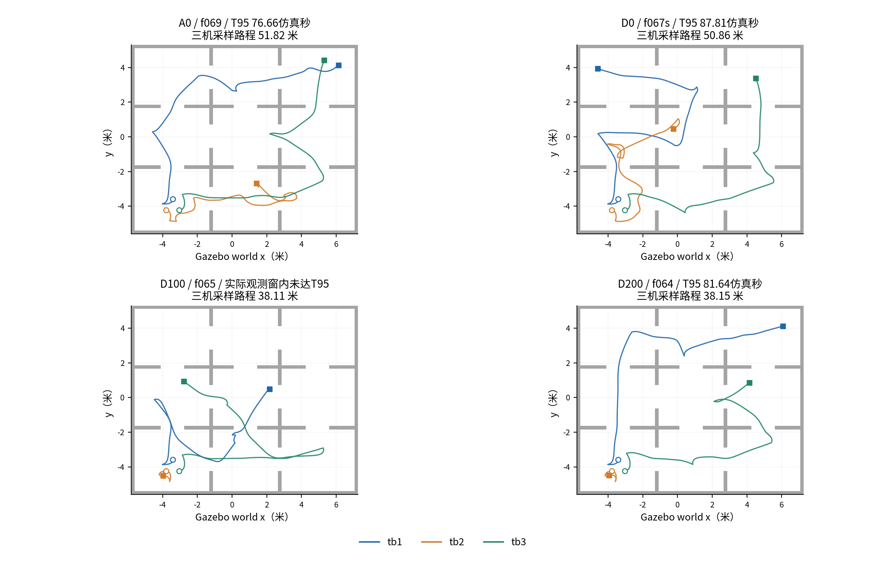

空心圆/方块为实际首/末采样位置，不插值端点、不平移拟合或平滑。10Hz名义采样与时钟量化；折线不是精确连续路程。时间倒退或≥0.20sim间隔断线，原间隔/长度保留数据中。

## 6. 房间 Rooms6101 第5块路径 (2/2)
三台机器人Gazebo world原样采样轨迹；背景真值仅停后图示，不输入策略。

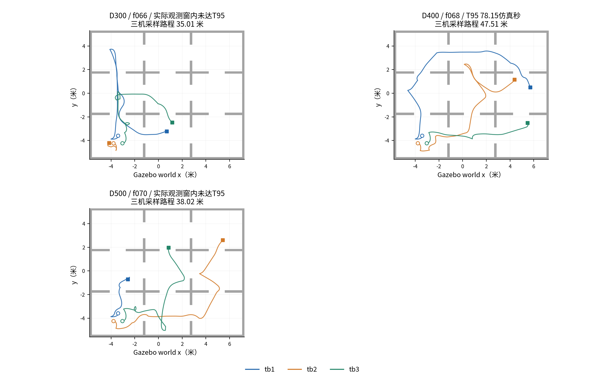

空心圆/方块为实际首/末采样位置，不插值端点、不平移拟合或平滑。10Hz名义采样与时钟量化；折线不是精确连续路程。时间倒退或≥0.20sim间隔断线，原间隔/长度保留数据中。

## 7. 走廊 Corr6201 三机总路程统计
沿全部原观测相邻位置sum hypot；三机相加，每组五个合格120窗等权。

|条件|三机总路程均值±样本SD（米）|达到T95 / 实测未达 / 未知|
|---|---|---|
|A0|45.83 ± 7.99|5 / 0 / 0|
|D0|47.79 ± 4.78|5 / 0 / 0|
|D100|50.14 ± 7.31|5 / 0 / 0|
|D200|39.10 ± 12.81|4 / 1 / 0|
|D300|40.75 ± 10.61|4 / 1 / 0|
|D400|45.72 ± 7.71|4 / 1 / 0|
|D500|38.08 ± 6.33|5 / 0 / 0|

## 7. 走廊 Corr6201 第1块逐次结果
保留logical→实际回合映射；全实际窗口，不按T95截断轨迹。

|条件|逻辑→实际回合|任务状态 / T95仿真秒|实际窗 仿真秒|tb1米|tb2米|tb3米|总米|
|---|---|---|---|---|---|---|---|
|A0|f001→f001|T95 60.51仿真秒|120.00|19.71|13.53|8.14|41.38|
|D0|f002→f002|T95 85.34仿真秒|120.00|16.09|19.02|19.22|54.32|
|D100|f004→f004|T95 85.07仿真秒|120.00|18.57|16.99|18.84|54.40|
|D200|f006→f006|实际观测窗内未达T95|120.00|2.27|14.68|1.63|18.58|
|D300|f007→f007|T95 59.08仿真秒|120.00|12.58|11.61|8.41|32.59|
|D400|f005→f005s|T95 76.75仿真秒|120.00|16.90|15.04|17.47|49.41|
|D500|f003→f003|T95 71.79仿真秒|120.00|14.24|16.70|15.97|46.91|

逐机器人采样数、首末时刻、最大间隔、断线与长间隔边长度见data/path_lengths.csv；总路程为采样估计，不能把采样稀疏差异当作精确行驶差异。

## 7. 走廊 Corr6201 第2块逐次结果
保留logical→实际回合映射；全实际窗口，不按T95截断轨迹。

|条件|逻辑→实际回合|任务状态 / T95仿真秒|实际窗 仿真秒|tb1米|tb2米|tb3米|总米|
|---|---|---|---|---|---|---|---|
|A0|f026→f026s|T95 44.24仿真秒|120.00|9.33|20.89|13.34|43.56|
|D0|f028→f028t|T95 45.68仿真秒|120.00|18.22|18.54|14.26|51.02|
|D100|f027→f027|T95 42.82仿真秒|120.00|9.64|22.20|7.93|39.77|
|D200|f025→f025|T95 80.67仿真秒|120.00|10.92|19.09|9.77|39.78|
|D300|f023→f023|实际观测窗内未达T95|120.00|2.29|22.26|1.83|26.38|
|D400|f022→f022|T95 37.93仿真秒|120.00|20.70|20.26|16.13|57.09|
|D500|f024→f024|T95 52.91仿真秒|120.00|12.56|12.70|10.22|35.48|

逐机器人采样数、首末时刻、最大间隔、断线与长间隔边长度见data/path_lengths.csv；总路程为采样估计，不能把采样稀疏差异当作精确行驶差异。

## 7. 走廊 Corr6201 第3块逐次结果
保留logical→实际回合映射；全实际窗口，不按T95截断轨迹。

|条件|逻辑→实际回合|任务状态 / T95仿真秒|实际窗 仿真秒|tb1米|tb2米|tb3米|总米|
|---|---|---|---|---|---|---|---|
|A0|f033→f033|T95 85.34仿真秒|120.00|20.76|17.35|12.59|50.69|
|D0|f031→f031|T95 77.85仿真秒|120.00|19.45|17.06|6.49|43.00|
|D100|f029→f029|T95 80.60仿真秒|120.00|19.44|18.95|8.12|46.52|
|D200|f030→f030|T95 50.04仿真秒|120.00|14.96|18.52|16.62|50.09|
|D300|f032→f032|T95 90.57仿真秒|120.00|19.38|16.60|14.62|50.60|
|D400|f034→f034|实际观测窗内未达T95|120.00|9.34|15.44|18.45|43.23|
|D500|f035→f035|T95 64.42仿真秒|120.00|10.51|13.62|5.62|29.76|

逐机器人采样数、首末时刻、最大间隔、断线与长间隔边长度见data/path_lengths.csv；总路程为采样估计，不能把采样稀疏差异当作精确行驶差异。

## 7. 走廊 Corr6201 第4块逐次结果
保留logical→实际回合映射；全实际窗口，不按T95截断轨迹。

|条件|逻辑→实际回合|任务状态 / T95仿真秒|实际窗 仿真秒|tb1米|tb2米|tb3米|总米|
|---|---|---|---|---|---|---|---|
|A0|f050→f050|T95 77.94仿真秒|120.00|22.15|20.05|14.69|56.89|
|D0|f052→f052|T95 79.30仿真秒|120.00|12.53|16.36|15.21|44.10|
|D100|f054→f054|T95 73.18仿真秒|120.00|11.26|17.57|22.45|51.28|
|D200|f056→f056|T95 77.91仿真秒|120.00|20.68|15.77|0.96|37.41|
|D300|f055→f055|T95 44.38仿真秒|120.00|13.91|17.76|15.63|47.31|
|D400|f053→f053|T95 44.15仿真秒|120.00|9.26|20.39|7.62|37.28|
|D500|f051→f051|T95 80.65仿真秒|120.00|10.41|17.55|12.57|40.52|

逐机器人采样数、首末时刻、最大间隔、断线与长间隔边长度见data/path_lengths.csv；总路程为采样估计，不能把采样稀疏差异当作精确行驶差异。

## 7. 走廊 Corr6201 第5块逐次结果
保留logical→实际回合映射；全实际窗口，不按T95截断轨迹。

|条件|逻辑→实际回合|任务状态 / T95仿真秒|实际窗 仿真秒|tb1米|tb2米|tb3米|总米|
|---|---|---|---|---|---|---|---|
|A0|f062→f062|T95 71.28仿真秒|120.00|10.41|16.59|9.64|36.64|
|D0|f063→f063|T95 110.53仿真秒|120.00|20.16|10.77|15.57|46.50|
|D100|f061→f061|T95 80.56仿真秒|120.00|21.59|19.19|17.94|58.72|
|D200|f059→f059|T95 79.24仿真秒|120.00|19.17|17.59|12.88|49.65|
|D300|f057→f057|T95 51.94仿真秒|120.00|20.86|18.46|7.54|46.86|
|D400|f058→f058|T95 79.54仿真秒|120.00|10.53|17.59|13.46|41.58|
|D500|f060→f060|T95 44.15仿真秒|120.00|14.23|13.89|9.61|37.74|

逐机器人采样数、首末时刻、最大间隔、断线与长间隔边长度见data/path_lengths.csv；总路程为采样估计，不能把采样稀疏差异当作精确行驶差异。

## 7. 房间 Rooms6101 三机总路程统计
沿全部原观测相邻位置sum hypot；三机相加，每组五个合格120窗等权。

|条件|三机总路程均值±样本SD（米）|达到T95 / 实测未达 / 未知|
|---|---|---|
|A0|47.84 ± 8.83|4 / 1 / 0|
|D0|49.47 ± 4.73|5 / 0 / 0|
|D100|43.69 ± 8.69|3 / 2 / 0|
|D200|38.52 ± 10.40|4 / 1 / 0|
|D300|35.06 ± 10.34|2 / 3 / 0|
|D400|41.78 ± 8.15|3 / 2 / 0|
|D500|44.14 ± 3.81|2 / 3 / 0|

## 7. 房间 Rooms6101 第1块逐次结果
保留logical→实际回合映射；全实际窗口，不按T95截断轨迹。

|条件|逻辑→实际回合|任务状态 / T95仿真秒|实际窗 仿真秒|tb1米|tb2米|tb3米|总米|
|---|---|---|---|---|---|---|---|
|A0|f010→f010|实际观测窗内未达T95|120.00|5.11|9.88|17.80|32.79|
|D0|f012→f012s|T95 111.83仿真秒|120.00|17.22|18.20|18.50|53.92|
|D100|f014→f014|T95 80.51仿真秒|120.00|17.91|14.20|19.24|51.35|
|D200|f013→f013|T95 111.50仿真秒|120.00|16.12|14.21|19.98|50.31|
|D300|f011→f011|实际观测窗内未达T95|120.00|0.78|1.96|19.72|22.45|
|D400|f009→f009|实际观测窗内未达T95|120.00|14.32|3.81|20.02|38.15|
|D500|f008→f008|T95 104.22仿真秒|120.00|15.38|12.55|17.31|45.24|

逐机器人采样数、首末时刻、最大间隔、断线与长间隔边长度见data/path_lengths.csv；总路程为采样估计，不能把采样稀疏差异当作精确行驶差异。

## 7. 房间 Rooms6101 第2块逐次结果
保留logical→实际回合映射；全实际窗口，不按T95截断轨迹。

|条件|逻辑→实际回合|任务状态 / T95仿真秒|实际窗 仿真秒|tb1米|tb2米|tb3米|总米|
|---|---|---|---|---|---|---|---|
|A0|f021→f021s|T95 116.85仿真秒|120.00|18.16|18.31|18.06|54.52|
|D0|f019→f019|T95 76.43仿真秒|120.00|15.60|14.48|18.53|48.60|
|D100|f017→f017|T95 115.33仿真秒|120.00|11.57|13.21|22.23|47.01|
|D200|f015→f015|T95 105.24仿真秒|120.00|15.40|12.52|14.63|42.55|
|D300|f016→f016|T95 108.94仿真秒|120.00|15.26|16.79|19.19|51.25|
|D400|f018→f018|实际观测窗内未达T95|120.00|12.03|3.65|15.36|31.04|
|D500|f020→f020|实际观测窗内未达T95|120.00|14.50|15.37|14.78|44.65|

逐机器人采样数、首末时刻、最大间隔、断线与长间隔边长度见data/path_lengths.csv；总路程为采样估计，不能把采样稀疏差异当作精确行驶差异。

## 7. 房间 Rooms6101 第3块逐次结果
保留logical→实际回合映射；全实际窗口，不按T95截断轨迹。

|条件|逻辑→实际回合|任务状态 / T95仿真秒|实际窗 仿真秒|tb1米|tb2米|tb3米|总米|
|---|---|---|---|---|---|---|---|
|A0|f037→f037|T95 85.05仿真秒|120.00|10.56|19.09|17.63|47.28|
|D0|f036→f036|T95 87.73仿真秒|120.00|16.78|12.19|12.79|41.76|
|D100|f038→f038|实际观测窗内未达T95|120.00|7.48|3.52|20.34|31.33|
|D200|f040→f040|实际观测窗内未达T95|120.00|3.07|17.44|1.40|21.91|
|D300|f042→f042|T95 114.16仿真秒|120.00|18.46|2.19|12.38|33.03|
|D400|f041→f041|T95 117.93仿真秒|120.00|10.15|22.25|19.50|51.90|
|D500|f039→f039|T95 88.67仿真秒|120.00|17.35|15.29|15.88|48.52|

逐机器人采样数、首末时刻、最大间隔、断线与长间隔边长度见data/path_lengths.csv；总路程为采样估计，不能把采样稀疏差异当作精确行驶差异。

## 7. 房间 Rooms6101 第4块逐次结果
保留logical→实际回合映射；全实际窗口，不按T95截断轨迹。

|条件|逻辑→实际回合|任务状态 / T95仿真秒|实际窗 仿真秒|tb1米|tb2米|tb3米|总米|
|---|---|---|---|---|---|---|---|
|A0|f046→f046|T95 87.99仿真秒|120.00|16.60|18.44|17.76|52.80|
|D0|f048→f048|T95 115.40仿真秒|120.00|19.22|14.65|18.33|52.20|
|D100|f049→f049s|T95 91.35仿真秒|120.00|17.84|14.25|18.56|50.64|
|D200|f047→f047|T95 93.06仿真秒|120.00|18.08|18.96|2.63|39.68|
|D300|f045→f045|实际观测窗内未达T95|120.00|15.49|7.68|10.39|33.55|
|D400|f043→f043|T95 86.78仿真秒|120.00|19.50|14.15|6.64|40.29|
|D500|f044→f044|实际观测窗内未达T95|120.00|18.38|6.46|19.43|44.27|

逐机器人采样数、首末时刻、最大间隔、断线与长间隔边长度见data/path_lengths.csv；总路程为采样估计，不能把采样稀疏差异当作精确行驶差异。

## 7. 房间 Rooms6101 第5块逐次结果
保留logical→实际回合映射；全实际窗口，不按T95截断轨迹。

|条件|逻辑→实际回合|任务状态 / T95仿真秒|实际窗 仿真秒|tb1米|tb2米|tb3米|总米|
|---|---|---|---|---|---|---|---|
|A0|f069→f069|T95 76.66仿真秒|120.00|18.61|13.37|19.83|51.82|
|D0|f067→f067s|T95 87.81仿真秒|120.00|19.64|14.45|16.77|50.86|
|D100|f065→f065|实际观测窗内未达T95|120.00|16.15|2.31|19.65|38.11|
|D200|f064→f064|T95 81.64仿真秒|120.00|18.51|2.65|16.98|38.15|
|D300|f066→f066|实际观测窗内未达T95|120.00|19.56|2.36|13.09|35.01|
|D400|f068→f068|T95 78.15仿真秒|120.00|18.86|18.48|10.18|47.51|
|D500|f070→f070|实际观测窗内未达T95|120.00|5.57|17.19|15.26|38.02|

逐机器人采样数、首末时刻、最大间隔、断线与长间隔边长度见data/path_lengths.csv；总路程为采样估计，不能把采样稀疏差异当作精确行驶差异。

## 8. 原零自主启动失败另列
保留原FAIL、无测量窗与明确named successor；不从条件分母中隐去启动可靠性。

|原实际回合|逻辑槽|地图/条件|原分类|原首因|
|---|---|---|---|---|
|f005|f005|Corr6201/D400|启动工程失败（原FAIL）|tb3的本地 /spawn_entity 服务响应发送超时；原日志明确客户端不会收到响应。spawn进程持续等待到清理时SIGINT退出，三机成功回执未齐，工厂fence未放行。未进入RUN或自主任务；不经过研究延时FIFO，底层RMW超时原因未确定。|
|f012|f012|Rooms6101/D0|启动工程失败（原FAIL）|tb3的本地 /spawn_entity 服务响应发送超时；原日志明确客户端不会收到响应。spawn进程持续等待到清理时SIGINT退出，三机成功回执未齐，工厂fence未放行。未进入RUN或自主任务；不经过研究延时FIFO，底层RMW超时原因未确定。|
|f021|f021|Rooms6101/A0|启动工程失败（原FAIL）|tb3的本地 /spawn_entity 服务响应发送超时；原日志明确客户端不会收到响应。spawn进程持续等待到清理时SIGINT退出，三机成功回执未齐，工厂fence未放行。未进入RUN或自主任务；不经过研究延时FIFO，底层RMW超时原因未确定。|

本表为逐案已审首因的中文说明；原日志、英文元数据、PID与时间以及原停止/PAUSE失败均保留于data中的启动失败register和PLAN来源。进程退出与复制完成不把原stop资格改成通过。

## 8. 原零自主启动失败另列
保留原FAIL、无测量窗与明确named successor；不从条件分母中隐去启动可靠性。

|原实际回合|逻辑槽|地图/条件|原分类|原首因|
|---|---|---|---|---|
|f026|f026|Corr6201/A0|启动工程失败（原FAIL）|tb2的本地 /spawn_entity 服务响应发送超时；原日志明确客户端不会收到响应。spawn进程持续等待到清理时SIGINT退出，三机成功回执未齐，工厂fence未放行。未进入RUN或自主任务；不经过研究延时FIFO，底层RMW超时原因未确定。|
|f028|f028|Corr6201/D0|启动工程失败（原FAIL）|三台spawn进程均成功退出0，但随后原gz model entity_info(tb3)查询始终没有输出；原启动预算耗尽。清理时SIGINT后仍未退出，再由原Launch升级SIGTERM。没有进入RUN或自主任务；查询内部阻塞环节未确定。|
|f028s|f028|Corr6201/D0|启动工程失败（原FAIL）|tb3的本地 /spawn_entity 服务响应发送超时；原日志明确客户端不会收到响应。spawn进程持续等待到清理时SIGINT退出，三机成功回执未齐，工厂fence未放行。未进入RUN或自主任务；不经过研究延时FIFO，底层RMW超时原因未确定。|

本表为逐案已审首因的中文说明；原日志、英文元数据、PID与时间以及原停止/PAUSE失败均保留于data中的启动失败register和PLAN来源。进程退出与复制完成不把原stop资格改成通过。

## 8. 原零自主启动失败另列
保留原FAIL、无测量窗与明确named successor；不从条件分母中隐去启动可靠性。

|原实际回合|逻辑槽|地图/条件|原分类|原首因|
|---|---|---|---|---|
|f049|f049|Rooms6101/D100|启动工程失败（原FAIL）|tb2的本地 /spawn_entity 服务响应发送超时；原日志明确客户端不会收到响应。spawn进程持续等待到清理时SIGINT退出，三机成功回执未齐，工厂fence未放行。未进入RUN或自主任务；不经过研究延时FIFO，底层RMW超时原因未确定。|
|f067|f067|Rooms6101/D0|启动工程失败（原FAIL）|tb2的本地 /spawn_entity 服务响应发送超时；原日志明确客户端不会收到响应。spawn进程持续等待到清理时SIGINT退出，三机成功回执未齐，工厂fence未放行。未进入RUN或自主任务；不经过研究延时FIFO，底层RMW超时原因未确定。|

本表为逐案已审首因的中文说明；原日志、英文元数据、PID与时间以及原停止/PAUSE失败均保留于data中的启动失败register和PLAN来源。进程退出与复制完成不把原stop资格改成通过。

## 9. 解释边界与数据来源

纯延时结论仅在D0..D500同代理路径内比较。A0是字面直连校准，A0→D0同时改变代理路径，不能当纯延时效应。wall毫秒、仿真秒T95及固定物理节拍各有独立观测，不按0.25RTF作数据换算。

采用本批V3的有限新鲜度合同；不能与旧V1功能诊断、旧V2阈值批次或旧40次Wi-Fi结果合并。AM3为事后离线关联修订，原错误结果仍有来源可查；真实运行源没有因此改变。

一个差例不能唯一归因于延时。f006完整有效但未达，tb1反复全局规划失败、tb3局部轨迹碰撞预测失败并恢复失败；现有合成costmap日志不能区分静态/SLAM/peer来源。该样本不筛除，也不以此调参。

真值背景与路径仅停后评价。三视图覆盖直接引用原T95工具CSV及质量标志；没有重播模型、重算覆盖、坐标拟合、源时间推断或向策略补理想输入。

### 可追溯数据

- [70槽紧凑原始事实与row来源](data/compact_rows.json)
- [等权展示统计](data/compact_summary.json)
- [三视图原status与T95](data/three_view_T95.csv)
- [三视图原观察及质量](data/coverage_samples.json)
- [实际三机轨迹](data/trajectories.json)
- [路程/采样/间隔](data/path_lengths.csv)
