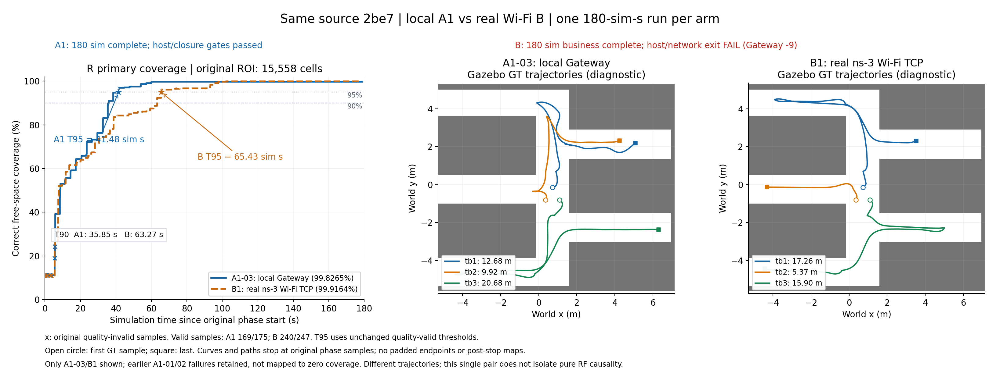
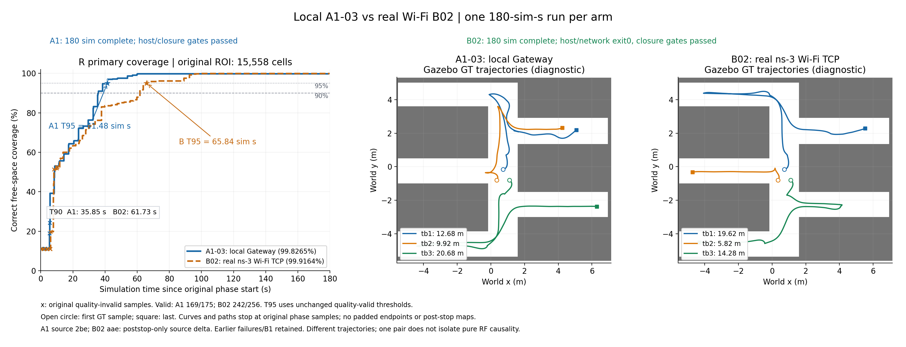
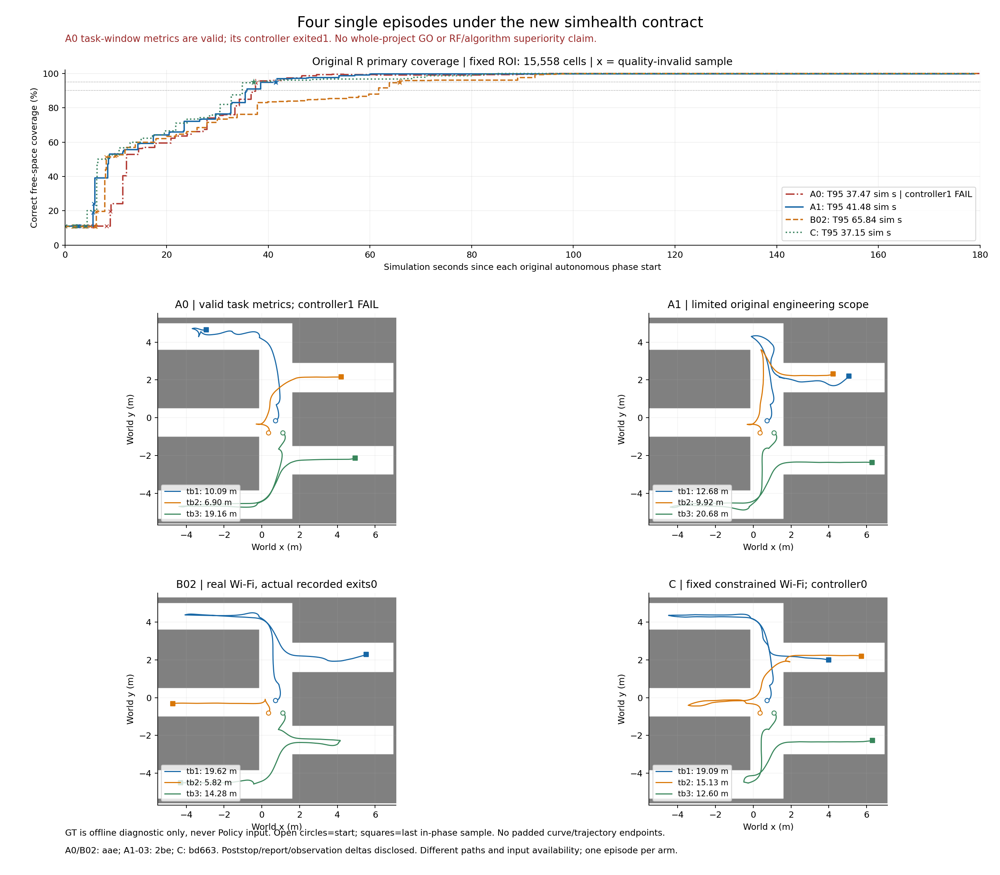

# NET-01D followup04 阶段报告

**当前结论：NET-01D 仍为 NO-GO，不进入 NET-02 或实机部署。** 新计时合同下，A0、A1-03、B02都有完整180sim任务窗口及原R指标，但A0实际控制器退出1，过程完整性失败；C也完成180sim且实际controller0；Gateway首阶段成本已一次导出，native条件cohort服务时间也已一次导出，但A0过程失败及整体NO-GO不变。高覆盖、原host0或停止成功不能覆盖过程失败。

## 四组当前实际结果

下表T95沿原R主指标、固定ROI15558格/质量gate/原自主阶段计算，单位为相对自主起点的sim秒。它是任务窗口指标，不是自然任务完成时间，也不自动构成整回合验收。

| 组/实际case | 自主窗口 | 原R末覆盖 / 质量T95 | 实际策略与Goal | 过程完整性与当前状态 |
| --- | --- | --- | --- | --- |
| A0 直接DDS `gz-simhealth-a0-01` | 180sim / 284.228446wall；RTF .633293 | 99.884304% / **37.47** | NN35；14accepted；13成功6/3/4，tb1另有最终status5（取消具体时序未捕获） | **PROCESS FAIL / NOT ACCEPTED**：controller1；原host0/runner0/networktrue原样保留，不能作全进程成功 |
| A1 本地Gateway `gz-simhealth-a1-03` | 180sim / 291.382910wall；RTF .617744 | 99.826456% / **41.48** | NN36；10成功3/3/4 | 已有有限A1接受；真实停止/PAUSE/ownership及原退出门成立，非部署GO |
| B 原定Wi-Fi `gz-simhealth-b1-02` | 180sim / 425.149891wall；RTF .423380 | 99.916442% / **65.84** | NN36；11成功5/2/4 | host/Gateway/Hub/native/时间侧车exit0，原run/network门成立；poststop单次真实回归有限通过 |
| C 原定受限Wi-Fi `gz-simhealth-c1-01` | 180sim / 380.834359wall；RTF .472646 | 99.890732% / **37.15**（T90=34.90） | NN36；11成功4/4/3 | 实际controller/host/Gateway/Hub/native/时间侧车0，停止/PAUSE/ownership及run/network门成立；有限C结果，不洗A0过程FAIL |

A0指标与过程失败分别见 [A0结果](analysis/gz-simhealth-a0-01/RESULT.md)、[R小指标](analysis/gz-simhealth-a0-01/metrics.small-result.json)、[独审](analysis/gz-simhealth-a0-01/INDEPENDENT_REVIEW.md)。A1/B02来源与图表见后文。每臂目前只有一条对应任务轨迹；Goal数量、路径、可用输入及实际wall速率不同，T95差异不能直接叫作纯adapter/RF成本或通信优化收益。

本轮用户在2026-11-11明确批准“允许新计时配置，先验证”：仅health/mask收件期限改为 **300ms实际R ROS模拟时间**，独立 **2wall秒进度保护**继续制约停钟/停滞。**旧wall300ms问题没有被修复或追写成通过**，新合同不是旧合同或实机安全性的等价证明；原源龄、pose/status wall门及冻结Policy/模型仍须分别满足。既往失败与原件见 [故障清单](FAULT_INVENTORY.md)、[f03报告](../followup03/NET01D_FINAL_REPORT.md)、[f02报告](../followup02/NET01D_FINAL_REPORT.md)。历史137.93ms窗口的唯一原因仍为 **UNRESOLVED**。

封存对象：**本报告所在提交；完整SHA由Root交付记录/最终回复给出**，不在文件中伪填未来HEAD。C已有实际小指标与有限独审；四组Gateway成本已有一次导出。B02/C独立native一次stream已完成；最终交付裁定/commit由Root补定。没有训练、改权重/策略或事后调源率/无线参数；C沿事前锁定条件，未做实机验证。PROJECT.md由Root单独维护，本报告未改。

## 当前合同与冻结边界

新显式 profile 为 `controlled1000-clock100-q10ms-pace10-raster-simhealth`。Guard 使用实际 R ROS 时钟对 health 与 bound-mask 的最后收件独立计龄；后继数据到达前仍先检查旧时效区间，原故障锁存保留。正常撤权与故障分开：已 ARM 且可信 authority-exited 的正常停止快照会实际执行取消、零速和 PAUSE，阻止重新发 Goal，但不伪发 guard fault；真实 coordinator failure 优先保留，不能被同时到达的 authority-exited 状态覆盖。

进度 watchdog 不以重复 stamp/重复 ACK 保活。实际物理 Future 悬挂超过 2 wall 秒时，HOLD 必须结束等待并返回失败，不能伪造 ACK、清空未完成 inflight 或发第二 token。正常停止后业务推进监视的范围与物理 inflight 保护分别定义，不将合法 authority-exited 停止当运行中继续许可。

旧默认 profile 的 wall300ms、新旧原始源龄 `.4/.55 sim-s`、Peer odom receipt `.2 wall-s`、Gateway process-status receipt `.3 wall-s`均保留各自含义。Policy 权重/冻结行为、源频率与时间戳、QoS、radio、TCP transport、10 sim-ms quantum、正常 20 sim-ms credit 和单 inflight 规则不因本报告改变。未训练、未部署实机，未进入 NET-02。

## 已完成的有限验证

| 已实测范围 | 结果 | 能证明什么 | 不包含什么 |
| --- | --- | --- | --- |
| 确定性实际 AST / 纯状态 | contract-03 **38 项通过** | 新旧时效、先 tick、各进度停滞、HOLD 悬挂、撤权/迟到接受、A0 两 override、Observer 与未授权旧门限 | ROS 回包、native/Gazebo、物理停止 |
| 旧默认真实 ROS 夹具 | **14 项通过，exit0**；outer 2.181374 wall s | 旧 wall300ms 与实际 owned UUID 取消/GetResult5、foreign UUID 不误取消 | 机器人/Nav2/物理停止 |
| 新合同真实 domain95 夹具 | **16 项通过，exit0**；outer 6.153309 wall s | 实际 LocalStop/admin DDS、暂停 R 时钟、真实取消/PAUSE、实际 TimeController/rclpy Future/HOLD 响应 | 实际 ns-3 网络、探索负载、跨网络中央结果或真实物理停止 |
| ARM激活边界小回归 | contract-04 **49项通过**；实际ROS增量 **19项通过/exit0**，outer6.060201wall | source2be7的ANY1ARM一次激活、重复不续、实际stamp原样；旧LocalStop/物理Future2wall机制保持 | 此行仅组件范围；后续Full/Gazebo实际资格另列 |
| Poststop退出修补 | 4分支无机器人fixture实际通过/独审有限接受；新aae下唯一B02实际host/Gateway/network正常退出 | 实际资源闭合证明后，固定有界证据退出阶段；未闭合/保存卡死/保存后不退出仍有界失败 | 不延长自主运动，不把组件fixture当真实机器人/物理停止证明，不回写B1失败 |

确定性检查调用实际 AST 方法和纯状态，I/O 请求 spy 不冒称 DDS 响应。contract-01/02 原 35/37 项结果保留；首次入口因测试脚本 REPO 路径多一级在 import 阶段失败，尚未执行断言，原错亦保留；该测试入口修正不算生产问题。

真实 ROS 窗口固定源码为 `c4ad853e7e5e8707a0e5a0be1426bc84b4bd2e1e`，使用原 `net01/ros-python.sh` env-i 封套，脚本实际 rclpy.init domain95 覆盖 wrapper 环境值92。两例分别保留原 30wall 内界和 35wall 外界；旧例通过后才执行新例，没有自动重试或模型运行。

新夹具 session61 的 R 时钟实际固定在100sim。其 latched_INVALID 旧 progress_context 显示 **2.002234446 wall s** 未推进后触发 `R_sim_clock_progress_wall_timeout`，当时 admin 最后收件只早约21.462ms，不能把该结果说成 admin 消息丢失。两个原 UUID 均有实际 Cancel response return0、精确 matching goals_canceling、本地 GetResult5 与 PAUSE success；接收的 cmd_vel 均为零。已 ARM 首见 authority-exited HOLD 的正常撤权不发 guard fault，迟到真实 accepted 仍导致同 UUID 取消。

同一隔离进程内，独立 session62 的实际 TimeController 调用受控物理 Trigger 服务，其实际 rclpy Future 挂起。2wall 到期后，真实 HOLD RPC 响应 false、`physics_RPC_inflight=true`、native ACK0、physical_ns=null，且只发过一个服务请求；issue→观察响应为 **2.003915807 wall s**。记录证据后才用真实 false 服务响应收尾，首个 `physics_RPC_wall_timeout` 保留，没有伪造物理 ACK。这是受控组件验证，不是实际 native 或 Gazebo 故障实验。

两例观察到的 owned 进程最终全部退出，无强制信号；ack socket 已由原 close 清理。Controlled PAUSE service 返回成功不等于实际机器人停稳。夹具没有跨网络 C 端 Future，不能把本地5填成中央结果；后续实际断链仍须诚实保留 UNKNOWN。

## 已执行 Full 与真实 Gazebo

| 阶段 | 实际事实 | 结论边界 |
| --- | --- | --- |
| A1 `tcp-simhealth-local-01` 无运动 Full | normal32.001230906wall、4/4/5、RPC空、第四SUPPLY_STOP同UUID本地取消5/PAUSE，中央实际5 | LIMITED功能接受；不等于Gazebo/真实Nav2/物理停稳 |
| B `tcp-simhealth-wifi-01` 无运动 Full | normal32.000818080wall、4/4/5、RPC空；第四实际RFoff同UUID本地5/PAUSE，中央pending/null **UNKNOWN** | LIMITED功能接受；实际cut后369新whole ingress、0新application frame/Hub delivery，未伪造中央闭合 |
| 2be A1 `tcp-arm-local-01` 无运动 Full | normal32.001346360wall、4/4/5、RPC空；实际globalARM事件一次，原SUPPLY_STOP同UUID本地5/PAUSE/中央5 | LIMITED功能接受；0normalprogressfailure。实际snapshot三机均ARM，ANYone由49unit/19ROS证明；**没有2be B Full新回合** |
| A1 `gz-simhealth-a1-01` | host317.991070wall；自主21.05→177.25，156.2sim/243.233908wall；NN31/accepted Goal3/2/4，路程9.102/5.590/12.981m | **FAIL记录器退出**；未完成180sim，原canonical因metadata缺失失败，coverage/T95不可验收 |
| A1 `gz-simhealth-a1-02`，禁止activeSQL | host210.559014wall；preflight失败，0自治/NN/Goal，首actualclock watchdog在2.000528899wall触发 | **FAIL启动**；原canonical无controller journal，不适用；不是完整的no-SQL探索对照 |
| 2be A1 `gz-simhealth-a1-03` | 180sim/291.382910wall；NN36，10实际UUID成功3/3/4；R末99.826456%，T90/95=35.85/41.48sim | 原host0/physicalstop/closure/完整性成立，LIMITED A1接受；预算结束非自然任务终态，无运动active-cancel演示 |
| 2be B `gz-simhealth-b1-01` | 180sim/412.160644wall；NN36，10实际UUID成功4/2/4；R末99.916442%，T90/95=63.27/65.43sim | 业务、实际停止与原Observer run_integrity成立；**Gateway ROS-9、host1/network_integrityfalse**，整体退出FAIL保留 |
| aae B02 `gz-simhealth-b1-02` | 180sim/425.149891wall；NN36，11实际UUID成功5/2/4；R末99.916442%，质量T90/95=61.73/65.84sim | 实际停止/PAUSE/UUID闭合、原run/network完整性成立；**host/Gateway/Hub/nativeleaf/时间侧车全exit0**，poststop单次真实回归通过 |
| aae A0 `gz-simhealth-a0-01` | 180sim/284.228446wall；NN35，14accepted/13成功与1最终status5（取消具体时序未捕获）；R末99.884304%，T95=37.47sim | **controller1 / PROCESS FAIL**；原host0/runner0/networktrue及独立停止/ownership事实保留，不签A0接受 |
| bd663 C `gz-simhealth-c1-01` | 180sim/380.834359wall；NN36/11成功4/4/3；R末99.890732%，质量T90/T95=34.90/37.15sim | 实际controller0、host/全部主要角色0，真实停止/PAUSE/closure；有限C诊断接受，A0失败保留 |

前两个Full原件见 [A1 RESULT](analysis/tcp-simhealth-local-01/RESULT.md) / [独审](analysis/tcp-simhealth-local-01/INDEPENDENT_REVIEW.md)、[B RESULT](analysis/tcp-simhealth-wifi-01/RESULT.md) / [独审](analysis/tcp-simhealth-wifi-01/INDEPENDENT_REVIEW.md)，它们身份均为C4；2be最小激活修补后的新A1证据见 [tcp-arm-local-01](analysis/tcp-arm-local-01/RESULT.md)。不得把C4 B的unchanged-wire/RF-negative继承误写成2be B Full已跑。old0cc serial/同13库均有运行门。正常每包**实际receipt_sim分布尚未测量**，没有用generated_sim代替；C4 Full的whole coordinator RTF约1.00021/.58259不是normal物理ACK RTF，也不是等模拟工作量性能比。

已结束的七次实际Gazebo（含A0/C）均执行冻结6d checkpoint、Corr6201/compact3、原SLAM/Nav2/footprint、old0cc serial/原13库，无RAM ledger/copy候选/诊断shim。01/02为C4，03/B1为 `2be7e229492d29817057fa8db166e38f114ca209`，A0/B02为 `aae271f49a8d041285b9a903b3f58d9546985574`（B02 activation `15a5af764d19c3520444d135ee239c6898cfdd3c`）；C为bd663（activation42f0095，含197a报告门及透明异常观察）；不得混淆运行身份。aae只改5个poststop源文件/显式证据阶段设置，继承38个未变adapter绑定；业务、radio、Policy和物理推进参数未变。原180sim/130decision、start180/autonomy720/outer900/cleanup90/host1000/stop12均保持事前界。B02的60wall证据阶段另行事前固定且受原cleanup/host余量约束，没有增加自主时间。各例owned最终清空；B1原Gateway SIGKILL保留，不能泛称历史全流程无force。

### 保留的同2be A1/B1历史图

两例都在writer/allowned退出后沿原canonical工具各一次完整allshards分析，原ROI15558/38.895m²、质量gate与phase轴不变。A1有效169/175、B240/247，最终均有效；阈值使用原quality-valid结果。原Rprimary路径为A1 **12.682936/9.920483/20.677849m**，B **17.258668/5.373756/15.900231m**；各10UUID原终态均4，取消/abort0，均不是停止时运动activeUUID取消展示。

[SVG](analysis/comparison/coverage-and-gt-comparison.svg) 与 [绘图来源](analysis/comparison/manifest.json)。图只用已存canonical CSV/结果、原GT trajectories.csv和原physical-reference NPZ；不再读bag/Gateway/native。曲线原点分别是原探索命令G21.68/G16.33，相对模拟时间对齐；raw样本保留、原质量无效样本标×、T95按quality-valid取值，不补齐曲线尾端。GT仅诊断显示，不是Policy输入。01/02不可用数据未画成0覆盖，C89没有替代R。

A1自主RTF **.617744**、B **.436723**，wholefirst-token→latestACK分别 **.611369/.433580**，端点范围不同。当前仅每臂一例，路径/Goal分布和输入可用时刻不同；T95差异包含交付、耦合计算/执行与轨迹变化，**不是纯RF损失或新通信算法因果收益**，更不是旧wall300条件下的通过。

### 当前A1-03 / B02覆盖与三机GT对照

B02沿原canonical工具在所有writer/owned退出后一次完整allshards分析（exit0/14.409370wall），ROI15558/质量gate/原phase不变。初始原R覆盖10.971847%，最终99.916442%（15545正确free格/38.8625m²），242/256样本有效、末样本有效。质量T50/80/90/95/98为 **11.82/37.85/61.73/65.84/92.47sim秒**；原raw T50=8.15sim单独保留，不用它替代质量T50。R末收件G195.29、原source194.78均在自治窗口15.53→195.53内，无停止后地图补样本。

原Rprimary路径A1为12.682936/9.920483/20.677849m，B02为 **19.619200/5.818328/14.283004m**。B02自治RTF **.423380**，wholefirst-token→latestACK为 **.421356**，后者不是自治RTF。B02有11个真实成功UUID（5/2/4）、NN36，无abort/cancel/未终态；全部Goal自然结束，`active_cancel_pass=false`，不冒称运动中取消展示。

[当前SVG](analysis/comparison-b02/coverage-and-gt-comparison.svg) / [当前绘图来源](analysis/comparison-b02/manifest.json)。图仅用现成canonical CSV/结果、原GT轨迹CSV和已有physical-reference NPZ，0bag/Gateway/native重读、0模型/NN/Torch。A1源2be与B02源aae的差异是**poststop证据退出**；图明确标注该身份差异，未声称两源全字节相同。旧comparison图和manifest未覆盖，01/02失败与B1失败未画成0覆盖。单pair的路径、Goal数量与输入可用时刻不同，不能把T95/RTF差值归为纯RF成本，或把正常退出修补宣称成业务性能提升。

B02实际poststop监督开始后2.101760s收到同PID/session的安全资源闭合证明（小于原20s）；初始20、grace至begin+50、总60wall，均受更早原cleanup/host界约束。close_begin→main_return23.312090s，persist标记跨度21.215705s，实际poll观察退出约27.904s；仅原SIGINT，没有TERM/KILL。host共516.929946wall/exit0，network完整性true，真实nativeleaf0/END及4PCAP/8.254091428GB复制完整。R92本例owned daemon标准stop0/finalgone、所有owned退出，69未动。详见 [B02 RESULT](analysis/gz-simhealth-b1-02/RESULT.md)、[小结果](analysis/gz-simhealth-b1-02/small-result.json)、[R小指标](analysis/gz-simhealth-b1-02/metrics.small-result.json) 与 [读取清单](analysis/gz-simhealth-b1-02/read-manifest.json)。此例支持修补的有限真实回归，不保证任意未来退出；每包receipt_sim/源龄分布仍未测，不由本图补造。

## A0过程失败、完整性漏报与单次诊断

A0的R任务窗口G22.83→202.83完成180sim，canonical一次exit0，163/172质量有效，末覆盖99.884304%，T90/T95均37.47sim；原R路径10.091713/6.904875/19.156169m。预算终止不是自然策略终态。实际14UUID最终均有状态闭合，其中13成功和tb1 UUID `cb4c8515cce94742ab5791aab79fa4b1` 的最终status5分别保留（取消caller/精确时序未捕获）；不能把status5改称已捕获matching GetResult5。原`active_cancel_pass=false`不变。

原supervisor在Unix1794394908.4831517记录对controller PID860524的SIGINT请求事件（随后由原helper发送信号），1794394910.1910439观察exit1；traceback经`rclpy.spin→_take_subscription→take_message`，结尾为`RuntimeError: Unable to convert call argument to Python object`。原栈没有异常mono、具体订阅topic/type，确切异常形成时刻、SIGINT/转换/生命周期的唯一因果仍 **UNRESOLVED**。随后真实物理停稳、3PAUSE、authority/UUID ownership closed成立；这些是独立的安全收尾事实，不是干净controller退出。原host0/networktrue保留为当时原门的记录，当前A0判定仍 **PROCESS FAIL**。

已证漏报在外部完整性门：原helper记录了非零process exit，但上层门只核Gateway/Hub等、没有要求controller0。源码 `197a21aa86b45fc67be41f9b6cd5ec811cc29125` 只补实际controller poll记录及最终controller0门，不捕获/忽略RuntimeError、不改变原停止顺序或frozen源码。唯一纯报告夹具实际5分支通过、exit0/0.613227wall：真实短child0→门0/true；child1、未创建、仍活、marker缺失→门1/false。它验证“失败能被报告”，不修复A0异常或回写历史host码。A1-03/B02的原版本退出事实也不冒称运行过后来197a新增门。见 [报告门结果](evidence/controller-exit-reporting-01/RESULT.md) / [方案与身份](CONTROLLER_EXIT_REPORTING_PLAN.md)。

源码 `bd663824d77983cb2b2721e90241ef97bf06461f` 在两个外部bootstrap加透明spin异常观察、并仅给已有controller信号event加pre-send mono。正常路径原调用一次/原返回，无日志/新线程/订阅/timer；异常时只读取现有traceback中`_take_subscription`的公共topic/type/raw、cause/context与完整栈，随后bare raise。原frozen异常处理/close_controller仍拥有行为；观察到KeyboardInterrupt本身不等于故障。唯一纯Python4分支与窄event/bare-raise/恢复检查通过、exit0/0.637519wall；均是合成异常透明性验证，不是DDS复现或异常修复。C独立回合采用此源，实际只观察到普通KeyboardInterrupt并由原frozen main处理、controller0；未复现RuntimeError，不因此解释或修复A0。见 [observer结果](evidence/spin-exception-observer-01/RESULT.md) / [方案](SPIN_EXCEPTION_OBSERVER_PLAN.md)。

两次独立授权DDS工具证据均不掩盖失败，也没有run03：

| 工具case | 实际输入/信号与退出 | 限定结论 |
| --- | --- | --- |
| `sigint-dds/run-01` | ready直接x写入被父进程读到空JSON；0publish/0SIGINT，父exit1；owned清理TERM/child−15 | **工具首败 / NOT TESTED**。原件保留；仅同目录tmp写完→原子rename修就绪发布 |
| `sigint-dds/run-02` | 实际240publish、160104B CDR/400²、20Hz目标/12s供给，1SIGINT；5s内无receiver退出/异常/cleanup记录，父TimeoutExpired/exit1，清理child−15 | **INCONCLUSIVE**。成功发signal不证明Python handler已执行；未捕获目标RuntimeError或普通KB栈，不当修复或完整NOT_REPRODUCED |

run02在SIGINT前结束供给，此后没有新DDS消息，与持续Gazebo输入不同；没有live栈可确定阻塞位置。两例parent/receiver均gone、domain97清空，没有第二次SIGINT、seed矩阵或模型重跑。`receiver_callback_count`在run02为未测，不能把240次publish改称240次接收。见 [DDS01](sigint-dds/run-01/RESULT.md)、[DDS02](sigint-dds/run-02/RESULT.md) 与对应小结果/原stderr。

A0新合同无运动接口曾完成一次实际domain96夹具：22项通过，原2UUID在正常撤权后actual accepted，两A0 response/status入口分别触发精确Cancel/GetResult5，registry/socket/context关闭。它使用合成1格mask/health/clock与PAUSE/zero spy，未实例化完整Gateway/native/Gazebo；不能覆盖后来的A0 GZ controller1。见 [A0接口结果](a0/evidence/ros-01/RESULT.md)。

## C实际结果与四组图

C使用bd663/activation42f0095的实际traced READY，一次完成G17.36→197.36、180sim/380.834359wall，NN36、11UUID全status4（4/4/3），0abort/cancel/unresolved；原physicalstop、三PAUSE与ownership闭合。host472.203110wall/exit0，controller PID885771实际returncode0，197a报告门已真实应用；Gateway/Hub/native/侧车均0。whole firsttoken→latestACK RTF .470322不同于自主RTF .472646。原4PCAP/END/8,280,497,889B复制及owned最终清空保留，无额外RFoff/脚本drop/sleep。

原Rcanonical一次exit0：223/229质量有效，末覆盖99.890732%（15541正确free格）；质量T50/80/90/95/98=8.45/30.53/34.90/37.15/70.96sim，末receipt196.59/source196.13在自治窗内。原R路径19.087938/15.125522/12.599953m。source C仍是事前锁定Mcs3/2dBm/LogDistance3，B是Mcs9/16dBm/LogDistance2；真实PHY/MAC/TCP参数未调，CHANNEL_FAULT未改。见 [C结果](analysis/gz-simhealth-c1-01/RESULT.md)、[R小指标](analysis/gz-simhealth-c1-01/metrics.small-result.json)、[独审](analysis/gz-simhealth-c1-01/INDEPENDENT_REVIEW.md)。

C的spin观察为普通builtins.KeyboardInterrupt，cause/contextNone、无_take_subscription frame；原frozen main处理后正常0。controller pre-send event mono614511334517996→异常观察614511395830677相差61.312681ms，分别是发信号前下界和wrapper观察时刻，不是准确signal receipt/异常创建时刻或唯一SIGINT因果证明。未复现A0 RuntimeError不等于该历史异常已修复。Gateway close_begin→main_return22.794251wall、persist20.565627wall，正常退出，原停止界/自主预算不扩。

[SVG](analysis/comparison-four-arm/coverage-and-gt-four-arm.svg) / [图源manifest](analysis/comparison-four-arm/manifest.json) / [绘图退出记录](analysis/comparison-four-arm/plot-exit.json)。仅已有canonical CSV/结果、原阶段内GT CSV与A1已有physical-reference NPZ；0bag/Gateway/native/PCAP/Torch/模型重读或运行。原ROI/质量gate/phase不变，坏样本标×，不补曲线/轨迹端点，GT不输入Policy。图明确A0任务窗口有效但controller1 FAIL。每臂一例且路径/输入时刻不同，C较低T95不能证明受限radio提升算法，也不能隔离纯RF、adapter或CPU因果。

## Gateway与native已测成本、缺测范围

Gateway首阶段已按独立准入d5039d0一次导出；每case原Gateway只decode1，A0额外16.85MB direct-safety decode1，没有fullcache复制、native ledger/PCAP/bag读取。实际source按各case启动准入解析为A0/A1/B02/C=AAE/2be/AAE/bd663。窗口是原自主阶段与Rclock relay mono bracket，并非exact Observer起止；source/accepted前驱可跨窗。

| 组 | normal健康 / accepted mask | Peer入口→health发布返回p95 wallms（非完整callback/CPU） | tb3健康publish→intake p95 wallms | tb3 mask wrappercapture→accept p95 wallms |
| --- | --- | ---: | ---: | ---: |
| A0 | 5400 / 5400 | 29.380 | 3.314 | 9.121 |
| A1 | 5400 / 5400 | 23.484 | 19.548 | 26.844 |
| B02 | 5399 / 5400 | 28.284 | 102.312 | 133.443 |
| C | 5400 / 5401 | 26.487 | 125.250 | 165.935 |

四组Peer该stage均n=1800批；它与三机health/mask总数的母数不同。Peer stage实际为publish_masks `timing.entry_monotonic→health_publish_after_monotonic`，含snapshot、3grid/build/data/publish和health序列化/发布，**不含**末尾`event_lines.append(json.dumps(...))`，不是完整callback或CPU。peer_timing=false仅禁可选timed_call threadCPU包装，不影响原内联wall记录。表中各stage可重叠，不能相加成总CPU/网络成本。

匹配总数A0=21600全match；A1=64800中48600match、16200not-applicable；B02=64792、C=64804均全match，所有适用匹配missing/ambiguous0。健康existing CDR比较A1/B02/C=5400/5399/5400全等；mask binding=5400/5400/5400/5401全等。A0直接健康CDR hash未记录，明确NOT_MEASURED。B02健康少1、C mask多1是不同intake窗边界cohort，不当丢包/重复率结论；不把有限匹配全等改称全阶段delivery PASS。

B02/C tb3 queue→socketflush p95 .225/.255wallms、endpoint→healthintake .086/.090ms，只是选定host段。mask wall-gap上界max307.980/310.647ms不是新sim300判据；每包exactreceipt_sim未存仍UNMEASURED，final Guard last-only字段、generated_sim或R时钟前后读数不替代。whole dispatch累计量与仅≥10ms的normal longspan分布分开，不求和重叠父子。A0PROCESSFAIL/原raw0与实际fault仍随统计保留。

详见 [Gateway摘要](analysis/costs-four-arm-01/SUMMARY.md)、[小汇总](analysis/costs-four-arm-01/small-summary.json)、[一次读取manifest](analysis/costs-four-arm-01/read-manifest.json)和各组stage/worst/flow/CDR/coverage JSON。B02/C selected native targets各10799/10801行，不是native ingress/loss母数。随后独立授权的native一次导出exit0，B02/C原账本各1open、完整18,693,385/18,722,606行、3,123,224,761/3,124,389,295B，离线stream191.729123/187.390982wall秒；这是解析成本，不是仿真或模型CPU。10799/10799与10801/10801条件ID全match，无missing/ambiguous/duplicate/byte/RX不一致。没有原Gateway重读或PCAP/bag扫描。

| normal已被R消费health/mask条件cohort | 模型scheduled admission→complete p95 simms | p99 simms | max simms |
| --- | ---: | ---: | ---: |
| B02，10799唯一ID | 17.317561 | 19.315920 | 23.582208 |
| C，10801唯一ID | 53.256243 | 60.688117 | 82.456931 |

这些真实服务时间含应用/TCP队列、WiFi竞争/重试与重组，不是airtime、纯RF或每包CPU；不使用source header作为TX。cohort以已在R窗口消费为条件，不能据零缺失宣称全输入零丢包。各stage/分位数和simms/wallms不相加，不能用平均RTF换算每个消息。逐包CPU与wall占比仍 **UNMEASURED**，不再记为待跑步骤。原4PCAP保留但本次未扫描。完整stage/最差ID/seq/witness与一次读取清单见 [Native摘要](analysis/native-costs-01/SUMMARY.md)、[B02](analysis/native-costs-01/B02.json)、[C](analysis/native-costs-01/C.json)、[manifest](analysis/native-costs-01/manifest.json)、[执行记录](analysis/native-costs-01/execution-record.json)。这些统计不修复A0，不产生新的性能优越或平台GO。

## 本轮故障库存与不可用指标

完整、显式的跨轮故障状态与证据入口见 [FAULT_INVENTORY.md](FAULT_INVENTORY.md)。下表保留已有01/02/B1事实；新增A0/报告门/诊断状态以上文与清单为准。

| ID | 已证事实 | 尚未证明 / 处理状态 |
| --- | --- | --- |
| F04-A 记录器失败 | 01原bag stderr抛出SqliteException/SQLite error5 database locked；Observer随后因进程退出fatal | 锁owner与唯一因果未定。运行期曾获准只读SQL也可能持SHARED锁，但exactquery开始/结束与exception mono未记录，不能伪造重叠；此后所有activebag打开/SQL/PRAGMA禁止 |
| F04-B 启动激活边界 | 02在尚未ARM/noAuthority业务的早期RUN启动了global clock/native watchdog；G.02最后callback后2.000528899wall先clock fault，G.03晚78.382443ms到达；当时第三physics RPC尚<2wall | source2be7已完成49unit/19ROS、新A1 Full和完整A1-03/B1业务；此缺陷的C4原败保留，不能把新B退出FAIL洗掉 |
| F04-C canonical数据不可用 | 01缺bag/metadata.yaml；02无controller/allocation-events.jsonl；各原tool仅执行一次，均在DB读取前失败 | 没有造metadata/journal、跳坏shard或停后地图补样本；T50/80/90/95/98和最终R覆盖均无可验收值，不能写成数值或“阈值未达” |
| F04-D 停止与完整性分开 | 01 observed_stop/PAUSE/ownershipclosed成立但recording fatal仍FAIL；02 observed_stop成立但原seal/完整性失败 | 物理/资源停下不洗掉失败episode；两例未演示运动activeUUID取消，不放宽seal或伪造terminal |
| F04-E 历史与深层原因 | 01有探索期真实tb3 abort1；02不涉及RL业务；f03首败原件不变 | 01该abort原因UUID/模型层细分仍未确证，不归收尾或擅改Nav2；旧wall300ms、137.93ms历史原因不因新合同回写 |
| F04-F B退出完整性 | B1在180sim与真实物理停稳后，Gateway PID727580按原SIGINT20s→TERM5s→KILL退出-9；nativeleaf/Hub均0，四PCAP与8.266837171GB复制完成 | B1原FAIL不改。aae固定poststop证据阶段经4分支fixture与唯一B02真实回归，B02实际Gateway/host0、network完整；保存标记仍不代替实际退出，19.589717s仍仅B1 persist一阶段，不伪造其全部退出成本 |

01的timestamped writer日志在Unix1794386463.510448799附近，实际fatal event为1794386504.959917，约差41秒；这两个时间不能合并为同一瞬间。控制器和launch随后才被原SIGINT关闭，exit0不是自然任务完成。01实际三机运动与SLAM/merge增长成立，却没有完整有效Rprimary资格，C89不替代它。

02的coordinator首失败有直接原记录：lastRclockG.02 mono604256409043392→failure604258409572291，nextG.03 mono604258487954734。全局RUN包含初始化状态，不能简单等同“机器人已经安全ARM并执行业务”。LocalStop自己的Rclock2wall本来从ARM起计；最小激活修补仅针对global clock/native启动条件，**physicsRPC2wall所有mode及startup180界继续保持**，不改sim300、Policy、源或射频。source2be7下49unit/19ROS及后续真实业务记录分别保留；C4失败不改标新source。见 [ROS增量小汇总](evidence/newprogress-ros-02-summary.json)。

两次GZ小报告：[01 RESULT](analysis/gz-simhealth-a1-01/RESULT.md) / [small-result](analysis/gz-simhealth-a1-01/small-result.json)；[02 RESULT](analysis/gz-simhealth-a1-02/RESULT.md) / [small-result](analysis/gz-simhealth-a1-02/small-result.json)。01的原缺失metadata事实与02的原未启动controller事实均保留，未为了高coverage另换分析标准。

完整任务数据：[A1-03 RESULT](analysis/gz-simhealth-a1-03/RESULT.md) / [R小指标](analysis/gz-simhealth-a1-03/metrics.small-result.json)；[B1 RESULT](analysis/gz-simhealth-b1-01/RESULT.md) / [R小指标](analysis/gz-simhealth-b1-01/metrics.small-result.json)；[B02 RESULT](analysis/gz-simhealth-b1-02/RESULT.md) / [R小指标](analysis/gz-simhealth-b1-02/metrics.small-result.json)。B1原`network-gateway-exit.json.native_exit=-9`是**Gateway ROS进程退出码**，并非真实ns3 nativeleaf退出码；B02两个实际进程均0。新回归结果另记，不改变旧回合，也不以物理停止、保存JSON或高覆盖宣称整个部署项目GO。

任何后续Gazebo仍须Root另行准入；上述预算不会因首败事后延长。后续进度只用原append日志/exact-owned进程，不读取activebag，witness CSV原实现只在结束时落盘，不伪称live CSV。记录器本身和busy_timeout没有修改。

## 原任务11项Gate：生产者证据建议

以下是对现有证据的限定映射，**不是代替独审或Root最终裁定**；表内PASS仅覆盖列明的实际版本、窗口与组件，不扩展到旧合同、任意负载或实机。

| Gate | 证据建议 | 实际支持与保留边界 |
| --- | --- | --- |
| RL FROZEN INTEGRITY | **PASS** | 冻结release/6d权重、观察/输出语义与核心选择规则保持；release后workspace差异空，0训练更新。外部计时合同改变已单独标版本，不称轨迹不变 |
| GATEWAY CORRECTNESS | **PASS** | 启动globalARM激活、旧间隔先check、正常撤权迟到接受、poststop生命周期、controller退出漏报均有对应实际/纯组件回归；不把合法调度/模型成本全叫bug，不宣称所有消费异常解决 |
| HEALTH TIMELINESS | **PASS** | 仅对新.3SIM合同；旧wall300仍FAIL/未修。已测任务窗口无normal Guard fault，独立2wall保护有实际ROS验证；逐包exactreceipt_sim分布未存，不伪造continuous supremum；原.4/.55源龄和.2/.3wall其他门保持 |
| ACTION RELIABILITY | **PASS** | 受控typed接口/lateaccept精确UUID/真实GetResult5及A1/B/C正常导航终态有证；C4实际断链中央UNKNOWN保留；A0GZ最终status5不冒称已捕获matching GetResult或运动active-cancel通过 |
| ROS MESSAGE INTEGRITY / 完整消费 | **FAIL** | 已匹配CDR/metadata与真实typed接口有有限字节/字段证据，但A0真实_take_subscription转换RuntimeError与controller1未修；无hash mismatch不等于消费过程全成功 |
| CLOCK CONSISTENCY | **PASS** | actualRclock/physicalACK/单owner/10sim-ms token/20sim-ms正常credit及ARM后2wall机制有证；目标1x不是保证，实机时钟合同未验 |
| NO DDS BYPASS | **PASS** | A0显式直接DDS是参考组；B/C原域隔离/路由不变、实际nativeRX/完整body匹配，继承C4真实cut负例369新ingress/0新应用frame/中央UNKNOWN；不声称B02/C新做了断链 |
| WIFI PACKET EVIDENCE | **PASS** | 真实ns3.40 PHY/MAC/TCP、完整4PCAP/ledger与actualold0cc/13库身份；B02/C实际应用写入与完整RX链匹配。未把未扫描PCAP当目标级RF airtime/重试归因 |
| SAFETY SEMANTICS | **PASS** | 实际取消/零速/PAUSE/物理停稳/ownership及正常撤权与故障分别保留；停钟不无限保权，错误/UNKNOWN不造Result；不证明实机300wall或任意未来场景安全 |
| GAZEBO CLOSED LOOP | **PARTIAL** | 四组都有180sim有效任务窗口；B02/C有限回合通过，A1有限接受；A0controller1使过程FAIL。预算终止均非自然策略终态，无新增运动active-cancel证明 |
| CAUSAL ATTRIBUTION | **PARTIAL** | Gateway wall段与native条件sim服务已有独立匹配/时钟范围/最差witness；一轨迹每组、负载/位置/可用输入不同，不能隔离纯RF/CPU份额或得性能优越结论 |

**OVERALL：NET-01D NO-GO，不进入NET-02或部署。** 四组数据与有限工程通过不抵销A0真实消费/退出故障；未知原因和实机缺口不以再画一张表消失。后续决策由Root，当前交付不授权新实验。

## 对原任务七个问题的直接回答

1. **已证实哪些软件Bug？** 历史journal长阻塞/退出方式/Hub异常证据尾/daemon遗漏分别保留；本轮确认bootstrap阶段过早global watchdog、poststop安全关闭与证据退出混用期限，以及controller非零漏报。对应修补有指定回归，原失败不改。A0转换异常是真实故障，但唯一底层cause未证；bd663只观察，197a只修漏报。合法PHY/队列/同步成本不冒充bug。
2. **137.93ms到底花在哪？** 原窗口仍 **UNRESOLVED**，缺细分现场不能精确还原。新窗口的Peer/adapter/native匹配与历史另窗127.313ms文件等待不能倒填其唯一原因。
3. **Action修补能支撑Gazebo吗？** 在新合同的有限180sim范围，A1/B02/C真实Nav2接受、完成、反馈/再分配与停止/ownership已成立；B02/C分别11成功UUID。无运动typed取消/迟到接受证据与GZ正常终态分开，中央断链UNKNOWN仍UNKNOWN。A0过程失败意味着不是四组完整系统全部通过。
4. **Gateway额外成本多少？** 已有各stage实测，不是一个可直接相减的纯CPU总数。例如tb3 health原发布→intake p95 A0/A1/B02/C为3.314/19.548/102.312/125.250wallms；B02/C queue→flush .225/.255、endpoint→intake .086/.090wallms。A0改变domain/fanout/业务适配一起，路径与wall输入也不同，不能把差值独归serialization。Peer入口→health返回p95不是完整callback/CPU，不含末尾event JSON。
5. **真实Wi-Fi额外成本多少？** B02/C正常已消费health/mask条件ID的scheduled admission→完整RX服务p95为17.317561/53.256243simms，p99为19.315920/60.688117；含TCP队列/竞争/重试/重组，不是纯传播、airtime或全输入loss率。native CPU/wall精确份额未测，不能与Gateway wallms相加。C的T95较低但模型服务较长，正说明一回合轨迹差不能当RF优化收益。
6. **哪些停止是Bug、哪些合理？** 旧过期数据违反wall300/源龄时保护停下是正确响应；未ARM就启全局运行进度门属于生命周期缺陷，已定向修。B1安全停稳后证据退出−9是另一过程问题；A0controller1是实际失败，原host0漏报已修但异常未修。C普通KeyboardInterrupt由原handler正常处理exit0，不把观察文件当故障，也不洗A0。停止、证据保存和干净退出必须独立判。
7. **是否已有科学可信的完整对照平台？** **尚未完整闭合。** 四组有限任务数据、真实业务过网、组件修补与条件成本可复核；但A0完整消费FAIL、历史137.93原因/稀有转换机制仍未知，单episode因果与实机部署未验证。当前只能给限定工程/诊断结论，不能发布总体PASS或自动进入NET-02。

## 代码边界、身份与可复核预算

[DELIVERY_IDENTITY.json](DELIVERY_IDENTITY.json)固定最终外部runtime `bd663824d77983cb2b2721e90241ef97bf06461f`、release `a014ef11d4b77fe45832268467993dfdeb4398f6` / `MR3-RL-POLICY-v1.1.0`、冻结行为源76fd与checkpoint-00512 SHA `6d4c51ba6f96737ccd89393c9738a888acb82606770483f97dd562051ee01d5d`。Root记录release后workspace Git差异为空；没有本轮重hash模型或改冻结Policy/SLAM/Nav2/场景/发布器来取得成绩。

[PRODUCTION_DIFF.patch](PRODUCTION_DIFF.patch)只比较a903→bd663的12个`net01`外部路径，必要边界为：

- 显式profile/Guard/Gateway及A0本地入口：实现获准sim收件时基、独立保护、撤权/迟到接受；不改消息内容/源率/QoS/权重。
- State/TimeController：明确实际ARM一次激活与各mode物理inflight保护，保actualstamp/单owner/原token与credit。
- boot/host/runner：事前慢速wall预算校验、真实safe-close后有界证据退出，以及实际controller退出报告；不延自主时间、原stop12不变。
- 两个controller bootstrap及窄parent event：仅透明异常与pre-send时刻观察，原调用/异常/关闭由frozen逻辑处理，未换系统库/private_take或吞错。

[RUN_BUDGET_LEDGER.json](RUN_BUDGET_LEDGER.json)逐例链接实际小源：f04共 **7次Gazebo尝试、210次实际policy forward、1056.2自主sim秒（含失败01的156.2，02为0）**，optimizer/training更新0，next stage未启动。它只计本轮7GZ，不把组件fixture/native诊断混作RL回合；缺字段保留null，不从缺少host/controller字段虚构exit0。实际每例READY保留180sim/130decision和startup180/autonomy720/outer900/cleanup90/host1000/stop12事前界，失败不延预算。

本报告封存对象为本报告所在提交，完整SHA由Root交付记录/最终回复给出，避免自指未来HEAD。选定关键交付校验清单由Root封存，不重hash原ledger/PCAP/bag/模型；大证据沿已有binding、原字节计数及消息SHA/读取索引复核。生产者文档不替代独审或Root最终裁定，PROJECT.md仍由Root维护。

## 原件入口与当前交付边界

- [TEST_PLAN](TEST_PLAN.md) 保存授权、合同、确定性及真实 ROS 场景边界和实际命令。
- [contract-03](evidence/contract-03/result.json) 为最终38项结果；此前 [contract-01](evidence/contract-01/result.json)、[contract-02](evidence/contract-02/result.json)、[首次入口错误](evidence/contract-01-launch-error.json) 均保留。
- [真实 ROS 小汇总](evidence/ROS_LOCALSTOP_WINDOW_RESULT.json)、[legacy 原 result](evidence/legacy-ros-01/result.json)、[newprogress 原 result](evidence/newprogress-ros-01/result.json)、[实际 TimeController 记录](evidence/newprogress-ros-01/time-controller.json)。
- [legacy launch](evidence/legacy-ros-01.launch.json) / [exit](evidence/legacy-ros-01.exit.json)、[newprogress launch](evidence/newprogress-ros-01.launch.json) / [exit](evidence/newprogress-ros-01.exit.json) 保存实际 argv、PID/startticks、owned exit；同前缀 stdout/stderr/GNU time 保留。源计划名 progress-ros-01 未执行，实际名称 newprogress-ros-01，不存在旧计划路径不代表测试失败。

当前已建立新合同的有限确定性/真实ROS/无运动Full及A1-03/B02完整180sim业务/原R指标；poststop修补有B02单次正常退出证据。A0虽有完整任务窗口和有效R指标，controller1使过程FAIL；197a仅修漏报、bd663仅观察异常。C已完成并有限接受，Gateway四组首阶段已导出；native条件cohort服务时间也已完成单stream；最终交付裁定/commit留Root。所有旧失败、wall300ms问题与137.93ms未定位原因保留；实机/真实Wi-Fi部署未验证，整体仍NO-GO，不进入NET-02。当前报告不授权新运行、改参数或减少原件，最终交付身份由Root补定。
