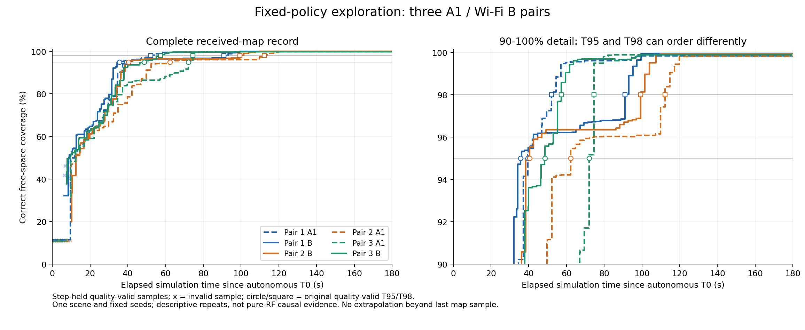
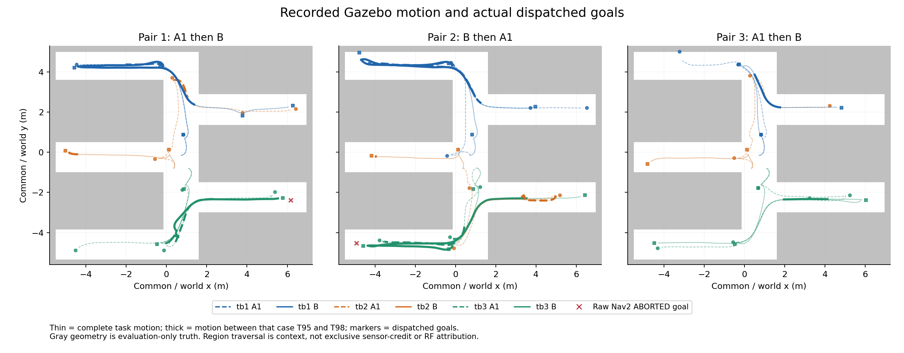

# NET-01E followup04：三对共同版本复现与性能波动分析

**六个新回合都真实完成了180秒仿真，三机器人导航、物理停止、进程退出及新自动daemon回收均闭合。工程流程在本轮条件下重复跑通，但探索效率仍明显波动，尤其本地Gateway A1；不能将“程序稳定结束”理解为“探索速度稳定或任务自然完成”。**

B在三对中都更早达到95%覆盖，但首对达到98%却明显更晚。六例共64个导航目标，62成功、2个原生Nav2 ABORTED；无任务超时或取消。不同初次观察、候选、分工、路线、消息量及实际仿真推进速度共同变化，当前不能得出“无线让探索更快”、统计优势或纯RF因果结论。

独立验收：[INDEPENDENT_REVIEW.md](INDEPENDENT_REVIEW.md)；失败与时序增量审查：[FAILURE_ATTRIBUTION_REVIEW.md](FAILURE_ATTRIBUTION_REVIEW.md)。以下六例不含旧bc18样本，行政启动失败单独保留。

## 1. 六回合结果

T90/T95/T98均采用原canonical首次**质量有效**阈值，单位为相对各例自主T0的仿真秒。评价区固定为15558个可达自由格、38.895m²；末覆盖是最后收到且质量有效的地图样本，不是恰好180秒的直接采样。六例均按预算结束，natural_completion_verified=false。

|执行槽/配对/模式|T90|T95|T98|末正确自由覆盖|有效/全部样本|原目标终态（成功/ABORT/取消）|
|---|---:|---:|---:|---:|---:|---:|
|1 / P1 / A1|34.66|39.46|52.07|99.839311%|217/217|11/0/0|
|2 / P1 / B|32.16|35.61|90.97|99.955007%|244/254|10/1/0|
|3 / P2 / B|36.29|40.42|99.31|99.935724%|232/246|10/0/0|
|4 / P2 / A1|49.76|62.25|112.26|99.826456%|206/217|11/1/0|
|5 / P3 / A1|67.01|72.01|74.51|99.877876%|204/217|11/0/0|
|6 / P3 / B|37.87|48.68|57.31|99.884304%|237/247|9/0/0|

曲线按各自T0对齐，阶梯线只连接质量有效的原接收样本，叉号保留无效样本位置，圆/方标记原T95/T98；不延伸最后样本、重算阈值或回填source stamp。右图放大90%—100%区间，能看见95%与98%的排序差。[SVG](figures/coverage-six.svg)。

|配对/既定顺序|A1 T95 / B T95|B−A1 T95|A1 T98 / B T98|B−A1 T98|
|---|---:|---:|---:|---:|
|P1 / A1 then B|39.46 / 35.61|-3.85|52.07 / 90.97|+38.90|
|P2 / B then A1|62.25 / 40.42|-21.83|112.26 / 99.31|-12.95|
|P3 / A1 then B|72.01 / 48.68|-23.33|74.51 / 57.31|-17.20|

只作描述：A1平均T95=57.91秒，范围39.46—72.01；B平均41.57，范围35.61—48.68。平均T98则A1=79.61、B=82.53，方向反过来。n=3、固定单场景/seed/run、非随机且仅部分平衡顺序，不作p值、统计显著性、跨地图泛化或通信优化收益声明。两次失败和正常但较慢的样本都在母数内，没有删失败后重算。原逐例/配对数据见[TRIALS.csv](TRIALS.csv)、[PAIRS.csv](PAIRS.csv)、[SUMMARY.json](SUMMARY.json)。

## 2. 路线、初始输入和长尾

路线图细线为完整自主窗口的Gazebo运动，粗线为各例T95至T98期间的运动。Goal标记明确取原`merge_map_target`，**没有混用机器人局部map下的actual_goal_position**；轨迹为Gazebo评价坐标，按既定初始共同标定直接叠加，未拟合/平移掩盖偏差。目标来自估计共享地图，背景为评价真值，少数目标在真值自由区外的原样差异保留；不据此独认某个Nav2/策略错误。真值仅用于评价和此图，未作为未通信的策略输入。[SVG](figures/routes-three-pairs.svg)。

|配对/模式|tb1 / tb2 / tb3实际路径m|合计m|自主wall秒|原physical整体RTF|
|---|---:|---:|---:|
|P1 A1|9.181 / 11.978 / 21.894|43.053|359.986|0.497493|
|P1 B|20.864 / 5.905 / 11.916|38.684|420.463|0.427401|
|P2 B|19.211 / 5.036 / 20.433|44.681|408.076|0.439087|
|P2 A1|21.606 / 12.549 / 8.110|42.265|359.983|0.497575|
|P3 A1|8.141 / 9.884 / 15.791|33.816|359.989|0.496957|
|P3 B|10.733 / 5.761 / 22.990|39.483|409.523|0.438809|

首次观察已经不相同：A1候选数6/5/8，B三次均7；首次NN的绝对G分别A1=25/25/25、B=20/25/20，距离各自T0亦不同。A1-r2原choices[1,3,-2]含合法WAIT，tb3并非三机同时收到首任务。候选索引和进程内map_version也不是跨回合相同物理对象；相同覆盖百分比不能证明相同栅格、TF或701向量。完整首次记录、每机首次Goal与相应局部导航资格见[event-cache/FIRST_OBSERVATIONS_AND_LONG_TAIL.json](event-cache/FIRST_OBSERVATIONS_AND_LONG_TAIL.json)。其中first_goal_requests仅是按时间的前三条请求、可能重复机器人，first_goal_request_per_robot才是各机首条。

新六例原allocation/轨迹/相关launch只各做了一次提取，后续绘图和归因复用缓存；没有再次打开bag或网络大账本，没有新探针。缓存保存实际source stamp、消费者记录时点、候选、原choices/条件mask和NPZ来源路径。没有逐值重建完整701向量或原始Frontier全池，不将筛选后候选冒称所有raw Frontier。

|槽/模式|T95→T98跨度sim秒|该窗三机合计采样平移m|
|---|---:|---:|
|1 / A1|12.61|6.41027|
|2 / B|55.36|18.61049|
|3 / B|58.89|24.39789|
|4 / A1|50.01|17.25164|
|5 / A1|2.50|0.00467|
|6 / B|8.63|4.33986|

B-r1/B-r2在95%之后仍分别走约18.61/24.40m，涉及右侧等后续支路；A1-r3只有2.5sim、合计约.00467m平移，覆盖仍更新。这展示了不同长尾，并不能把毫米级平移独认成网络排队：旋转、持续LiDAR/SLAM、地图融合及共享消息收件没有独立分摊。轨迹是10Hz已录样本，窗口端点最多约.1sim采样差，不外推；区域经过也不等于独占感知贡献。[INPUT_AND_TAIL_TABLE.csv](INPUT_AND_TAIL_TABLE.csv)保留窗口和交叠Goal。

## 3. 两个原生ABORT与旧超时分开

|新例/机器人/token|request G|实际接受 G|本例T95 G|raw6结果 G|可证关系|
|---|---:|---:|---:|---:|---|
|B-r1 / tb3 / 3|50.00|50.46|51.74|72.08|T95时已接受且仍活动，不能把整条Goal排除在T95前|
|A1-r2 / tb2 / 4|85.00|85.53|80.55|117.90|整条Goal始于T95之后，其后失败不能导致此前阈值变慢|

两条都是真实顶层NavigateToPose ABORTED=6，高层失败也记1，最终owned UUID闭合。B-r1该Goal在T95前已有约.255m实际采样运动；已缓存首个规划失败候选文字约G53.852才出现，A1-r2首候选约G94.275。原logger仍无Goal UUID，G由wall/轨迹插值近似；不能据此证明更早没有未记录的内部困难，也不能唯一归因无线/地图/同伴mask或Nav2某参数。内部FollowPath abort、恢复服务问题不自动等于外层Action闭合失败。

没有失败也可慢：A1-r3全部11目标成功，T95仍比A1-r1慢32.55sim；B-r1有一次ABORT却是本组三次中T95最短。失败次数不能单独解释效率波动。旧bc18 A1-04的token4在G85后开始、G180.46超时raw5并高层aborted，与本轮raw6不同；它的整个Goal始于旧T95 G80.5后，不能混入本轮64 UUID/失败率或解释旧阈值差。原旧对诊断见[PRIOR_PAIR_DIAGNOSIS.md](PRIOR_PAIR_DIAGNOSIS.md)、[A1_TIMEOUT_REVIEW.md](A1_TIMEOUT_REVIEW.md)，原失败历史不改。

## 4. 通信和计时能说明什么

A1是原ordered本地Gateway业务路径，**不是直接ROS参考A0**；B的关键业务走原ns-3 Wi-Fi完整CDR路径，未启理想旁路/fallback。两者共同source/参数/世界/出生点和seed一致，不等于逐条消息、观察或路线相同。

A1完整自主wall约360秒，B约408—420秒；原physical整体RTF分别约.497和.427—.439，前者不是与自主窗口完全相同的起止定义。共同target .5不能写成实测完全相同。ROS适配、计算/同步等待及可能由wall驱动的反馈每sim负荷会耦合；Nav2所有反馈timer的wall/sim语义未在本轮独立核实，不能把这段更慢推进统称纯RF成本。

现成记录已列[MESSAGE_AND_INPUT_OBSERVATIONS.json](MESSAGE_AND_INPUT_OBSERVATIONS.json)：每机R Observer实际回调计数、C journal feedback计数、原主窗wall、RTF、地图变化与首NN源龄。两个计数覆盖的回调/窗口不同，Observer保存计数可能含收尾尾段，不能相减当丢包，也不硬除180或wall算同负载速率。未添加CPU probe/完整逐段成本重建，不用某个网络p95相减填满任务差额。

首次共享地图header age约1.738—2.486sim秒，是建图/融合最旧stamp、发布、排队、传输和取件等的合成源龄，不是机器人health的300sim-ms合同、纯无线时延或已证过期bug。received timestamp的最早到达含义缺少独立证明，缺测保持缺测。当前只有相关输入/执行差异和时间顺序，尚不能量化各因素独立贡献；旧唯一SIGSEGV/A0历史根因亦未因此恢复。

## 5. 工程与安全验收、行政偏离

六例均有三机器人真实LiDAR/SLAM/融合/NN/Frontier高层Goal/Nav2反馈与Gazebo运动，三机实际参与；原observed_stop、三机PAUSE、run/network integrity均通过，hazard/error为空。runner/Hub/已启动controller/coordinator/两clock均0。原停止用新鲜真实位姿速度、驱动消费零命令与持续仿真推进判定，不以杀进程代替停止；没有额外运动中取消专项测试，结果不是连续安全/实机认证。

新host在原资源关闭后六次都自动匹配本case/session/domain/UID/完整ros2cli argv和startticks的daemon，pidfd单次SIGINT、约.251wall后实际/proc消失，无TERM/KILL；非子进程daemon退出码仍未知。每例原55+实际匹配daemon共56 PID均退出、精确case/session残留为空。host总wall/end包含清理耗时。这使自动接线由旧followup03“组件资格/源码审”推进到本轮六次真实整例后的有限正向集成证据，但不声称所有故障路径穷尽。

行政失败单独计数：共7次host尝试=1次IPC父目录缺失FAIL+6次真正Gazebo。原session1261的Hub本地sock.bind失败，native虽起并错误收尾退出0，ROS/Gazebo/NN/Goal从未启动，证据不完整，不因native0或helper无match改PASS。事前producer-command文件也因父目录未存在写入失败，审计缺口和事后原host UTC绑定分别保留，不伪造事前时间。Root明确狭窄修订后仅补本轮IPC目录、用fresh02/session1267重新独立READY/START，未观察过任务后挑样本，也无第七物理运行。见[ROOT_PRE_GAZEBO_AMENDMENT.md](ROOT_PRE_GAZEBO_AMENDMENT.md)、[原失败小件](gz-analysis/corr6201-common58-r01-a1/RESULT.md)。

两个B缓存使后续16GiB guard不足时，只在native0/磁盘copy完整、writer/拥有进程退出且一次10文件source/dest内容全等后，定点释放p02-b、p03-b的RAM副本；磁盘原件与其他缓存不动。最后B p06-b的RAM和磁盘原件均有意保留，未为清缓存重复大核验；停后快照tmpfs16832692224bytes低于原16GiB门限，但没有下一实验。进程自动回收不等于RAM缓存已删除，原source_retained字段保持其记录时状态，后续释放回执独立保存。

## 6. 固定身份与可复现证据

本轮运行源码共同锁`cec5c5676f8ba156a6cdab05ce8fc94575987df5`，分支`net01e/followup04-paired-common`，含既有ada4e14 post-run修补；本轮未修改运行源码、冻结workspace/Policy、Frontier/SLAM/Nav2/RF/物理或保护参数，没有构建/安装/训练/重放资格实验。冻结权重SHA256 `6d4c51ba6f96737ccd89393c9738a888acb82606770483f97dd562051ee01d5d`；63e738…首8Step诊断插件、static-footprint-common-v1、pace20/graceful/raw均保持。

共同58绑定为旧57中56项继承、仅host更新+helper新增，直接复用旧封存SHA，没有重hash模型/13DSO/历史原件。见[COMMON_BINDING_58.json](gz-requests/COMMON_BINDING_58.json)、[COMMON58_DELTA.json](gz-requests/COMMON58_DELTA.json)。六次具体READY和事前producer-command/原host argv可审；原准入均一次性已消费，不可照抄复用或自动重启。

事前[PLAN.md](PLAN.md)/[PROTOCOL.json](PROTOCOL.json)固定A1B/BA1/A1B顺序和原physics_seed2026110601、network_seed2026110901/run1；三对只部分平衡先后，不是三个独立RF种子。所有180sim/130decisions、startup180/autonomy720/outer900/cleanup90/host1000/stop12wall与2wall/300sim-ms等原guard保持。新helper仅原资源结束后有界管理，不续自主/物理。

运行只原append/liveness，无active bag/SQLite/PRAGMA/并行分析/Git/编译/散列/备份。每例56PID/writer关闭后，原canonical各执行一次且退出0，offline calls的NN/Gazebo=0不否认运行期真实NN；每例实际NN次数另在UUID摘要。两份独审仅读小件/缓存，没有重跑。图仅使用原coverage.csv和一次封存轨迹/Goal缓存，现有NumPy/Matplotlib，无新可视化框架/依赖。

完整账本[RUN_LEDGER.json](RUN_LEDGER.json)，原始日志/轨迹/地图/bag/native ledger/PCAP及大逐例缓存保留本地，索引[EVIDENCE_INDEX.md](EVIDENCE_INDEX.md)。Git只精确白名单收本轮小件/图/分析脚本/PROJECT，不add -A、不碰历史untracked、不覆盖旧报告或推远程。小件校验[FINAL_SHA256SUMS](FINAL_SHA256SUMS)，不伪称覆盖全部GB原件。最终本地交付commit由消息提供，Root做增量bundle，生产者不重复备份。

本轮结论：共同版本六次有界工程重复、物理停止/进程/自动daemon收束**有限PASS**；任务全成功并非每例成立，完整自然探索、实机可靠性及性能/RF因果仍未证明。本轮6/6物理预算已结束，保留所有慢回合和失败；不再新GZ、调参、训练、地图切换、NET-02、实机或push。

## 7. 六项最终结论

|验收项|结论|本轮范围与边界|
|---|---|---|
|CONTROLLER CORRECTNESS|**PASS（有限）**|六例实际高层NN/Goal/反馈与64个owned UUID闭合，62成功、2真实原ABORT保留；不是全状态空间正确性、策略最优性或历史A0唯一故障修复证明。|
|COMMUNICATION PATH VALIDITY|**PASS（有限）**|同一已审common58实际A1本地Gateway/B原ns-3完整业务路径、实际native加载和交付记录成立，无本轮新增理想旁路；不等于每包/每RF机制归因或实网校准已完成。|
|TIME AND SAFETY CONTRACT|**PASS（本轮合同）**|原sim300ms/2wall/其余源时效与停止门限不改，六例原停稳/PAUSE/进程/自动资源回收成立；未作独立最早到达证明、穷尽故障注入、wall300ms或实机安全认证。|
|GAZEBO REPEATABILITY|**PASS（有界工程重复）**|同一场景/固定seed/run六例均完成180sim并干净收束；效率明显波动，不代表自然任务完成、跨地图泛化或未来无故障。|
|WIFI CAUSAL ATTRIBUTION|**INSUFFICIENT EVIDENCE**|输入、Goal、路线、消息负荷与wall/RTF耦合，n3且非逐包同输入；T95与T98排序也不同，不能签纯RF、统计优势或通信优化收益。|
|NET-02 READINESS|**INSUFFICIENT EVIDENCE**|本轮只完成共同执行重复和有限工程资格，通信影响、适配与同步耦合尚未独立分摊，有限实验不足以完成因果归因；不得据此自动开始NET-02、训练、RF优化或实机。实机未验证是本轮范围声明，不作为后续通信研究准入前提。|

历史未知/FAIL原件及其唯一根因缺口保持，不将它们改写成已被本轮修复；也不把有限工程PASS扩大为RF因果PASS。
