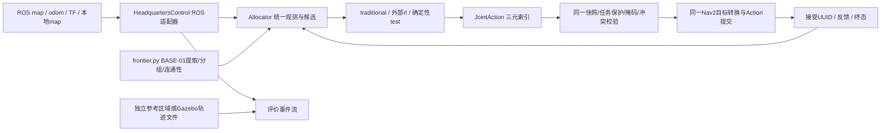

# BASE-02 状态、动作、生命周期及训练/评价合同

版本`base02-v1`；仅用于中央高层目标选择。机器人底座、SLAM、地图融合、Nav2和差速执行沿用BASE-01。默认3机器人，可观察坐标均为`merge_map`，Nav2目标发送前转换为各机隔离TF的`map`。

## 数据路径与源码边界



`frontier.py`提取原函数；`allocation.py`包含三种选择器和共同状态/校验；`control.py`只接收ROS数据并执行Nav2目标；`environment.py`提供训练交互合同；`evaluation.py`统计统一事件及可选离线参考指标。不引入Gym/PPO/学习库。

## 观测

观测是不可写映射，内部列表变成tuple，栅格以不可写bytes支持的NumPy数组保存，不能由策略修改底层候选或掩码。每次观测具有`decision_id`和`map_version`；候选索引不是跨版本永久ID。

| 字段 | 含义与来源 |
| --- | --- |
| contract / decision_id / map_version / sim_stamp | 合同、决策快照、地图内容/元数据版本、ROS仿真时间秒 |
| map | 收到的`/merge_map`栅格、分辨率、origin、frame、消息stamp/source；不是全真值地图 |
| robots | 有序tb1/tb2/tb3：x/y/yaw、odom消息stamp、TF来源、线/角速度、idle/pending/active、目标/token/UUID、目标持续秒、最近终态、上个成功目标及等待/超时状态 |
| candidates | 各机原前五Frontier组的有效代表点；每项有共同坐标、组ID、连通性、已知膨胀栅格的8邻域最短路估计m、Frontier格面积代理m²、原评分、传统候选资格及本地地图有效性 |
| action_mask / keep_mask / wait_mask | 逐机器人候选、KEEP、WAIT合法性；候选按机器人行关联，最多每机5项，总数可变，不预定神经网络padding形式 |
| assigned / candidate_conflicts / history / valid_counts | 目标归属、间距<0.2m的候选对、任务终态历史、逐机合法候选数 |

路径代价为8邻域静态已知自由栅格Dijkstra距离，不是Nav2规划承诺，不输入传统评分。信息增益为Frontier边界格面积代理，不读取边界后面的未知真值。缺位姿/坐标/本地地图时不伪造有效观测；本地地图暂缺与已证非法分开，暂缺不进入失败黑名单。初始共同坐标仍继承BASE-01声明标定假设，实机需真实标定。

三种选择器接收同一观测。rl仅调用外部`predict(observation)`，未挂接则明确报错，无traditional/test回退、权重下载或训练。ROS自主入口本轮只允许traditional；rl/test只在离线合同中测试，不指挥Gazebo。

## 动作与共同执行

`JointAction(decision_id,map_version,choices=(a1,a2,a3))`：非负数是该快照候选索引，KEEP=-1，WAIT=-2。边界一次归一化Python/NumPy整数；bool/浮点不是合法动作。没有cmd_vel动作或发布器。

共同执行拒绝：旧决策/地图版本、任务token/state已变、非法索引、掩码为假、本地目标失效、活动任务被改派、与当前/同批新预留目标距离<0.2m。接受后先统一预留再提交Nav2；重复输出不会重复发Action。目标提交前再次核对pending token、halt/取消状态及实时坐标/本地自由格。异步晚到的接受若已失去执行权则取消该handle，不赋予新任务所有权；旧token结果不能释放新任务。

当前有正常任务只允许KEEP。idle且无合法候选时WAIT；有候选仍WAIT或idle输出KEEP产生拒绝事件，不会隐藏为有效分配。连续5次无任务等待显式置`stalled_wait`；它是可检测停滞，不是任务完成。传统选择的last_target后置否决保持原语义，不自动改选次优。传统候选落在本地非法地图时依原失败处置排除，不为覆盖率更换目标。

## 生命周期和决策时机

```text
idle → reserve(token) → pending → accepted(UUID) → active
                   ↘ unavailable/rejected         ↘ succeeded/aborted/canceled
                                  terminal(token校验) → idle
```

传统ROS入口沿用原每机8秒墙钟检查：idle有地图/位姿才做选择，同一联合三元动作只授权本次触发机器人，其余保持/等待，因此不把三线程改成新优化分配器。给定状态的原Frontier提取/排序/平分顺序/预留/成功失败/last_target语义由冻结实现对照。多线程调度和物理轨迹本来就不是逐次确定的，不以不同回合轨迹逐点相同作为算法等价证据。

完成/失败/取消释放当前任务，下一周期可重新分配。共享图内容/元数据变化形成版本事件；新候选只用于idle。活动目标附近Frontier自然消失不自动取消正常导航。冲突在发新目标前拒绝；可选`task_timeout_s`形成`cancel_required`，ROS适配器取消实际handle，等待终态再释放；BASE-01兼容配置默认不额外设置任务超时。终止/安全异常通过`halted`阻断选择与迟到接受，由外部监督器取消导航并用物理观测证明停止；Allocator.stop本身不声称已停稳。

## 训练交互合同

`AllocationEnvironment(backend,policy,max_decisions,max_sim_s)`：

| 接口 | 语义 |
| --- | --- |
| reset | 后端必须确认world/机器人、SLAM、Nav2均重置，返回新episode和初始观测；未完成即停止/抛出错误，不能只清Python计数 |
| get_observation / get_action_mask | 返回当前冻结快照与候选/KEEP/WAIT掩码 |
| step | 校验联合动作，交给同一任务执行后端；后端有界推进到下一高层交互边界，回报接受/终态和ROS可获得的新快照 |
| reward | 返回带单位的奖励分量增量；本轮不选权重、不返回伪装已调好的标量奖励 |
| terminated | 仅后端显式`natural_complete`且有完成证书；没有候选或全部idle均不构成自然完成 |
| truncated | 决策预算、时钟不推进/步长越界、显式环境/安全/人工终止、停滞、任务级失败等各自reason；Nav2单任务aborted默认是可继续的任务终态 |
| info | episode、失败原因/动作拒绝、停止是否真正确认、评价快照；不喂回策略观测 |

policy/后端推进/reset等外部边界抛异常时，先阻断本episode和请求后端停止，保留错误/停止结果，再抛出原异常；不偷偷重试或伪造正常transition。结束需后端实际确认停止，未确认归`stop_not_verified`。

最小后端测试是非物理确定性fixture，直接产生可控消息合同，不是第二套仿真器，也不用于算法性能。**本轮没有生产Gazebo reset/训练后端**。现有环境交互合同可测试，直接开始Gazebo训练仍BLOCKED，需RL-01先完成真实episode重置及逐次验证。ROS生产入口仍由现有有界监督器管理。

## 奖励与评价

| 分量 | 单位/时序/来源 |
| --- | --- |
| new_shared_known_area_m2 | 相邻共享图已知面积正增量之和，m²；可观测增量代理，可能受SLAM重定位影响，非真值覆盖 |
| elapsed_sim_s | 高层step之间ROS仿真秒增量，时间代价 |
| navigation_distance_m | 同期odom+TF位姿采样路程增量，m；有定位漂移误差 |
| duplicate_assignment_count | 同机器人连续近重复目标分配次数，重复分配代理，不等同重复感知面积 |
| target_switch_count | 活动目标被抢占次数；本轮保护当前任务，因此正常为0 |
| target_conflict_count | 同批/已有目标近距离冲突拒绝次数 |

奖励方向为增加可观测有效信息、减少时间/路程/重复/冲突。尚不选标量权重，重复探索面积在仅有合图计数时不可辨识，明确为None，不补零冒充已测。后续如需感知重复面积，须从带坐标的逐机观测构造一致口径；安全作为硬门控，不仅扣奖励。

统一事件JSONL保存地图版本、目标/身份/终态、位姿、反馈和停止原因；Evaluator返回独立小字典快照，后续数据不能改写旧info。输出逐机路程/参与、分配、重复分配/冲突、成功/失败（取消单列且不进成功率分母）、切换/取消及结束原因。实际物理路程可由独立Gazebo轨迹CSV离线附加，不进入Allocator观测。

覆盖率接口接收**独立固定参考区域**与对齐的已观测掩码；无分母时coverage与阈值时间为None。按固定参考自由区域中已观测格比例报告，90%/95%首次达到的仿真秒可记录，不能以每次变化的合图尺寸当分母。评价参考从不放入policy observation。

```bash
tools/in-rootfs.sh --baseline-runtime -c '
 source /opt/ros/humble/setup.bash; source /project/workspace/install/setup.bash
 export PYTHONPATH=/mnt/workspace/src/multi_robot_exploration:${PYTHONPATH:-}
 python3 -B -m multi_robot_exploration.evaluation \
 /mnt/evidence/traditional-tf-fixed-01/allocation-events.jsonl \
 --trajectories /mnt/evidence/traditional-tf-fixed-01/trajectories.csv \
 --observer-events /mnt/evidence/traditional-tf-fixed-01/events.jsonl \
 --start-sim 21.7 --end-sim 201.7'
```

## 训练路线建议（本轮不执行）

| 路线 | 优势 | 代价与部署差距 |
| --- | --- | --- |
| A ROS/Gazebo高层交互 | 与真实SLAM/Frontier/Nav2一致，能直接发现不可达和执行延迟；先做合同闭环最可信 | 慢、重置昂贵、仿真/墙钟需区分；目前缺生产reset/backend，不能直接训练 |
| B 轻量环境同合同训练 | 可提高采样速度、并行和确定性 | 必须模拟可观测建图和高层任务执行，不能泄漏全图或将目标瞬移；动作合法性、Nav2失败/耗时和部署差距要校准 |

建议先以A验证真实episode重置和少量高层交互，再依据实测吞吐决定是否值得建立B；如果建立B，只替换backend，冻结相同候选/动作/任务语义，并定期Gazebo验收。现在不创建新环境或选定PPO/MAPPO网络，不自动启动RL-01。
